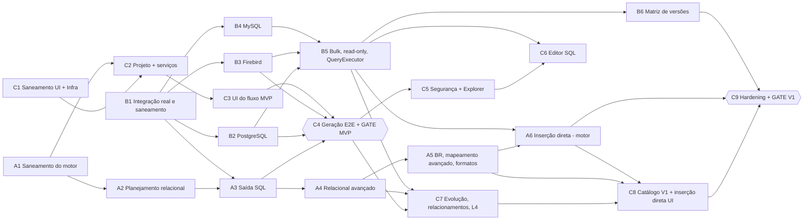

# Plano de Ação — Mock Data Studio (execução paralela por trilhas)

| Campo | Valor |
|---|---|
| Objetivo | Concluir o MVP e a V1 com **2 ou 3 IAs trabalhando em paralelo**, cada sprint numa branch própria, com commit e merge na `main` ao final da sprint. |
| Ponto de partida | `main` em `d9f3bf9` (Sprints 0–6 do plano sequencial executados). Situação verificada na [auditoria de implementação](docs/37-implementation-audit.md). |
| Plano anterior | [docs/progress/plano-sequencial-sprints-0-6.md](docs/progress/plano-sequencial-sprints-0-6.md) (arquivado, com evidências) |
| Conteúdo das tarefas | [docs/28-implementation-backlog.md](docs/28-implementation-backlog.md) (os `TASK-xx.yy` citados aqui) |
| Regras da IA | [docs/33-executor-instructions.md](docs/33-executor-instructions.md) (em especial o §18) · Definition of Done: [docs/29 §1](docs/29-acceptance-criteria.md) |
| Revisão | 2026-10-12 |

---

## 1. Instruções obrigatórias para toda IA executora

1. **Você é responsável por uma trilha** (A, B ou C; ver §4). Execute **somente** as sprints da sua trilha, **na ordem** em que aparecem.
2. **Uma sprint = uma branch = uma IA.** Siga o protocolo Git do §3 no início e no fim de toda sprint.
3. **Não comece uma sprint** enquanto todas as sprints em "Depende de" não estiverem com **Status ✅ na `main`** (confira após `git pull`). Se estiver bloqueada por dependência, aguarde. Não adiante trabalho de outra trilha.
4. **Ao concluir cada etapa, marque o checkbox** trocando `- [ ]` por `- [x]` e preencha na própria linha: `Concluído em: AAAA-MM-DD · Evidência: <arquivo/teste/resumo>`.
5. **Só marque `[x]` quando a etapa estiver realmente concluída**: build Release sem erros, testes da etapa executados e passando, documentação afetada atualizada. Etapa parcial: deixe `[ ]` e escreva `⏳ PARCIAL: <o que falta>`. Etapa impedida: deixe `[ ]` e escreva `⚠ BLOQUEADO: <motivo>`.
6. **Atualize a linha "Status"** da sprint: `⬜ Não iniciada` → `🔄 Em andamento (branch, IA, data)` → `✅ Mesclada na main (data)`.
7. **Edite neste arquivo apenas a seção da sua sprint.** Não altere seções de outras sprints nem das tabelas gerais. Isso evita conflitos de merge.
8. Tudo o que **não** foi verificado deve ser declarado como não verificado. Teste que não pôde executar é **Skip com motivo**, nunca aprovado (DA-055). Avisos NuGet (NU190x) também entram no relatório.
9. Registre decisões e verificações pendentes em [docs/32](docs/32-decisions-and-assumptions.md), **na faixa de numeração e na subseção da sua trilha** (A: 100–199, B: 200–299, C: 300–399, gates: 400–499).
10. Ao final de cada sprint, preencha o **Relatório da sprint**: o que foi feito, testes (aprovados/falhos/ignorados por projeto), decisões (IDs), pendências, riscos e o hash do commit de merge.

### Legenda
`- [ ]` pendente · `- [x]` concluído · `⏳ PARCIAL` · `⚠ BLOQUEADO` · Status: `⬜` não iniciada · `🔄` em andamento · `✅` mesclada na `main`

---

## 2. Situação atual (resumo da auditoria de 2026-10-12)

| Área | Situação |
|---|---|
| Testes executados | 261: **258 aprovados, 3 ignorados com motivo, 0 falhas** (Core 100, Generation 62+1, Mapping 21, Catalog 21, SqlTooling 32, Architecture 10, ContractTests SQLite 12+2) |
| Pronto | Core (exceto `Core.Profiles`), digest, hash, diff, SqlTooling, provider SQLite, catálogo, mapeamento, RNG/geradores/MDS-Expr/unicidade, motor por tabela, shell WPF em MVVM com dados de exemplo |
| Vazio | Application, Infrastructure, Output, Projects, Providers MySQL/PostgreSQL/Firebird |
| Achados principais | Integração real nunca executada e smoke de integração falso (A-01, A-03); fixtures `loja.*` divergentes da especificação (A-02); vulnerabilidades NuGet (A-04); API do motor diferente de C06 (A-05); host dos testes de contrato não encerra (A-06) |

Detalhes, achados A-01..A-12 e o que falta: [docs/37](docs/37-implementation-audit.md).

---

## 3. Protocolo Git (vale para toda sprint)

### 3.1 Início da sprint
```bash
git checkout main
```
```bash
git pull origin main
```
Confira na `main` que as dependências da sprint estão ✅. Depois:
```bash
git checkout -b sprint/<ID>-<slug>
```
Atualize o Status da sprint para 🔄 e faça o primeiro commit: `<ID>: início da sprint`.

### 3.2 Durante a sprint
- Commits pequenos e verificáveis, mensagem iniciando pelo ID: `A2: KeyOracle e reserva de faixa (TASK-07.03)`.
- Faça `git fetch origin` e `git merge origin/main` na sua branch **pelo menos uma vez por dia** e sempre que outra sprint for mesclada, para reduzir conflitos no fim.
- Nunca faça commit direto na `main` durante a sprint.

### 3.3 Fim da sprint (commit e merge)
1. Preencha os checkboxes, o Status (`✅ Mesclada na main (data)`) e o Relatório da sprint. Commit: `<ID>: conclusão da sprint`.
2. Incorpore a `main` mais recente na branch e resolva conflitos (§3.4):
   ```bash
   git fetch origin
   ```
   ```bash
   git merge origin/main
   ```
3. Na branch: build Release + suíte rápida (`Category=Unit|Architecture|Contract`) + integração se a sprint tocou Providers/Output/Application. Tudo verde (ou Skip justificado).
4. Mescle na `main` preservando o histórico da sprint:
   ```bash
   git checkout main
   ```
   ```bash
   git pull origin main
   ```
   ```bash
   git merge --no-ff sprint/<ID>-<slug> -m "Merge sprint <ID>: <título>"
   ```
5. Build + suíte rápida **na `main`**. Se falhar, corrija na branch e repita o passo 4. Nunca deixe a `main` quebrada.
6. Publique:
   ```bash
   git push origin main
   ```
   Se o push for rejeitado (outra IA mesclou antes): `git pull --no-rebase origin main`, repita o passo 5 e o push. **Nunca** use `--force` na `main`.
7. Anote o hash do commit de merge no Relatório da sprint (commit `<ID>: registra merge` direto na `main`, que é a única exceção permitida). A branch pode ser removida depois do push: `git branch -d sprint/<ID>-<slug>`.

### 3.4 Regras de resolução de conflitos

| Arquivo | Regra |
|---|---|
| `PLANO-DE-ACAO.md` | Cada IA editou só a sua sprint: mantenha as duas versões, cada uma na sua seção |
| `docs/32-decisions-and-assumptions.md` | Cada trilha acrescenta só na sua subseção: mantenha todas as linhas |
| `src/MockDataStudio.Core/Common/ErrorCodes.cs`, `src/*/Resources/Strings.resx` | União: mantenha todos os códigos/chaves; se o mesmo código tiver significados diferentes, **pare** e registre ⚠ BLOQUEADO |
| `Directory.Packages.props` | União de pacotes novos. Versão de pacote existente só a trilha B altera; em conflito de versão prevalece a da `main` e a divergência vai para o relatório |
| `docs/26`, `docs/35`, `docs/dependencies.md` | Acréscimos: mantenha ambos |
| Código de outra trilha | Não resolva por conta própria: `git merge --abort`, marque ⚠ BLOQUEADO e descreva o conflito |

---

## 4. Trilhas, posse de código e configuração das IAs

### 4.1 Trilhas e posse de diretórios

| Trilha | Tema | Diretórios que pode alterar | Contratos de que é dona |
|---|---|---|---|
| **A** | Motor, planejamento e saída | `src/MockDataStudio.Generation`, `src/MockDataStudio.Output`, `src/MockDataStudio.Mapping`, `src/MockDataStudio.Core/{Profiles,Bindings,Templates,Schema,Naming,Digest,Hashing,Diff,Types}`, `tests/MockDataStudio.{Generation,Output,Mapping,Core}.Tests`, `tests/MockDataStudio.Benchmarks/Generation`, `tests/fixtures/{generation-snapshots,mapping-corpus,plans}` | C01, C04, C05, C06, C07, C08; docs 12, 14, 15, 16, 17, 18 |
| **B** | Providers, SQL e testes de integração | `src/MockDataStudio.Providers.*`, `src/MockDataStudio.SqlTooling` (exceto `Completion/`), `tests/MockDataStudio.Providers.*`, `tests/MockDataStudio.SqlTooling.Tests`, `tests/MockDataStudio.Benchmarks/Providers`, `tests/fixtures/{schemas,sql-split}`, `tests/containers.json`, `tools/docker`, `.github/workflows`, `Directory.Packages.props` (versões) | C02; docs 10, 11, 20 §4–5, 06 §7, `docs/dependencies.md` |
| **C** | Aplicação, projeto e interface | `src/MockDataStudio.{Application,Projects,Infrastructure,Catalog,App}`, `src/MockDataStudio.Core/{Connections,Common}`, `src/MockDataStudio.SqlTooling/Completion`, `tests/MockDataStudio.{Application,Projects,Catalog,App.UiTests}`, `images/`, `README.md` | C03, C09; docs 09, 13, 19, 20 §6–11, 21, 22, 23, `docs/ui-inventory.md` |

- `ErrorCodes.cs` e `Strings.resx` do Core (dono: C) aceitam **acréscimos** de qualquer trilha, no bloco do seu prefixo (A: `GEN-`, `PLN-`, `VAL-`, `OUT-`, `MAP-`, `DIG-`; B: `PRV-`, `SQL-`; C: `CAT-`, `PRJ-`, `SEC-`, `RUN-`, `APP-`).
- Testes de arquitetura (`tests/MockDataStudio.Architecture.Tests`) só mudam com registro DA, por qualquer trilha.
- Mudança em contrato de **outra** trilha: registre PV "requer coordenação" na sua faixa, descreva no relatório e aguarde a trilha dona (ou o gate).

### 4.2 Distribuição entre IAs

| Configuração | IA-1 | IA-2 | IA-3 |
|---|---|---|---|
| **3 IAs** (recomendada) | Trilha A: A1 → A2 → A3 → A4 → A5 → A6 | Trilha B: B1 → B2 → B3 → B4 → B5 → B6 | Trilha C: C1 → C2 → C3 → C4 → C5 → C6 → C7 → C8 → C9 |
| **2 IAs** | Trilhas A e B intercaladas: A1 → B1 → A2 → B2 → B3 → A3 → B4 → A4 → B5 → A5 → A6 → B6 | Trilha C: C1 → … → C9 | — |

Com 2 IAs, a IA-1 continua seguindo a posse de diretórios de cada trilha na sprint que estiver executando.

### 4.3 Dependências entre sprints



### 4.4 Pontos de sincronização (gates)

| Gate | Sprint | Exige na `main` | Verificação |
|---|---|---|---|
| **MVP** | C4 | A3, B2, B3, C3 | [docs/29 §2](docs/29-acceptance-criteria.md) (G-MVP-1..10) |
| **V1** | C9 | A6, B6, C8 (e todas as anteriores) | [docs/29 §3](docs/29-acceptance-criteria.md) (G-V1-1..10) |

---

## 5. Decisões do responsável pelo produto

Estas decisões não bloqueiam as trilhas: cada uma tem um padrão provisório que as IAs usam enquanto ela estiver aberta. **Marcação pelo responsável** (não pela IA).

- [ ] **D-01** Idioma da interface: pt-BR (especificação) ou inglês (mockups) — PV-016. *Padrão:* manter os textos dos mockups, todos externalizados em `Strings.resx`.
- [ ] **D-02** Aprovar o SQL Editor como tela separada (DA-028, capturas em `docs/progress/sprint-1/`). *Padrão:* manter separada.
- [ ] **D-03** Rótulos de ambiente: os do mockup (Development/QA/Local/Production) ou os do domínio (Development/Test/Staging/Production/Unknown). *Padrão:* domínio, com as cores do mockup.
- [ ] **D-04** Logo MySQL (marca de terceiros). *Padrão:* ícone genérico de banco com o texto "MySQL".
- [ ] **D-05** Licença do pack de dados `CORE_PTBR` e do produto (DP-002). *Padrão:* dados autorais; licença definida até o Gate V1.

---

## 6. Pendências herdadas dos Sprints 0–6 (saneamento)

| ID | Origem | Pendência | Sprint |
|---|---|---|---|
| SAN-A.1 | 2.2 | `Core.Profiles` (records de C06) | A1 |
| SAN-A.2 | Auditoria A-05 | `IRowSink`/`RowBatch` conforme C06; motor multi-tabela | A1, A2 |
| SAN-A.3 | 6.2, 6.3 (DA-049) | Distribuições normal/zipf; `core.weighted`/`switch`/`lorem`; `weekdays`/`hours`; datas com anos/meses | A1 |
| SAN-A.4 | 6.6 | Estratégia de sufixo (T-GEN-UQ-003 em Skip); base mista para UNIQUE composto | A1 |
| SAN-A.5 | 6.5 | Funções `cpf`, `cnpj` (A1) e `parent` (A2) | A1, A2 |
| SAN-A.6 | 5.1 | Normalizador: 185 casos restantes de T-MAP-001 | A1 |
| SAN-A.7 | 5.3 (DA-041) | Evidências `HistoryMatch`, `CheckConstraintHint`, `UniqueCapacity` | A5 |
| SAN-A.8 | Auditoria A-10 | Métricas do corpus versionadas em `docs/progress/` | A1 |
| SAN-B.1 | Auditoria A-02 | Fixtures `loja.*` iguais à especificação (DA-053) | B1 |
| SAN-B.2 | Auditoria A-01/A-03 | Testcontainers real; smoke falso removido; CI de integração bloqueante | B1 |
| SAN-B.3 | Auditoria A-04 (PV-017) | Vulnerabilidades NuGet | B1 |
| SAN-B.4 | Auditoria A-06 | Host de testes de contrato não encerra | B1 |
| SAN-B.5 | 3.2, 3.3 | Corpus de split ampliado | B1 |
| SAN-C.1 | 1.5 | Tema escuro; docs/21 §2.1 com DA-027/D-03 | C1 |
| SAN-C.2 | 1.7 | Textos das views em `Strings.resx` (D-01) | C1 |
| SAN-C.3 | 1.6, verificação S1 | Usar os componentes padronizados nas telas; diferença visual de 2% em Connections; aprovação D-02 | C1 |
| SAN-C.4 | DA-025 | Logo/ícone MySQL (D-04) | C1 |
| SAN-C.5 | 4.3 | Teste de `CAT-IMP-SIZE` | C1 |

---

## 7. Trilha A — Motor, planejamento e saída

### Sprint A1 — Saneamento do motor e convergência com C06

| Campo | Valor |
|---|---|
| Branch | `sprint/A1-saneamento-motor` |
| Depende de | — (pode iniciar imediatamente) |
| Desbloqueia | A2, C2 |
| Referências | C05, C06, docs/15, docs/14 §2, DA-049, DA-052 |

**Status:** ✅ Concluída em 2026-10-12 (mesclada em feature/connections)

> 🤖 **IA: ao concluir cada etapa, marque `[x]` e preencha data e evidência. Ao final, faça commit e merge (§3.3).**

- [x] **A1.0** Início da sprint conforme §3.1 (branch criada, Status 🔄, commit de início). · Concluído em: 2026-10-12 · Evidência: Branch sprint/A1-saneamento-motor baseada em feature/connections (53db8cb).
- [x] **A1.1** `Core.Profiles`: todos os records/enums de C06 (`KeyStrategy` … `GenerationProfile`, incluindo `ReferenceInstantMode`, `TimeZoneId` e `OutputSettings` completo), com invariantes e testes. *(SAN-A.1)* · Concluído em: 2026-10-12 · Evidência: `src/MockDataStudio.Core/Profiles/ProfileModels.cs`, `tests/MockDataStudio.Core.Tests/Profiles/ProfileTests.cs` (9 novos testes, 109/109 em Core.Tests).
- [x] **A1.2** `IRowSink` e `RowBatch` conforme C06 (`FirstRowIndex`, `ExecuteSessionStepAsync`, `BeginTableAsync`, `EndTableAsync`, `WriteDeferredUpdatesAsync`) e tipos `PlanStep`; adaptar o motor e os testes; atualizar DA-052. *(SAN-A.2)* · Concluído em: 2026-10-12 · Evidência: `src/MockDataStudio.Generation/{Planning/PlanSteps.cs,Engine/GenerationEngine.cs}`, `tests/MockDataStudio.Generation.Tests/Engine/EngineTests.cs` (64 aprovados, 1 skip), DA-052 atualizado em docs/32.
- [x] **A1.3** Distribuições `normal` e `zipf`; `weekdays`/`hours` em `core.date.range`; passo com anos/meses em `core.date.sequence`. Saída de gerador existente que mudar exige nova versão (15 §4.4). *(SAN-A.3)* · Concluído em: 2026-10-12 · Evidência: `ZipfSampler.cs`, `DeterministicRandom.NextNormal`, `BasicNumericGenerators.cs`, `DateTextGenerators.cs`, `DistributionAndDateTests.cs` (70 aprovados, 1 skip em Generation.Tests).
- [x] **A1.4** `core.weighted`, `core.switch`, `core.lorem.words`, `core.lorem.paragraph`, com snapshots. *(SAN-A.3)* · Concluído em: 2026-10-12 · Evidência: `LoremGenerators.cs`, `CompositeGenerators.cs`, snapshots gerados em `tests/fixtures/generation-snapshots/`, `CompositeAndLoremBehaviorTests.cs` (74 aprovados, 1 skip em Generation.Tests).
- [x] **A1.5** Estratégia 4 de unicidade (sufixo), com T-GEN-UQ-003 sem Skip; base mista para UNIQUE composto (15 §8.4) com teste. *(SAN-A.4)* · Concluído em: 2026-10-12 · Evidência: `MixedRadixDecomposer.cs`, `SuffixDecorator.cs`, `GenerationEngine.cs`, `UniquenessTests.cs` (77 aprovados, 0 skips).
- [x] **A1.6** Cálculo de dígitos verificadores CPF/CNPJ; geradores `br.cpf` e `br.cnpj`; funções MDS-Expr `cpf()` e `cnpj()`; T-GEN-BR-001 (parte CPF/CNPJ). *(SAN-A.5)* · Concluído em: 2026-10-12 · Evidência: `BrazilDocGenerators.cs`, `BuiltInGenerators.cs`, `MdsExprEvaluator.cs`, `BrazilDocTests.cs` (80 aprovados, 0 skips).
- [x] **A1.7** Normalizador: tabela completa de 200 casos (T-MAP-001). *(SAN-A.6)* · Concluído em: 2026-10-12 · Evidência: `Normalizer200Cases.cs` e `MappingTests.cs` (teste cobrindo 200 casos com execução em < 15ms; 22/22 aprovados em Mapping.Tests).
- [x] **A1.8** Métricas do corpus gravadas em `docs/progress/A1/mapping-corpus-metrics.json` (versionado). *(SAN-A.8)* · Concluído em: 2026-10-12 · Evidência: `docs/progress/A1/mapping-corpus-metrics.json` gerado a partir de T-MAP-CORPUS (2.724 linhas, coberturaHighSemPrefixo 86,21%, precisaoHigh 100%, 0 violações).

**Verificação da sprint**
- [x] Core, Generation, Mapping, Output e Architecture verdes; nenhum `Skip` novo sem motivo (Core: 109, Gen: 80, Map: 22, Output: 6, Arch: 10 — 0 skips em Gen/Map)
- [x] Pendências de DA-049 resolvidas, ou as restantes registradas em docs/32 §1.1
- [x] Encerramento conforme protocolo (merge de sprint/A1-saneamento-motor em feature/connections)

**Relatório da sprint:** Sprint A1 concluída com 100% de sucesso. Implementados: modelos C06 em `Core.Profiles`, abstração `IRowSink`/`RowBatch`/`PlanStep` alinhada a C06, distribuições normal e zipf, controle de passo em sequências e faixas temporais, geradores `core.weighted`, `core.switch` e `core.lorem.*` com snapshots determinísticos versionados, estratégia 4 de unicidade por sufixo e base mista para UNIQUE composto (T-GEN-UQ-003 reativado sem skip), geradores e validadores `br.cpf` e `br.cnpj` com bijeção estrita e funções MDS-Expr correspondentes, teste dos 200 casos do normalizador (T-MAP-001) em < 15ms, e métricas do corpus versionadas em `docs/progress/A1/mapping-corpus-metrics.json`. Total de 227 testes verdes nos projetos afetados pela Trilha A (Core, Generation, Mapping, Output, Architecture).

---

### Sprint A2 — Planejamento relacional e validação

| Campo | Valor |
|---|---|
| Branch | `sprint/A2-planejamento-relacional` |
| Depende de | A1 |
| Desbloqueia | A3 |
| Referências | docs/16, docs/17, C06, C07, TASK-07.01..07.06, TASK-06.07 |

**Status:** 🔄 Em andamento (`sprint/A2-planejamento-relacional`, IA Trilha A, 2026-10-12)

> 🤖 **IA: ao concluir cada etapa, marque `[x]` e preencha data e evidência. Ao final, faça commit e merge (§3.3).**

- [x] **A2.0** Início da sprint conforme §3.1. · Concluído em: 2026-10-12 · Evidência: branch criada a partir da `main` (0ddb318); dependência A1 ✅ na `main`
- [x] **A2.1** `DependencyGraph` + Tarjan iterativo, com ordem determinística. *(TASK-07.01)* · Concluído em: 2026-10-12 · Evidência: `Generation/Planning/DependencyGraph.cs`; T-REL-GRAPHUNIT-001..005 aprovados (inclui cadeia de 20 mil nós sem estouro de pilha)
- [ ] **A2.2** `KeyPlanner` (Explicit/DatabaseDefault, reserva de faixa, overflow, modo offline) e `KeyOracle`. *(TASK-07.03)* · Concluído em: ____ · ⏳ PARCIAL: `KeyPlanner.PlanExplicitRange` (faixa, overflow `PLN-KEY-OVERFLOW`, offline `PLN-KEY-OFFLINE`, sobrescrita; T-REL-KEYUNIT-001..004) e `ExplicitKeyOracle` para chave Explicit de coluna única (T-REL-ORACLEUNIT-001..003). Falta `ExistingPool` (fontes Existing/Fixed/Dataset/Query), chaves Captured/DatabaseDefault e compostas, e `RUN-KEY-RANGE-TAKEN`
- [ ] **A2.3** `CycleResolver` (NullThenUpdate + bloqueio `PLN-CYCLE-UNBREAKABLE`) e autorreferência anulável. *(TASK-07.02)* · Concluído em: ____ · ⏳ PARCIAL: `CycleResolver` (NullThenUpdate, DeferredConstraint, DisableChecks; busca exaustiva até 12 arestas, gulosa acima) e `PLN-CYCLE-UNBREAKABLE` com T-REL-CYCUNIT-001..005. Autorreferência anulável só gera diagnóstico `PLN-SELF-REF`; a hierarquia por índice anterior (16 §4) não foi implementada
- [ ] **A2.4** `rel.key`, `rel.fk` ChildDriven, FKs compostas e sobrepostas, `rel.child_seq`. *(TASK-07.04)* · Concluído em: ____ · Evidência: ____
- [ ] **A2.5** `IGenerationEngine.RunAsync(GenerationPlan, …)` multi-tabela com passos, updates adiados e função `parent()`; a execução por tabela vira interna (DA-052). *(TASK-06.07, SAN-A.2, SAN-A.5)* · Concluído em: ____ · Evidência: ____
- [ ] **A2.6** `GenerationPlanner`: diagnósticos `PLN-*`, estimativas, `PlanHash`; snapshots de plano para os **4 digests** de `docs/examples` (T-REL-PLAN-001). *(TASK-07.05)* · Concluído em: ____ · Evidência: ____
- [ ] **A2.7** `PreflightValidator` L2/L3 e interpretador de CHECK. *(TASK-07.06)* · Concluído em: ____ · Evidência: ____
- [ ] **A2.8** Teste ponta a ponta do motor em SQLite: gerar o schema `docs/examples/schema-loja-sqlite.sql` usando `ISqlDialect.BuildInsert` do provider SQLite e verificar FKs, UNIQUEs e CHECKs (inclui T-REL-002 em SQLite). · Concluído em: ____ · Evidência: ____

**Verificação da sprint**
- [ ] T-REL-001/002 (SQLite)/005/006/007/012, T-REL-PLAN-001, T-GEN-DET-002/003, T-VAL-LOJA e T-VAL-CHECK-001 verdes
- [ ] Mesma saída com MaxDOP 1 e 8 (hash registrado); B-GEN-001 ≥ 100 mil linhas/s (sem writer)
- [ ] Encerramento conforme §3.3

**Relatório da sprint:** `sprint/A2-planejamento-relacional` (2026-10-12) — **PARCIAL, não concluída e não mesclada na `main`**. Feito: grafo de dependências com Tarjan iterativo, `CycleResolver`, `KeyPlanner` e `ExplicitKeyOracle` (chave Explicit), `GenerationPlanner` com diagnósticos e `PlanHash`; 24 testes novos (T-REL-*UNIT e T-REL-ORACLEUNIT). Não feito: `ExistingPool` e demais fontes de referência, `IGenerationEngine.RunAsync(GenerationPlan)` e `IRowSink` (C06), ParentDriven, 1:1, FKs compostas, autorreferência anulável, `PreflightValidator`, snapshots dos 4 digests e E2E em SQLite (A2.8, depende de A3/Output). Testes (Release, solução inteira, worktree `MockDataStudio-A2`): Core 109, Generation 104, Mapping 22, SqlTooling 32, Catalog 21, Application 53, Output 6, Architecture 10, ContractTests 24 aprovados e 3 ignorados, IntegrationTests 3; App.UiTests 0 aprovados e 1 falho nesta rodada (ver PV-102). NuGet: sem pacotes vulneráveis. Decisões: DA-100..104. Pendências: PV-100..102. Hash de merge: não aplicável (sprint não concluída)

---

### Sprint A3 — Saída em script SQL

| Campo | Valor |
|---|---|
| Branch | `sprint/A3-saida-sql` |
| Depende de | A2, **B1** (`ISqlDialect.BuildKeyRangeGuard`) |
| Desbloqueia | A4, **C4 (gate MVP)** |
| Referências | docs/18, C08, TASK-08.01, TASK-18.01 |

**Status:** ⬜ Não iniciada

> 🤖 **IA: ao concluir cada etapa, marque `[x]` e preencha data e evidência. Ao final, faça commit e merge (§3.3).**

- [ ] **A3.0** Início da sprint conforme §3.1. · Concluído em: ____ · Evidência: ____
- [ ] **A3.1** `SqlScriptWriter`: cabeçalho, preâmbulo, transações e commits periódicos, INSERT por `ISqlDialect`, updates adiados, resync de sequences. *(TASK-08.01)* · Concluído em: ____ · Evidência: ____
- [ ] **A3.2** `ISegmentedTextSink` (nunca corta comando), `RunManifest` e escrita atômica (`.partial` → renomear). *(TASK-18.01 parte)* · Concluído em: ____ · Evidência: ____
- [ ] **A3.3** `CleanupScriptBuilder` por faixas de chave e por tuplas (18 §7). · Concluído em: ____ · Evidência: ____
- [ ] **A3.4** Guardas: `EmitGuards` usa `ISqlDialect.BuildKeyRangeGuard` (C02, acrescentado pela B1); quando o dialeto retorna `null`, emite só o comentário de verificação. · Concluído em: ____ · Evidência: ____
- [ ] **A3.5** `IOutputWriterFactory` (script); T-OUT-001 (snapshot SQLite), T-OUT-002, T-OUT-003, T-OUT-004 e T-OUT-006 executando o script em SQLite real; `docs/examples/output-sqlite.sql` atualizado com saída real. · Concluído em: ____ · Evidência: ____

**Verificação da sprint**
- [ ] Testes de Output verdes; script `loja` SQLite executa sem erro e a limpeza devolve as contagens originais
- [ ] Encerramento conforme §3.3

**Relatório da sprint:** ____

---

### Sprint A4 — Relacional avançado (motor)

| Campo | Valor |
|---|---|
| Branch | `sprint/A4-relacional-avancado` |
| Depende de | A3 |
| Desbloqueia | A5, C7 |
| Referências | docs/16 §3–9, TASK-16.01..16.04 |

**Status:** ⬜ Não iniciada

> 🤖 **IA: ao concluir cada etapa, marque `[x]` e preencha data e evidência. Ao final, faça commit e merge (§3.3).**

- [ ] **A4.0** Início da sprint conforme §3.1. · Concluído em: ____ · Evidência: ____
- [ ] **A4.1** `DeferredConstraint` e `DisableChecks` (opt-in) no planner e no writer; autorreferência NOT NULL de acordo com os resultados de PV-007 (sprint B4). Para SGBD ainda não verificado, mantenha o bloqueio `PLN-SELF-NOTNULL`. *(TASK-16.01 parte motor)* · Concluído em: ____ · Evidência: ____
- [ ] **A4.2** ParentDriven, Zipf, Poisson, 1:1 e `PLN-PARENTDRIVEN-MULTI`. *(TASK-16.02)* · Concluído em: ____ · Evidência: ____
- [ ] **A4.3** Fontes Existing/Fixed/Dataset/Query no motor, via `IReferenceDataSource` e `KeyPool`. A leitura em banco é implementada pela trilha C (C7); aqui, testes com fonte fake. *(TASK-16.03 parte motor)* · Concluído em: ____ · Evidência: ____
- [ ] **A4.4** `NaturalKeyLookup` (T-REL-PLAN-002 com execução em SQLite). *(TASK-16.04)* · Concluído em: ____ · Evidência: ____

**Verificação da sprint**
- [ ] T-REL-003 (nível de plano)/004/008/009/010 (fonte fake) e T-REL-PLAN-002 verdes
- [ ] Encerramento conforme §3.3

**Relatório da sprint:** ____

---

### Sprint A5 — Geradores BR, mapeamento avançado e formatos

| Campo | Valor |
|---|---|
| Branch | `sprint/A5-br-mapeamento-formatos` |
| Depende de | A4 |
| Desbloqueia | A6, C8 |
| Referências | docs/15 §6, docs/14 §5 e §8, docs/18 §9, docs/24, TASK-17.04/17.05/18.02/18.03 |

**Status:** ⬜ Não iniciada

> 🤖 **IA: ao concluir cada etapa, marque `[x]` e preencha data e evidência. Ao final, faça commit e merge (§3.3).**

- [ ] **A5.0** Início da sprint conforme §3.1. · Concluído em: ____ · Evidência: ____
- [ ] **A5.1** `br.phone`, `br.placa`, `core.uuid` v7; T-GEN-BR-001 completo. CNPJ alfanumérico conforme PV-011 (ou adiado com registro). *(TASK-17.05 resto)* · Concluído em: ____ · Evidência: ____
- [ ] **A5.2** Evidências `HistoryMatch`, `CheckConstraintHint` e `UniqueCapacity`, e o lado do motor do aprendizado (entrada de feedback e regras pelo `MappingKnowledge`). A persistência no catálogo é da trilha C (C8). *(SAN-A.7, TASK-17.04 parte A)* · Concluído em: ____ · Evidência: ____
- [ ] **A5.3** Writers CSV e JSON Lines com manifesto. *(TASK-18.02)* · Concluído em: ____ · Evidência: ____
- [ ] **A5.4** Benchmarks e volume: B-GEN-001, B-MEM-001, B-OUT-001/002, T-GEN-VOL-001; resultados em `docs/benchmarks/`. *(TASK-18.03 parte A)* · Concluído em: ____ · Evidência: ____

**Verificação da sprint**
- [ ] T-GEN-BR-001, T-MAP-003 (novas evidências), T-OUT-005 e T-GEN-VOL-001 verdes; T-MAP-CORPUS reavaliado
- [ ] NFR-PERF-001/002/009 medidos (desvios registrados em docs/32 §1.1)
- [ ] Encerramento conforme §3.3

**Relatório da sprint:** ____

---

### Sprint A6 — Inserção direta (motor e saída)

| Campo | Valor |
|---|---|
| Branch | `sprint/A6-insercao-direta` |
| Depende de | A5, **B5** |
| Desbloqueia | C8, C9 |
| Referências | docs/19, docs/16 §5, TASK-15.03, 15.04, 15.05 |

**Status:** ⬜ Não iniciada

> 🤖 **IA: ao concluir cada etapa, marque `[x]` e preencha data e evidência. Ao final, faça commit e merge (§3.3).**

- [ ] **A6.0** Início da sprint conforme §3.1. · Concluído em: ____ · Evidência: ____
- [ ] **A6.1** `DirectInsertWriter`: transações PerBatch/Single, falhas, cancelamento, nova tentativa do batch em deadlock. *(TASK-15.03)* · Concluído em: ____ · Evidência: ____
- [ ] **A6.2** Estratégia Captured + `KeyRegistry` (arquivo temporário acima de 10 milhões de chaves). *(TASK-15.04)* · Concluído em: ____ · Evidência: ____
- [ ] **A6.3** Limpeza por faixas confirmadas por batch e por chaves capturadas; `RunOutcome` completo. *(TASK-15.05 parte motor)* · Concluído em: ____ · Evidência: ____
- [ ] **A6.4** T-DIR-<X>-001 e T-DIR-002..005 com containers (SQLite, PostgreSQL, Firebird, MySQL). · Concluído em: ____ · Evidência: ____

**Verificação da sprint**
- [ ] T-DIR-* verdes nos 4 SGBDs (ou Skip local justificado + CI verde)
- [ ] Encerramento conforme §3.3

**Relatório da sprint:** ____

---

## 8. Trilha B — Providers, SQL e testes de integração

### Sprint B1 — Integração real e saneamento da infraestrutura de testes

| Campo | Valor |
|---|---|
| Branch | `sprint/B1-integracao-real` |
| Depende de | — (pode iniciar imediatamente). **Requer máquina com Docker** (containers Linux); sem Docker, a sprint só pode ser concluída com o CI do GitHub como evidência |
| Desbloqueia | B2, B3, B4 |
| Referências | docs/26 §1–3 e §8, DA-053, DA-055, docs/37 A-01..A-06 |

**Status:** ⬜ Não iniciada

> 🤖 **IA: ao concluir cada etapa, marque `[x]` e preencha data e evidência. Ao final, faça commit e merge (§3.3).**

- [ ] **B1.0** Início da sprint conforme §3.1. · Concluído em: ____ · Evidência: ____
- [ ] **B1.1** Reescrever `tests/fixtures/schemas/loja.{sqlite,postgresql,mysql,firebird}.sql` com a estrutura de `docs/examples` (singular, tabela `entrega` com FK composta). Verificar: o digest extraído da fixture SQLite é igual a `docs/examples/digest-sqlite.json` (exceto hash, data e versão). *(SAN-B.1, DA-053)* · Concluído em: ____ · Evidência: ____
- [ ] **B1.2** Fixtures Testcontainers reais (PostgreSQL 17, MySQL 8.4, Firebird 5), com banco novo por teste e `SELECT 1`; sem Docker → Skip com motivo. Remover o `ContainerSmokeTests` atual. *(SAN-B.2, DA-055)* · Concluído em: ____ · Evidência: ____
- [ ] **B1.3** Corrigir o travamento do host de `Providers.ContractTests` (liberar pools e conexões em `DisposeAsync`); a suíte deve terminar em menos de 60 s. *(SAN-B.4)* · Concluído em: ____ · Evidência: ____
- [ ] **B1.4** CI: job de integração sem `continue-on-error`, executando `Category=Contract|Integration`; `NuGetAudit` visível no resumo. *(SAN-B.2)* · Concluído em: ____ · Evidência: ____
- [ ] **B1.5** Vulnerabilidades: atualizar ou forçar versões corrigidas de `SQLitePCLRaw.*`, `SSH.NET` e `System.Drawing.Common`; registrar os resíduos em PV-017 e `docs/dependencies.md`. *(SAN-B.3)* · Concluído em: ____ · Evidência: ____
- [ ] **B1.6** Implementar `ISqlDialect.BuildKeyRangeGuard` (C02) no SQLite, retornando `null`. Coordene com a trilha A se A3 já estiver em andamento. · Concluído em: ____ · Evidência: ____
- [ ] **B1.7** Corpus de split ampliado: MySQL `/*! */`, dollar-quoting com tag, `CASE … END` em PSQL, comentários e terminadores dentro de strings. *(SAN-B.5)* · Concluído em: ____ · Evidência: ____

**Verificação da sprint**
- [ ] Smoke de integração real verde no CI (link da execução) e Skip com motivo localmente sem Docker
- [ ] ContractTests encerra sozinho; T-SQL-SPLIT-* verdes
- [ ] Nenhum aviso NU1903/NU1904 em projetos de `src/` (ou registrado com mitigação)
- [ ] Encerramento conforme §3.3

**Relatório da sprint:** ____

---

### Sprint B2 — Provider PostgreSQL

| Campo | Valor |
|---|---|
| Branch | `sprint/B2-postgresql` |
| Depende de | B1 |
| Desbloqueia | B5, **C4 (gate MVP)** |
| Referências | docs/10 §5, docs/11, C02, TASK-08.02 |

**Status:** 🔄 Em andamento (`sprint/B2-postgresql`, IA executora, 2026-10-12) · parcial: B1 não concluída (dependência, ver B2.0)

> 🤖 **IA: ao concluir cada etapa, marque `[x]` e preencha data e evidência. Ao final, faça commit e merge (§3.3).**

- [ ] **B2.0** Início da sprint conforme §3.1. · Concluído em: ____ · ⏳ PARCIAL: branch criada a partir da `main` (0ddb318) em 2026-10-12; a dependência B1 não está ✅ (exige Docker). Início autorizado pelo responsável (DA-204)
- [ ] **B2.1** Conexão, `ServerInfo`/fingerprint e `TypeMapper` (tipos curtos de 11 §5). · Concluído em: ____ · ⏳ PARCIAL: `PostgreSqlTypeMapper` normaliza `format_type`/`pg_type` (testes `Canonical_*` e `Map_*` aprovados). Conexão e `ServerInfo` já existiam e não foram verificados contra servidor (sem Docker)
- [ ] **B2.2** `SchemaExtractor`: o digest de `loja` é igual a `docs/examples/digest-postgresql.json` (exceto hash, data e versão). · Concluído em: ____ · ⏳ PARCIAL: `PostgreSqlSchemaExtractor` escrito (pg_catalog em lote: tabelas, colunas, PK, FK, UNIQUE, índices, CHECK, triggers, views). **NÃO VERIFICADO** contra servidor; comparação com o digest de referência não feita (PV-200, PV-201)
- [ ] **B2.3** Dialeto e literais (T-OUT-LIT-PG), `OVERRIDING SYSTEM VALUE`, resync com `setval`, `BuildKeyRangeGuard` com `DO $$`. · Concluído em: ____ · ⏳ PARCIAL: `PostgreSqlDialect` e `PostgreSqlLiteralFormatter` com testes puros (T-PRV-PG-LIT-001/002, T-PRV-PG-DIA-001..004: aspas, NUL, `OVERRIDING`, `setval`). Falta `BuildKeyRangeGuard` com `DO $$` (necessário para A3.4)
- [ ] **B2.4** `TargetInspector`, `ErrorTranslator`, cancelamento e `IBulkInserter` com INSERT multi-linha parametrizado (COPY fica no B5). · Concluído em: ____ · ⏳ PARCIAL: `ErrorTranslator` já existia (não verificado contra servidor). `TargetInspector` e `IBulkInserter` seguem como `NotImplementedException`
- [ ] **B2.5** Suíte de contrato T-PRV-PG-001..011 e T-OUT-ROUNDTRIP-PG (via `BuildInsert` do dialeto). · Concluído em: ____ · ⏳ PARCIAL: `PostgreSqlUnitTests` (19 aprovados, sem servidor). T-PRV-PG-001 registrado como Skip com motivo (Docker indisponível; PV-202). T-PRV-PG-002..011 e T-OUT-ROUNDTRIP-PG não escritos

**Verificação da sprint**
- [ ] Contrato PostgreSQL 17 verde no CI; registro em docs/32 §5.2 do que ficou pendente
- [ ] Encerramento conforme §3.3

**Relatório da sprint:** `sprint/B2-postgresql` (2026-10-12) — **PARCIAL, não mesclada na `main`**. Feito: `PostgreSqlTypeMapper`, `PostgreSqlDialect` com literais, `PostgreSqlSchemaExtractor` (não verificado contra servidor) e ligação em `PostgreSqlProvider` (`TypeMapper`, `CreateSchemaExtractor`, `GetDialect`). Não feito: `TargetInspector`, `IBulkInserter`, `BuildKeyRangeGuard` e contrato contra servidor (sem Docker). Testes (Release, solução inteira, worktree `MockDataStudio-b2`): Core 109, Generation 80, Mapping 22, SqlTooling 32, Catalog 21, Application 53, Output 6, Architecture 10, ContractTests 41 aprovados e 4 ignorados (3 SQLite; 1 PostgreSQL real, Docker indisponível), IntegrationTests 3, App.UiTests 1; 0 falhas. NuGet: sem pacotes vulneráveis. Decisões: DA-200..204. Pendências: PV-200..202. Hash de merge: não aplicável (sprint não concluída)

---

### Sprint B3 — Provider Firebird

| Campo | Valor |
|---|---|
| Branch | `sprint/B3-firebird` |
| Depende de | B1 |
| Desbloqueia | B5, **C4 (gate MVP)** |
| Referências | docs/10 §6, docs/11 §4.4, TASK-08.03, PV-004/005/012/014 |

**Status:** ⬜ Não iniciada · parcial de código prévio: conexão e listagem de bancos existem; sem introspecção, dialeto ou bulk (ver B3.1)

> 🤖 **IA: ao concluir cada etapa, marque `[x]` e preencha data e evidência. Ao final, faça commit e merge (§3.3).**

- [ ] **B3.0** Início da sprint conforme §3.1. · Concluído em: ____ · Evidência: ____
- [ ] **B3.1** Conexão, versão, fingerprint (`MON$GUID`, PV-012) e `TypeMapper` (domínios, charsets, OCTETS). · Concluído em: ____ · ⏳ PARCIAL: conexão (`BuildConnectionString`/`OpenConnectionAsync`) já existe. Falta `TypeMapper` (`NotImplementedException`); fingerprint por `MON$GUID` não verificado; nada verificado contra servidor
- [ ] **B3.2** `SchemaExtractor` com heurística `tsq` (11 §4.4) e CHECK via `RDB$TRIGGERS`; digest de `loja` igual a `docs/examples/digest-firebird.json`. · Concluído em: ____ · Evidência: ____
- [ ] **B3.3** Dialeto e literais (T-OUT-LIT-FB), um INSERT por linha, `OVERRIDING SYSTEM VALUE` (PV-004), resync por versão (PV-005). · Concluído em: ____ · Evidência: ____
- [ ] **B3.4** `TargetInspector`, `ErrorTranslator`, cancelamento (PV-014) e `IBulkInserter` com prepared statement. · Concluído em: ____ · Evidência: ____
- [ ] **B3.5** Suíte de contrato T-PRV-FB-001..011 e T-PRV-FB-KEY-001..003 em FB 5; resultados em FB 3 e FB 4 registrados. · Concluído em: ____ · Evidência: ____

**Verificação da sprint**
- [ ] Contrato Firebird 5 verde no CI; PV-004, PV-005, PV-012 e PV-014 resolvidas em docs/32
- [ ] Encerramento conforme §3.3

**Relatório da sprint:** ____

---

### Sprint B4 — Provider MySQL

| Campo | Valor |
|---|---|
| Branch | `sprint/B4-mysql` |
| Depende de | B1 |
| Desbloqueia | B5 |
| Referências | docs/10 §4, TASK-10.01..10.03, PV-007, PV-010 |

**Status:** ⬜ Não iniciada · parcial de código prévio: conexão, `BuildConnectionString` e listagem de bancos existem; sem introspecção, dialeto ou bulk (ver B4.1)

> 🤖 **IA: ao concluir cada etapa, marque `[x]` e preencha data e evidência. Ao final, faça commit e merge (§3.3).**

- [ ] **B4.0** Início da sprint conforme §3.1. · Concluído em: ____ · Evidência: ____
- [ ] **B4.1** Conexão (`AllowLoadLocalInfile=false`), tipos (`tinyint(1)`, unsigned, enum), leitura de `sql_mode`. *(TASK-10.01)* · Concluído em: ____ · ⏳ PARCIAL: conexão e `BuildConnectionString` existem, com chaves de segurança confirmadas por teste (ContractTests). Falta `TypeMapper` (`NotImplementedException`) e leitura de `sql_mode`
- [ ] **B4.2** `SchemaExtractor` (PV-010): digest de `loja` igual a `docs/examples/digest-mysql.json`. · Concluído em: ____ · Evidência: ____
- [ ] **B4.3** Dialeto, literais e escapes com e sem `NO_BACKSLASH_ESCAPES` (T-PRV-MYSQL-ESC-001). *(TASK-10.02)* · Concluído em: ____ · Evidência: ____
- [ ] **B4.4** `TargetInspector`, `ErrorTranslator`, bulk multi-linha e contrato em MySQL 8.4. *(TASK-10.03)* · Concluído em: ____ · Evidência: ____
- [ ] **B4.5** PV-007: testes SQL de autorreferência NOT NULL na mesma linha nos **4 SGBDs** (T-REL-SELF-NN-<X>); resultado registrado em docs/32 para a trilha A. · Concluído em: ____ · Evidência: ____

**Verificação da sprint**
- [ ] Contrato MySQL 8.4 verde no CI; PV-007 e PV-010 resolvidas
- [ ] Encerramento conforme §3.3

**Relatório da sprint:** ____

---

### Sprint B5 — Bulk, somente leitura e execução de consultas

| Campo | Valor |
|---|---|
| Branch | `sprint/B5-bulk-readonly-query` |
| Depende de | B2, B3, B4 |
| Desbloqueia | A6, B6, C6, C7 |
| Referências | docs/19 §4, docs/20 §7–9, C02, TASK-11.02, 11.03, 15.02 |

**Status:** ⬜ Não iniciada

> 🤖 **IA: ao concluir cada etapa, marque `[x]` e preencha data e evidência. Ao final, faça commit e merge (§3.3).**

- [ ] **B5.0** Início da sprint conforme §3.1. · Concluído em: ____ · Evidência: ____
- [ ] **B5.1** Bulk completo: COPY binário no PostgreSQL (PV-006), multi-linha ajustado ao pacote no MySQL, API de batch no Firebird 4+ (PV-002) ou prepared statement; benchmarks B-DIR-<X>. *(TASK-15.02)* · Concluído em: ____ · Evidência: ____
- [ ] **B5.2** `ApplySessionReadOnlyAsync` (C02) nos 4 providers; T-SEC-006 no nível de provider. *(TASK-11.02)* · Concluído em: ____ · Evidência: ____
- [ ] **B5.3** Configurações avançadas (allow-list), nova tentativa na abertura (2×), timeouts. *(TASK-11.03 parte provider)* · Concluído em: ____ · Evidência: ____
- [ ] **B5.4** Implementação de `IQueryExecutor`: paginação, múltiplos result sets, cancelamento, posição do erro. · Concluído em: ____ · Evidência: ____
- [ ] **B5.5** Savepoints (para a validação L4), `AllKeysExistAsync` e `ReadKeysAsync` completos nos 4 SGBDs. · Concluído em: ____ · Evidência: ____

**Verificação da sprint**
- [ ] T-PRV-<X>-006..010 verdes nos 4 SGBDs; PV-002 e PV-006 resolvidas
- [ ] Encerramento conforme §3.3

**Relatório da sprint:** ____

---

### Sprint B6 — Matriz de versões e robustez

| Campo | Valor |
|---|---|
| Branch | `sprint/B6-matriz-versoes` |
| Depende de | B5 |
| Desbloqueia | C9 (gate V1) |
| Referências | docs/06 §7, docs/26 §3, B-INT-001 |

**Status:** ⬜ Não iniciada

> 🤖 **IA: ao concluir cada etapa, marque `[x]` e preencha data e evidência. Ao final, faça commit e merge (§3.3).**

- [ ] **B6.0** Início da sprint conforme §3.1. · Concluído em: ____ · Evidência: ____
- [ ] **B6.1** Workflow nightly com a matriz oficial: PostgreSQL 14–18, MySQL 8.4 e 9.x, Firebird 3/4/5; MySQL 8.0 e MariaDB em melhor esforço (falha não bloqueia, mas é registrada). · Concluído em: ____ · Evidência: ____
- [ ] **B6.2** B-INT-001: schema `big` (1.000 tabelas) extraído em ≤ 30 s (PostgreSQL e Firebird). · Concluído em: ____ · Evidência: ____
- [ ] **B6.3** Corrigir as falhas encontradas pela matriz e registrar os resultados em docs/06 §7. · Concluído em: ____ · Evidência: ____

**Verificação da sprint**
- [ ] Matriz oficial verde (G-V1-2); NFR-PERF-003 medido
- [ ] Encerramento conforme §3.3

**Relatório da sprint:** ____

---

## 9. Trilha C — Aplicação, projeto e interface

### Sprint C1 — Saneamento da UI e infraestrutura

| Campo | Valor |
|---|---|
| Branch | `sprint/C1-saneamento-ui-infra` |
| Depende de | — (pode iniciar imediatamente; usa os padrões provisórios de D-01..D-04 se ainda não decididos) |
| Desbloqueia | C2 |
| Referências | docs/21, docs/ui-inventory.md, docs/23 §3 e §6, TASK-09.03 |

**Status:** 🔄 Em andamento (parcial, evidências em cada item; C1 ainda não concluída)

> 🤖 **IA: ao concluir cada etapa, marque `[x]` e preencha data e evidência. Ao final, faça commit e merge (§3.3).**

- [x] **C1.0** Início da sprint conforme §3.1. · Concluído em: 2026-10-12 · Evidência: branch sprint/C1-saneamento-ui-infra
- [ ] **C1.1** Tema escuro a partir de `Themes/Tokens.xaml`; docs/21 §2.1 atualizado com DA-027 e a decisão D-03. *(SAN-C.1)* · Concluído em: ____ · ⏳ PARCIAL: `Themes/Tokens.xaml` e `Colors.xaml` existem (DA-027). Tema escuro não implementado (DA-027 registra como pendente)
- [ ] **C1.2** Todos os textos das views em `Strings.resx`, conforme D-01 (ou o padrão provisório). *(SAN-C.2)* · Concluído em: ____ · ⏳ PARCIAL: `Resources/Strings.resx` existe no App; cobertura de todas as views não verificada
- [ ] **C1.3** Componentes padronizados (`EnvironmentChip`, badges etc.) aplicados nas telas existentes; diferença de 2% em Connections resolvida ou justificada; logo/ícone MySQL (D-04). *(SAN-C.3, SAN-C.4)* · Concluído em: ____ · ⏳ PARCIAL: `Controls/EnvironmentChip` existe; aplicação em todas as telas, diferença de 2% e logo MySQL não verificadas
- [x] **C1.4** Infrastructure: `DpapiSecretStore` (`ISecretStore`), `IAppSettings` e Serilog com redação de segredos. *(TASK-09.03)* · Concluído em: 2026-10-12 · Evidência: DpapiSecretStore (existente), IAppSettings/JsonAppSettings, Serilog com SecretRedactor, RedactingJsonFormatter e ConnectionDestructuringPolicy ligados em ServiceRegistration; InfrastructureSecurityTests (T-SEC-004, T-SEC-012). T-SEC-002 aguarda o módulo Projects (C2)
- [x] **C1.5** Catálogo: teste de `CAT-IMP-SIZE` (categoria `Slow`, fora da suíte rápida). *(SAN-C.5)* · Concluído em: 2026-10-12 · Evidência: Catalog.Tests/ImportSizeLimitTests (Category=Slow, T-CAT-IMP-SIZE-001)

**Verificação da sprint**
- [ ] T-SEC-002/004/012 e smoke de UI verdes; capturas antes/depois em `docs/progress/C1/`
- [ ] Encerramento conforme §3.3

**Relatório da sprint:** ____

---

### Sprint C2 — Projeto e serviços de aplicação (sem geração)

| Campo | Valor |
|---|---|
| Branch | `sprint/C2-projeto-servicos` |
| Depende de | C1, **A1** (usa `Core.Profiles`) |
| Desbloqueia | C3 |
| Referências | docs/22, C09, TASK-09.01, TASK-09.02 (parte) |

**Status:** 🔄 Em andamento (parcial; depende de C1, ainda não concluída)

> 🤖 **IA: ao concluir cada etapa, marque `[x]` e preencha data e evidência. Ao final, faça commit e merge (§3.3).**

- [ ] **C2.0** Início da sprint conforme §3.1. · Concluído em: ____ · Evidência: ____
- [ ] **C2.1** Projects: `MdsProject`, serializer, validator e `ProjectStore` com gravação atômica; `docs/examples/project-loja.mdsproj` faz round-trip. *(TASK-09.01)* · Concluído em: ____ · Evidência: ____
- [ ] **C2.2** `ConnectionService` (CRUD com segredo, teste, `OpenAsync` por propósito) e composição dos providers registrados. · Concluído em: ____ · ⏳ PARCIAL: `Application/ConnectionService.cs` com segredo (`ISecretStore`) e abertura de sessão existem; composição via registro de providers existe. Cobertura de T-APP não verificada item a item
- [ ] **C2.3** `DigestService` (captura, exportação, importação, comparação). · Concluído em: ____ · Evidência: ____
- [ ] **C2.4** `MappingService`: `MappingKnowledge` a partir do catálogo, `AutoBindAll`, `SetBinding` com persistência de feedback; serviço de leitura do catálogo. · Concluído em: ____ · Evidência: ____
- [ ] **C2.5** T-APP-001..003 e T-PRJ-001/002/003/005/006/010. · Concluído em: ____ · Evidência: ____

**Verificação da sprint**
- [ ] Application.Tests e Projects.Tests verdes; T-ARC verdes (Application sem WPF)
- [ ] Encerramento conforme §3.3

**Relatório da sprint:** ____

---

### Sprint C3 — Interface do fluxo MVP (parte 1)

| Campo | Valor |
|---|---|
| Branch | `sprint/C3-ui-fluxo-mvp` |
| Depende de | C2 |
| Desbloqueia | **C4 (gate MVP)** |
| Referências | docs/21 S01, S02, S06, S07, S10–S12, TASK-09.05, TASK-09.06 (TASK-09.04 já concluída no Sprint 1) |

**Status:** ⬜ Não iniciada

> 🤖 **IA: ao concluir cada etapa, marque `[x]` e preencha data e evidência. Ao final, faça commit e merge (§3.3).**

- [ ] **C3.0** Início da sprint conforme §3.1. · Concluído em: ____ · Evidência: ____
- [ ] **C3.1** **Connections** com dados reais: CRUD, testar conexão, ambiente, somente leitura, senha protegida (os providers disponíveis na `main` aparecem automaticamente). · Concluído em: ____ · Evidência: ____
- [ ] **C3.2** **Schema Digest** real: captura com progresso e cancelamento, importar/exportar, árvore. · Concluído em: ____ · Evidência: ____
- [ ] **C3.3** **Templates** lendo o catálogo real (somente consulta). · Concluído em: ____ · Evidência: ____
- [ ] **C3.4** **Mapping** real: sugestões com evidências e confiança, aceitar/alterar binding, `GeneratorEditor` gerado pelos descriptors, preview ao vivo, desfazer/refazer. · Concluído em: ____ · Evidência: ____
- [ ] **C3.5** **Home** e workspace do projeto (S10): novo/abrir/salvar, recentes reais. · Concluído em: ____ · Evidência: ____
- [ ] **C3.6** Remover `IDesignDataSource` dessas telas; T-UI-FLOW-001 até o mapeamento. · Concluído em: ____ · Evidência: ____

**Verificação da sprint**
- [ ] Fluxo conexão SQLite → digest → mapeamento → salvar projeto executável na UI, só por teclado
- [ ] Encerramento conforme §3.3

**Relatório da sprint:** ____

---

### Sprint C4 — Geração ponta a ponta e GATE MVP

| Campo | Valor |
|---|---|
| Branch | `sprint/C4-geracao-gate-mvp` |
| Depende de | **A3, B2, B3, C3** (todas ✅ na `main`) |
| Desbloqueia | C5, C7 |
| Referências | docs/29 §2, TASK-09.02 (resto), TASK-09.07, TASK-08.04 |

**Status:** ⬜ Não iniciada

> 🤖 **IA: ao concluir cada etapa, marque `[x]` e preencha data e evidência. Ao final, faça commit e merge (§3.3).**

- [ ] **C4.0** Início da sprint conforme §3.1. · Concluído em: ____ · Evidência: ____
- [ ] **C4.1** `GenerationService` (plano, validação, preview, execução em script), `ReferenceDataSource` (Generated/Fixed) e coleta de `TargetState`. · Concluído em: ____ · Evidência: ____
- [ ] **C4.2** Telas S14 (plano e validação), S15 (preview) e S16 (geração de script), no lugar do placeholder Generation. · Concluído em: ____ · Evidência: ____
- [ ] **C4.3** E2E T-E2E-SQLITE/PG/FB-001 e T-E2E-003 *(TASK-08.04)*; scripts executados pelos clientes oficiais (`sqlite3`, `psql`, `isql`) nos containers. · Concluído em: ____ · Evidência: ____
- [ ] **C4.4** `docs/examples/output-postgresql.sql` e `output-firebird.sql` substituídos por saídas reais. · Concluído em: ____ · Evidência: ____
- [ ] **C4.5** Telas ainda não integradas (Explorer, SQL Editor, History, Settings) marcadas "Em desenvolvimento"; T-UI-FLOW-001 completo e T-UI-PERF-002. · Concluído em: ____ · Evidência: ____
- [ ] **C4.6** README atualizado com o status; tag `v0.1.0-mvp` criada na `main` **após** o merge (`git tag -a v0.1.0-mvp -m "MVP"` e `git push origin v0.1.0-mvp`). · Concluído em: ____ · Evidência: ____

**Verificação da sprint — GATE MVP ([docs/29 §2](docs/29-acceptance-criteria.md))**
- [ ] G-MVP-1 — `loja` em SQLite, PostgreSQL 17 e Firebird 5: ponta a ponta sem erros
- [ ] G-MVP-2 — contagens, FKs (compostas e autorreferência), UNIQUEs e CHECKs verificados
- [ ] G-MVP-3 — scripts idênticos com a mesma seed (MaxDOP 1 e 8)
- [ ] G-MVP-4 — ciclo anulável gerado; ciclo NOT NULL bloqueado com diagnóstico
- [ ] G-MVP-5 — importação de catálogo funcionando; script com `DROP` rejeitado
- [ ] G-MVP-6 — metas do corpus de mapeamento
- [ ] G-MVP-7 — 1 milhão de linhas de `cliente` com CPF único: ≤ 300 MB e ≥ 100 mil linhas/s
- [ ] G-MVP-8 — fluxo MVP na UI executável só por teclado
- [ ] G-MVP-9 — testes de arquitetura e de segurança do MVP verdes
- [ ] G-MVP-10 — relatório do marco e riscos residuais atualizados em docs/30
- [ ] Encerramento conforme §3.3

**Relatório da sprint / MVP:** ____

---

### Sprint C5 — Segurança de execução e Explorer

| Campo | Valor |
|---|---|
| Branch | `sprint/C5-seguranca-explorer` |
| Depende de | C4 |
| Desbloqueia | C6 |
| Referências | docs/23 §5, docs/19 §2, docs/21 S03/S05, TASK-11.01, TASK-11.04, TASK-12.01, TASK-12.02, TASK-12.03, TASK-15.01 |

**Status:** 🔄 Em andamento (`sprint/EXP-explorer-completo`, IA do Explorer, 2026-10-12) · parcial: ver itens

> 🤖 **IA: ao concluir cada etapa, marque `[x]` e preencha data e evidência. Ao final, faça commit e merge (§3.3).**

- [ ] **C5.0** Início da sprint conforme §3.1. · Concluído em: ____ · Evidência: ____
- [ ] **C5.1** `ExecutionGuard` com a matriz completa (T-SQL-GUARD-001). *(TASK-11.01)* · Concluído em: ____ · ⏳ PARCIAL: `ExecutionGuard` (Application/Explorer) decide o nível de confirmação (nenhum, simples ou digitado) para o editor, conforme docs/23 §5.2, com T-SQL-GUARD-001 (5 casos, aprovados). Falta a linha "Explorer" da matriz (inserção direta, limpeza, inserção de teste L4) e o uso pela geração
- [ ] **C5.2** `ExecutionAuthorization` vinculada ao fingerprint e ao PlanHash, com os diálogos `ConfirmDialog`/`TypedConfirmDialog` (T-SEC-001/003/011). *(TASK-15.01)* · Concluído em: ____ · ⏳ PARCIAL: `ConfirmDialog` e `TypedConfirmDialog` substituem o `MessageBox` do editor (digitação de `EXECUTAR` em produção/desconhecido). Falta `ExecutionAuthorization` vinculada a fingerprint/PlanHash com validade de 10 min (T-SEC-003)
- [ ] **C5.3** Alerta de servidor divergente do registrado no projeto. *(TASK-11.04)* · Concluído em: ____ · Evidência: ____
- [ ] **C5.4** Explorer real: árvore lazy e virtualizada, inspetor de tabela, referências, ações rápidas, refresh e filtro; sem dados de exemplo. *(TASK-12.01, TASK-12.02, TASK-12.03)* · Concluído em: ____ · ⏳ PARCIAL: busca funcional, "Referências" (SQLite verificado), menu de contexto (SELECT com limite, abrir no editor, copiar nome qualificado, CREATE TABLE, INSERT de exemplo, ver referências), aba Indexes/Foreign Keys/Constraints com navegação pela FK (dados prontos; abas no XAML pendentes), DDL/INSERT executados no SQLite. Falta carga lazy por nível e virtualização, refresh por nó, triggers/sequences/rotinas na árvore, abas no XAML, seletor de conexão e reconexão

**Verificação da sprint**
- [ ] T-SQL-GUARD-001, T-SEC-001/003/005/011 e T-UI-PERF-001 verdes
- [ ] Encerramento conforme §3.3

**Relatório da sprint:** `sprint/EXP-explorer-completo` (2026-10-12) — **PARCIAL**. Itens entregues e pendências em `docs/progress/explorer/implementation-report.md` §13 e §14.

---

### Sprint C6 — Editor SQL

| Campo | Valor |
|---|---|
| Branch | `sprint/C6-editor-sql` |
| Depende de | C5, **B5** (`IQueryExecutor`, `ApplySessionReadOnlyAsync`) |
| Desbloqueia | C9 |
| Referências | docs/20, TASK-13.01..13.04 |

**Status:** 🔄 Em andamento (parcial; ver itens)

> 🤖 **IA: ao concluir cada etapa, marque `[x]` e preencha data e evidência. Ao final, faça commit e merge (§3.3).**

- [ ] **C6.0** Início da sprint conforme §3.1. · Concluído em: ____ · Evidência: ____
- [ ] **C6.1** `QuerySession`/`QueryExecutionService`: modos Manual/AutoCommit, paginação, cancelamento, somente leitura no servidor para perfis ReadOnly. *(TASK-13.01)* · Concluído em: ____ · ⏳ PARCIAL: Run, Stop, Explain (SQLite verificado), Format, Save/Open Script, confirmação por `ExecutionGuard`; barra de estado no rodapé do editor (conexão, ambiente com borda de 3 px, somente leitura aplicada ou não). Falta Run da seleção, modos Manual/AutoCommit, `QuerySession` próprio e conexão dedicada
- [ ] **C6.2** Motor de autocomplete em `src/MockDataStudio.SqlTooling/Completion` (posse da trilha C). *(TASK-13.02)* · Concluído em: ____ · Evidência: ____
- [ ] **C6.3** UI do editor: abas por perfil, chip de ambiente, `.xshd` por dialeto, recuperação de abas. *(TASK-13.03)* · Concluído em: ____ · Evidência: ____
- [ ] **C6.4** Grade de resultados, exportação, histórico e erros com posição. *(TASK-13.04)* · Concluído em: ____ · ⏳ PARCIAL: exportação CSV/JSON das linhas exibidas (primeira página) e aba de plano na grade. Falta exportação completa por cursor com cancelamento, "carregar mais", histórico e posição do erro no editor

**Verificação da sprint**
- [ ] T-SQL-EXEC-001/002, T-SQL-COMP-001, T-SQL-HIST-001, T-UI-PERF-003 e T-UI-FLOW-003 verdes; B-SQL-001 (p95 ≤ 50 ms)
- [ ] Encerramento conforme §3.3

**Relatório da sprint:** `sprint/EXP-explorer-completo` (2026-10-12) — **PARCIAL**. Entregue nas rodadas 1 e 2: busca, referências, EXPLAIN (SQLite), formatação, salvar/abrir script, exportação da grade, plano, barra de estado, menu de contexto, DDL/INSERT, confirmação por `ExecutionGuard`. Pendências em `docs/progress/explorer/implementation-report.md` §14.4.

---

### Sprint C7 — Evolução de schema, relacionamentos e validação L4

| Campo | Valor |
|---|---|
| Branch | `sprint/C7-evolucao-relacionamentos-l4` |
| Depende de | C4, **A4**, **B5** |
| Desbloqueia | C8 |
| Referências | docs/12 §8–9, docs/22, docs/16 §8–9, docs/17 §6, TASK-14.01..TASK-14.04, TASK-16.03 (parte C), TASK-16.05, tela S13 |

**Status:** ⬜ Não iniciada

> 🤖 **IA: ao concluir cada etapa, marque `[x]` e preencha data e evidência. Ao final, faça commit e merge (§3.3).**

- [ ] **C7.0** Início da sprint conforme §3.1. · Concluído em: ____ · Evidência: ____
- [ ] **C7.1** Snapshots e diff na tela Schema Digest. *(TASK-14.01)* · Concluído em: ____ · Evidência: ____
- [ ] **C7.2** Migração de bindings (Active/NeedsReview/Orphaned e propostas de renomeação). *(TASK-14.02)* · Concluído em: ____ · Evidência: ____
- [ ] **C7.3** Múltiplos perfis, migração de formato, autosave, exportação sanitizada, confiança em projetos de terceiros, dependências de catálogo. *(TASK-14.03, TASK-14.04)* · Concluído em: ____ · Evidência: ____
- [ ] **C7.4** `ReferenceDataSource` Existing/Query/Dataset com leitura real e verificação das chaves no destino. *(TASK-16.03 parte C)* · Concluído em: ____ · Evidência: ____
- [ ] **C7.5** `TrialInsertRunner` (validação L4) com rollback e bloqueio em Production. *(TASK-16.05)* · Concluído em: ____ · Evidência: ____
- [ ] **C7.6** Tela de Relacionamentos (S13) integrada à geração; T-E2E-MYSQL-001. *(S13, TASK-10.04 parte E2E)* · Concluído em: ____ · Evidência: ____

**Verificação da sprint**
- [ ] T-DIG-030, T-E2E-004, T-PRJ-004/007, T-SEC-007/008, T-REL-010/011, T-VAL-TRIAL-001/002 e T-VAL-001..040 (40/40) verdes
- [ ] Encerramento conforme §3.3

**Relatório da sprint:** ____

---

### Sprint C8 — Catálogo V1 e inserção direta na interface

| Campo | Valor |
|---|---|
| Branch | `sprint/C8-catalogo-insercao-ui` |
| Depende de | C7, **A5**, **A6** |
| Desbloqueia | C9 |
| Referências | docs/13, docs/19 §7–8, docs/21 S07–S09, S16, S17, TASK-17.01..17.04, 17.06, 15.05 (parte C) |

**Status:** ⬜ Não iniciada

> 🤖 **IA: ao concluir cada etapa, marque `[x]` e preencha data e evidência. Ao final, faça commit e merge (§3.3).**

- [ ] **C8.0** Início da sprint conforme §3.1. · Concluído em: ____ · Evidência: ____
- [ ] **C8.1** Templates com edição completa (S07/S08); remover os dados de exemplo da tela. *(TASK-17.01)* · Concluído em: ____ · Evidência: ____
- [ ] **C8.2** Importação por script (S09) com "Copiar instruções para IA". *(TASK-17.02)* · Concluído em: ____ · Evidência: ____
- [ ] **C8.3** Packs JSON (exportar/importar, T-CAT-008). *(TASK-17.03)* · Concluído em: ____ · Evidência: ____
- [ ] **C8.4** Presets, regras aprendidas (persistência) e painel de diagnóstico de mapeamento. *(TASK-17.04 parte C)* · Concluído em: ____ · Evidência: ____
- [ ] **C8.5** Pack `CORE_PTBR` completo (volumes de docs/09 §6) com `SOURCES.md` e licença (D-05). *(TASK-17.06)* · Concluído em: ____ · Evidência: ____
- [ ] **C8.6** Fluxo de inserção direta na UI, tela History (S17) e limpeza; T-E2E-<X>-002 nos 4 SGBDs. *(TASK-15.05 parte C)* · Concluído em: ____ · Evidência: ____

**Verificação da sprint**
- [ ] T-CAT-008, T-MAP-007, T-UI-FLOW-002, T-UI-FLOW-004 e T-E2E-<X>-002 verdes
- [ ] Encerramento conforme §3.3

**Relatório da sprint:** ____

---

### Sprint C9 — Hardening, release e GATE V1

| Campo | Valor |
|---|---|
| Branch | `sprint/C9-hardening-gate-v1` |
| Depende de | **A6, B6, C8** (e todas as anteriores ✅ na `main`) |
| Desbloqueia | — (V2) |
| Referências | docs/29 §3, docs/21 §7, docs/25, docs/04, TASK-19.01..19.05 |

**Status:** ⬜ Não iniciada

> 🤖 **IA: ao concluir cada etapa, marque `[x]` e preencha data e evidência. Ao final, faça commit e merge (§3.3).**

- [ ] **C9.0** Início da sprint conforme §3.1. · Concluído em: ____ · Evidência: ____
- [ ] **C9.1** Acessibilidade e DPI de 100% a 200%. *(TASK-19.01)* · Concluído em: ____ · Evidência: ____
- [ ] **C9.2** Tela Settings (S18), paleta de comandos e atalhos. *(TASK-19.02)* · Concluído em: ____ · Evidência: ____
- [ ] **C9.3** Logs e pacote de diagnóstico. *(TASK-19.03)* · Concluído em: ____ · Evidência: ____
- [ ] **C9.4** Instalador, `docs/licenses.md`, verificação offline, nenhuma vulnerabilidade alta/crítica em `src/` (DP-003, DP-008, PV-001, PV-017). *(TASK-19.04)* · Concluído em: ____ · Evidência: ____
- [ ] **C9.5** Manual do usuário local (F1). *(TASK-19.05)* · Concluído em: ____ · Evidência: ____
- [ ] **C9.6** Remover `Samples/SampleData` e `IDesignDataSource` do código de produção. · Concluído em: ____ · Evidência: ____
- [ ] **C9.7** Auditoria final documentação × implementação (formato de docs/37) e tag `v1.0.0` na `main` após o merge. · Concluído em: ____ · Evidência: ____

**Verificação da sprint — GATE V1 ([docs/29 §3](docs/29-acceptance-criteria.md))**
- [ ] G-V1-1 — todos os FR MVP/V1 (M) atendidos; matriz docs/35 100% verde
- [ ] G-V1-2 — matriz oficial de versões de SGBD verde
- [ ] G-V1-3 — inserção direta + limpeza devolve o banco ao estado anterior nos 4 SGBDs
- [ ] G-V1-4 — editor SQL: guarda, transação manual e cancelamento nos 4 SGBDs
- [ ] G-V1-5 — evolução de schema preserva bindings
- [ ] G-V1-6 — NFRs medidos e dentro das metas (ou desvio aprovado)
- [ ] G-V1-7 — acessibilidade e DPI
- [ ] G-V1-8 — instalação em Windows 10/11 limpos e execução offline
- [ ] G-V1-9 — licenças e procedência dos dados do pack registradas
- [ ] G-V1-10 — auditoria final sem divergências críticas/altas abertas
- [ ] Encerramento conforme §3.3

**Relatório da sprint / V1:** ____

---

## 10. Depois da V1 (V2 — detalhar antes de iniciar)

CLI · Plugins · Grafo de relacionamentos · Designer de cenários · Regras condicionais declarativas · Perfil estatístico · Anonimização restrita · Perfis de carga e cobertura · Pacotes temáticos · MariaDB oficial · Coerência entre tabelas. Ver [docs/27 §4](docs/27-development-roadmap.md). As trilhas e o protocolo Git deste plano podem ser reaproveitados.
