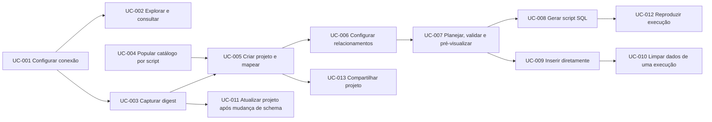

# 03 — Especificação Funcional (Casos de Uso)

| Campo | Valor |
|---|---|
| Objetivo | Descrever os fluxos ponta a ponta do usuário (UC), conectando requisitos (FR), telas (S) e serviços. |
| Escopo | Casos de uso MVP e V1. |
| Relacionados | [02](02-requirements.md), [21](21-user-interface-ux.md), [C09](contracts/C09-projects-and-application.md) |

## Atores
- **Usuário** (dev/QA/DBA) — único ator humano.
- **Banco externo** — SQLite/MySQL/PostgreSQL/Firebird.
- **IA externa** (fora do sistema) — apenas produz scripts que o usuário importa.

## Visão geral

---

### UC-001 — Configurar conexão
- **FR**: 001–005 · **Telas**: S02
- **Pré-condição**: app instalado; para Firebird, servidor acessível.
- **Fluxo principal**: 1) Usuário abre Conexões e clica Novo. 2) Escolhe SGBD; o formulário mostra os campos do provider. 3) Preenche dados, define ambiente. 4) Clica Testar → sistema exibe versão. 5) Salva → perfil aparece no Explorer.
- **Alternativos**: 4a) Falha → mensagem com dica; usuário corrige. 3a) SQLite arquivo inexistente → "Criar novo banco?" (confirmação). 3b) Ambiente Production → ReadOnly marcado automaticamente.
- **Pós-condição**: perfil persistido; senha protegida.

### UC-002 — Explorar e consultar
- **FR**: 010–031 · **Telas**: S03, S04, S05
- **Fluxo**: 1) Expande perfil no Explorer (conexão aberta em background). 2) Seleciona tabela → `Enter` abre SELECT limitado no editor. 3) Edita, `Ctrl+Enter` → resultados paginados. 4) Executa `UPDATE` com WHERE em perfil Test (modo Manual) → barra "Transação pendente". 5) Confere e clica Commit.
- **Alternativos**: 4a) `DELETE` sem WHERE → diálogo de confirmação (com "Contar linhas afetadas"). 4b) Perfil ReadOnly → bloqueado com mensagem. 3a) Consulta longa → Cancelar.
- **Pós-condição**: histórico registrado.

### UC-003 — Capturar digest
- **FR**: 040–047 · **Telas**: S06
- **Fluxo**: 1) Explorer → "Capturar digest" (ou no projeto). 2) Opções de captura (filtros). 3) Progresso por fase. 4) Snapshot criado (hash exibido); opcionalmente exportado como `.mdsdigest.json`.
- **Alternativos**: 3a) Sem permissão em rotinas → aviso `PRV-INTROSPECT-PARTIAL`, captura concluída sem rotinas. 3b) Cancelado → nada persistido.

### UC-004 — Popular catálogo por script
- **FR**: 050–058 · **Telas**: S09
- **Fluxo**: 1) Catálogo → Importar script. 2) Usuário clica "Copiar instruções para IA" e, fora do app, pede a uma IA "500 endereços fictícios coerentes de MG". 3) Cola o script. 4) Analisar → cartões de resumo + issues. 5) Mesclar → backup + merge → relatório.
- **Alternativos**: 4a) Script com `DROP` → rejeitado (`CAT-STG-FORBIDDEN`), nada muda. 4b) Registro sem campo obrigatório → Error com índice do comando; usuário corrige. 5a) Usuário desfaz → restaura backup `premerge`.

### UC-005 — Criar projeto e mapear
- **FR**: 060–066, 110 · **Telas**: S10, S11, S12
- **Fluxo**: 1) Novo projeto → escolhe conexão de origem → captura digest (UC-003) ou importa arquivo. 2) Sistema aplica bindings estruturais e `AutoBind` (High). 3) Usuário abre tabela `cliente`: `zap` sugerido TELEFONE (High, evidência "alias exato ZAP"); `doc` ambíguo (CPF/CNPJ) → escolhe CPF. 4) Ajusta `email` para expressão derivada do nome; preview ao vivo confirma. 5) Marca "Lembrar para outros projetos" em `fone_res`. 6) Salva projeto.
- **Alternativos**: 3a) Nenhum candidato → fallback por tipo (Low) destacado. 4a) Expressão inválida → erro com posição.

### UC-006 — Configurar relacionamentos e quantidades
- **FR**: 080–087, 090, 111 · **Telas**: S10, S13
- **Fluxo**: 1) Define linhas: cliente 1.000, pedido 5.000. 2) `item_pedido` em ParentDriven 1..5 por pedido (linhas derivadas exibidas). 3) `pedido.cliente_id` com Zipf 1,1. 4) `pedido.vendedor_id` aponta para tabela não incluída → escolhe fonte Existing (conexão de referência) com limite 10.000.
- **Alternativos**: 4a) Referência ≠ destino → aviso de verificação de chaves no destino.

### UC-007 — Planejar, validar e pré-visualizar
- **FR**: 086, 091, 092 · **Telas**: S14, S15
- **Fluxo**: 1) `F7` → sistema coleta TargetState (se destino conectado), planeja e valida. 2) Lista passos e diagnósticos. 3) Usuário resolve Errors (ex.: `PLN-UNIQUE-CAPACITY` → troca template por `br.cpf`). 4) Preview de `cliente` (50 linhas).
- **Alternativos**: 1a) Offline → `PLN-KEY-OFFLINE`. 3a) Executa inserção de teste (L4) em Test → `VAL-TRIGGER-KEY-OVERRIDE` detectado → muda estratégia para Captured.

### UC-008 — Gerar script SQL
- **FR**: 093, 094, 096–099, 101 · **Telas**: S16
- **Fluxo**: 1) `F9` → saída Script SQL, diretório, segmentação 50 MB. 2) Execução com progresso. 3) Resumo: arquivos, manifesto, limpeza; "Abrir no editor".
- **Alternativos**: 2a) Cancelar → segmento atual fechado com marcador, manifesto `cancelled`. 2b) Disco cheio → `OUT-DISK-FULL`, segmentos completos preservados.

### UC-009 — Inserir diretamente
- **FR**: 095–099, 007 · **Telas**: S16
- **Fluxo**: 1) Saída Inserção direta → escolhe perfil de destino (chip). 2) Sistema replaneja com TargetState real e valida. 3) Diálogo de confirmação (resumo; TypedConfirm se Production RW). 4) Autorização emitida → execução por batches. 5) Relatório.
- **Alternativos**: 2a) Faixa de chave ocupada → `RUN-KEY-RANGE-TAKEN` → replanejar. 4a) Violação em batch → rollback do batch, parada, relatório com diagnóstico. 4b) Cancelar → rollback do batch corrente; oferta de limpeza.

### UC-010 — Limpar dados de uma execução
- **FR**: 099 · **Telas**: S16, S17
- **Fluxo**: 1) Histórico → execução → "Executar limpeza". 2) Confirmação conforme ambiente. 3) DELETEs em ordem reversa; relatório de linhas removidas.
- **Alternativos**: 3a) Linhas referenciadas por dados criados depois → erro de FK; relatório explica.

### UC-011 — Atualizar projeto após mudança de schema
- **FR**: 044–046 · **Telas**: S06, S10
- **Fluxo**: 1) Banner "O banco mudou". 2) Captura novo snapshot → diff com severidades. 3) Resumo da migração de bindings (mantidos/revisar/órfãos/renomeações). 4) Usuário aceita renomeação `tel→telefone`; revisa `NeedsReview`. 5) Ativa snapshot.

### UC-012 — Reproduzir uma execução
- **FR**: 097 · **Telas**: S17, S14
- **Fluxo**: 1) Histórico → "Reexecutar com mesma seed". 2) Sistema compara PlanHash, versões e ContentHash; mostra nível de reprodutibilidade. 3) Gera; hash do script igual ao anterior (Exact).
- **Alternativos**: 2a) Template alterado desde então → aviso; usuário decide prosseguir.

### UC-013 — Compartilhar projeto
- **FR**: 112, 116 · **Telas**: S10
- **Fluxo**: 1) Projeto → Exportar sanitizado. 2) Colega abre: perfis não resolvidos → associa perfil local; dependências de catálogo verificadas; projeto de terceiro com `Query` → confiança solicitada.
