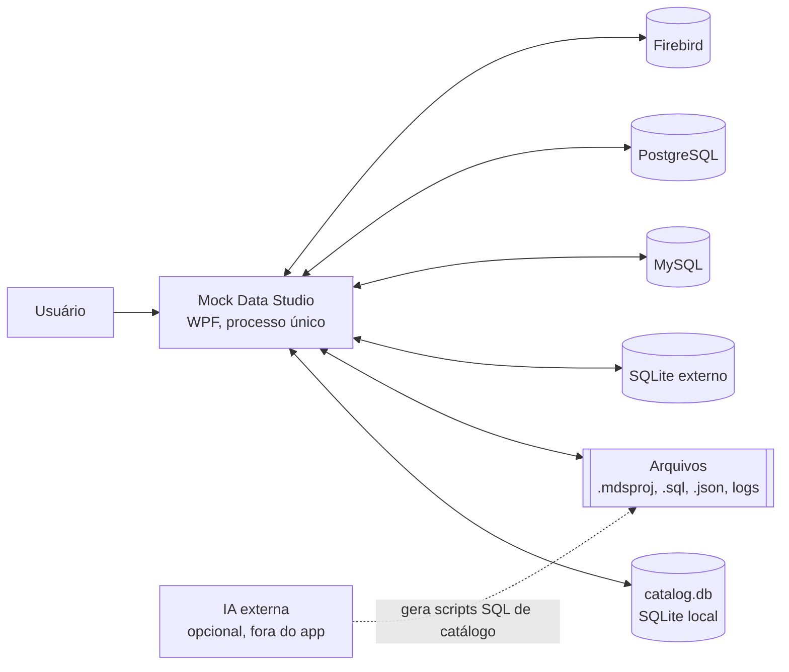
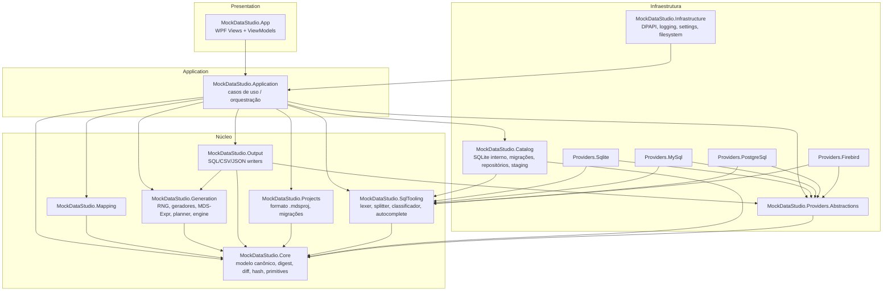
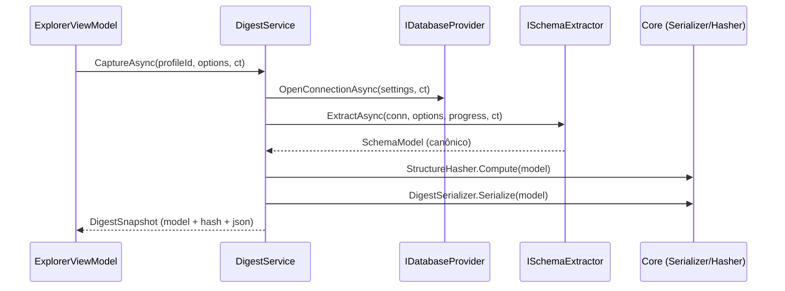
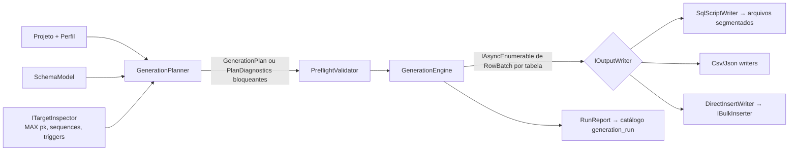

# 05 — Arquitetura do Sistema

| Campo | Valor |
|---|---|
| Objetivo | Definir componentes, responsabilidades, dependências permitidas/proibidas, fluxos de dados, ciclo de vida, concorrência, cancelamento, transações e resiliência. |
| Escopo | Todo o sistema (MVP→V2). |
| Relacionados | [07-solution-structure](07-solution-structure.md), [08-domain-model](08-domain-model.md), [contracts/](contracts/README.md), ADR-002, ADR-006 |

---

## 1. Visão de contexto

Não há comunicação com serviços remotos além dos bancos configurados pelo usuário.

## 2. Visão de componentes

### 2.1 Responsabilidades

| Componente | Responsabilidade | Não deve |
|---|---|---|
| **Core** | Tipos de domínio puros: `SchemaModel` e filhos, `ObjectName`, `LogicalType`, `DigestSerializer`, `StructureHasher`, `SchemaDiffer`, `Result<T>`/erros, `IClock` | Fazer IO de rede/banco |
| **Providers.Abstractions** | Contratos `IDatabaseProvider`, `ISchemaExtractor`, `ISqlDialect`, `IBulkInserter`, `ITargetInspector`; `ConnectionSettings`; tipos de execução | Conhecer drivers concretos |
| **Providers.\*** | Implementação por SGBD: conexão, introspecção, mapeamento de tipos, dialeto SQL, inserção em massa, captura de chave | Conhecer UI, catálogo ou geração |
| **Catalog** | Persistência do catálogo interno: migrações, repositórios, importação staging, backup, perfis de conexão (sem segredos em claro) | Conhecer providers externos |
| **Mapping** | Normalização de nomes, pontuação, sugestão, regras aprendidas | Gerar valores |
| **Generation** | RNG, geradores, MDS-Expr, `GenerationPlanner` (dependências, ciclos, capacidade), `GenerationEngine` (stream de linhas) | Escrever SQL ou acessar banco diretamente (acesso a dados existentes via interface `IReferenceDataSource` implementada na Application) |
| **Output** | `IOutputWriter` (SQL por dialeto, CSV, JSON), segmentação, manifesto, script de limpeza; `DirectInsertWriter` (usa `IBulkInserter`) | Decidir o que gerar |
| **SqlTooling** | Lexer por dialeto, splitter, classificador de comandos, motor de autocomplete independente de UI | Executar SQL |
| **Projects** | Modelo `MdsProject`, (de)serialização, validação por JSON Schema, migração de formato | Acessar catálogo diretamente |
| **Application** | Casos de uso (`ConnectionService`, `ExplorerService`, `QueryExecutionService`, `DigestService`, `CatalogService`, `MappingService`, `GenerationService`, `ProjectService`, `RunHistoryService`), políticas de segurança (`ExecutionGuard`), coordenação de transações | Referenciar WPF |
| **Infrastructure** | `ISecretStore` (DPAPI), `IAppSettings`, logging (Serilog), `IFileSystem`, `IClock` real | Lógica de negócio |
| **App** | Views XAML, ViewModels, navegação, diálogos, temas, composição (DI root) | Lógica de negócio fora de ViewModels finos |

## 3. Regras de dependência

| ID | Regra | Verificação |
|---|---|---|
| AR-01 | `Core` não referencia nenhum outro assembly do produto nem pacotes de banco/UI. | T-ARC-001 |
| AR-02 | `Generation`, `Mapping`, `SqlTooling`, `Projects` referenciam apenas `Core` (e BCL/`System.IO.Hashing`). | T-ARC-002 |
| AR-03 | Somente `App` referencia WPF (`PresentationFramework`) e AvalonEdit. | T-ARC-003 |
| AR-04 | Somente `Providers.<X>` referencia o driver ADO.NET do SGBD X. `Catalog` referencia `Microsoft.Data.Sqlite` para o banco interno (exceção documentada). `Providers.<X>` e `Catalog` podem referenciar `SqlTooling` (lexer para parse de DDL do SQLite/triggers Firebird e para o importador de staging). | T-ARC-004 |
| AR-05 | `App` não referencia `Providers.*` exceto no *composition root* (`App/Composition/ServiceRegistration.cs`). | T-ARC-005 |
| AR-06 | Nenhum ciclo de referência entre assemblies (garantido pelo MSBuild). | Build |
| AR-07 | Tipos públicos de `Core` são imutáveis (`record`/`sealed`, coleções `IReadOnlyList`/`ImmutableArray`). | Revisão + T-ARC-006 |

## 4. Fluxos de dados principais

### 4.1 Introspecção → Digest

### 4.2 Mapeamento

`MappingService.SuggestAsync(model, tableName)` → `StructuralBinder` (PK/FK/identity/generated/default) → `SemanticMatcher` (catálogo + regras) → `MappingSuggestion[]` com evidências → ViewModel exibe → usuário confirma → `ColumnBinding` gravado no projeto; confirmações opcionalmente viram `MappingRule` no catálogo.

### 4.3 Geração

## 5. Ciclo de vida dos serviços (DI)

| Lifetime | Serviços |
|---|---|
| Singleton | `IProviderRegistry`, `ICatalogDatabase` (fábrica de conexões do catálogo), `ISecretStore`, `IAppSettings`, `IClock`, `IGeneratorRegistry`, `IExprFunctionRegistry`, `ILogger<T>`, serviços de Application (stateless) |
| Transient | ViewModels de documento (cada aba), diálogos |
| Por operação (criado explicitamente, `IAsyncDisposable`) | `DbConnection` externa, `GenerationRunContext`, `QuerySession` (uma por aba do editor) |

Regras:
- **Conexões externas não são compartilhadas entre operações** (requisito "conexões independentes por operação"). Cada aba do editor tem sua `QuerySession` com conexão própria; cada execução de geração abre conexões próprias de leitura (origem) e escrita (destino).
- Pooling do driver permanece habilitado (padrão dos drivers), exceto SQLite externo, para o qual o pool é desabilitado ao fechar a aba para liberar o arquivo (`SqliteConnection.ClearPool`).

## 6. Concorrência

| Área | Modelo |
|---|---|
| UI | Thread de UI apenas para binding. Todo IO é `async`; comandos usam `AsyncRelayCommand` com `CancellationToken`. Progresso via `IProgress<T>` (marshal automático para UI). |
| Geração | Por tabela, cada batch (`BatchSize`, padrão 1.000 linhas) é calculado em paralelo em sub-faixas de 256 linhas (`MaxDegreeOfParallelism = Environment.ProcessorCount - 1`) e os batches são emitidos **em ordem de índice** para o writer ([15 §3](15-generation-engine.md)). Determinismo garantido por ADR-013. |
| Escrita | Um único consumidor por writer (pipeline `Channel<RowBatch>` limitado, capacidade padrão 8 batches) → contrapressão. |
| Catálogo | SQLite WAL; escrita serializada por `SemaphoreSlim(1)` em `CatalogDatabase`; leituras concorrentes. |
| Editor SQL | Uma execução por aba por vez; outras abas independentes. |

## 7. Cancelamento

- Todo método assíncrono público recebe `CancellationToken` como último parâmetro.
- Cancelamento de consulta: `ct.Register(() => command.Cancel())` + fechamento da conexão se o driver não responder em 5 s (Firebird/MySQL podem ignorar `Cancel` em algumas versões [K] → fallback de fechar conexão).
- Cancelamento de geração em script: interrompe após o batch corrente, fecha o segmento atual com comentário `-- CANCELADO EM <tabela> linha <n>` e grava manifesto com `status = "cancelled"`.
- Cancelamento de inserção direta: rollback da transação corrente; lotes já confirmados permanecem e o relatório oferece o script de limpeza ([19 §7](19-direct-database-execution.md)).

## 8. Transações

| Operação | Política |
|---|---|
| Migração do catálogo | Uma transação por arquivo de migração; backup antes. |
| Merge de importação staging | Uma transação para todo o merge. |
| Editor SQL | Modo `Manual` (padrão para ambientes ≠ Development) ou `AutoCommit`; ver [20 §7](20-sql-editor.md). |
| Inserção direta | `PerBatch` (padrão; commit a cada N linhas) ou `Single` (tudo ou nada; limitado a 1 M linhas para evitar logs de transação gigantes — alerta acima disso). |
| Inserção de teste (validação) | Sempre transação revertida. |

## 9. Resiliência

| Falha | Comportamento |
|---|---|
| Conexão perdida durante introspecção | Operação falha com `MdsError(Code="PRV-CONN-LOST")`; nada é persistido; usuário pode repetir. |
| Conexão perdida no editor | Aba marca sessão "Desconectada"; transação pendente é considerada perdida e o usuário é informado explicitamente; botão "Reconectar". |
| Timeout | Timeouts distintos: conexão (padrão 15 s), comando de editor (padrão 0 = ilimitado com cancelamento manual), introspecção (120 s por consulta), batch de inserção (300 s). Configuráveis por perfil. |
| Falha de disco ao gravar script | Aborta, mantém segmentos completos, manifesto marca `failed`, mensagem com caminho. |
| Catálogo corrompido (`PRAGMA integrity_check` ≠ ok) | App abre em modo de recuperação: oferece restaurar último backup automático. |
| Exceção não tratada na UI | Handler global registra log, mostra diálogo com ID de correlação, não encerra o app salvo se a exceção for de inicialização. |

Repetição automática (*retry*) **somente** para: abertura de conexão (2 tentativas, backoff 1 s/3 s). Nunca para comandos de escrita (risco de duplicação).

## 10. Padrões de projeto utilizados

| Padrão | Onde | Motivo |
|---|---|---|
| Strategy | `ISqlDialect`, `IValueGenerator`, `IOutputWriter`, estratégias de chave/ciclo | Variação por SGBD/gerador |
| Registry + Factory | `IProviderRegistry`, `IGeneratorRegistry` | Extensibilidade (ADR-009) |
| Pipeline/Producer-Consumer | Engine → Channel → Writer | Streaming e contrapressão |
| Specification/Result | Validação (`ValidationIssue`) e `Result<T>` | Erros esperados sem exceções |
| Memento/Snapshot | `DigestSnapshot` | Comparação e evolução |
| MVVM | App | Testabilidade |
| Unit of Work leve | `CatalogTransaction` | Merge e migrações |

## 11. Decisões pendentes
Nenhuma. Pontos dependentes de verificação empírica estão em [30](30-risks-and-tradeoffs.md).
