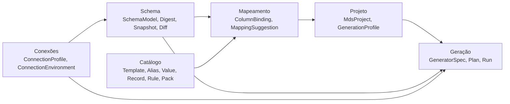
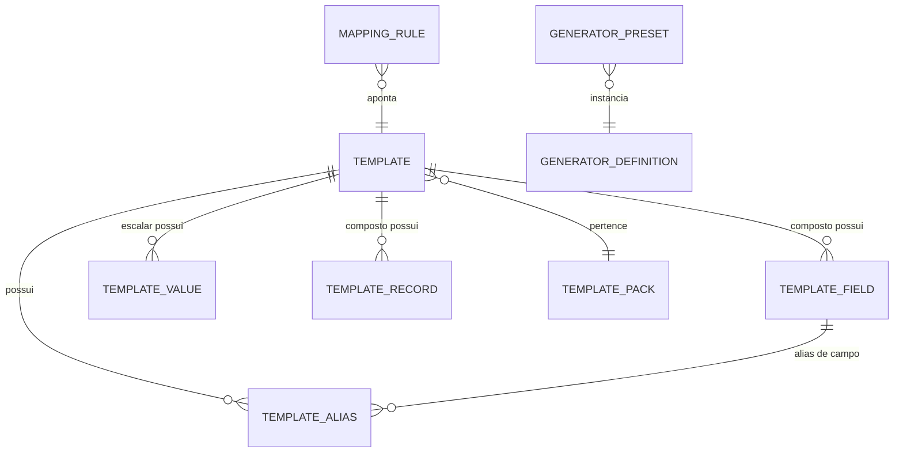

# 08 — Modelo de Domínio

| Campo | Valor |
|---|---|
| Objetivo | Definir entidades, value objects e invariantes do domínio, com nomes únicos usados em toda a documentação. |
| Escopo | Modelo canônico de schema, catálogo, mapeamento, geração, projeto, execução. |
| Relacionados | [contracts/](contracts/README.md) (assinaturas C#), [09](09-internal-database.md) (persistência do catálogo), [22](22-project-file-format.md) (persistência do projeto), [34-glossary](34-glossary.md) |

## 1. Mapa de contextos

## 2. Contexto Schema (modelo canônico)

### 2.1 Identidade de objetos — `ObjectName`

- Um objeto é identificado por `ObjectName(Namespace, Name)`; uma coluna por `ColumnRef(ObjectName Table, string Column)`.
- Os nomes são preservados **exatamente como armazenados no catálogo do SGBD** (case preservado).
- **Forma textual canônica** (`CanonicalId`): partes unidas por `.`; uma parte é envolvida por aspas duplas se contiver `.`, `"`, espaço ou caractere fora de `[A-Za-z0-9_$]`; aspas internas são duplicadas. Ex.: `public.cliente`, `public.cliente.nome`, `PUBLIC.CLIENTE.NOME`, `main."item pedido".valor`.
- Comparação: **ordinal, case-sensitive** sobre o nome armazenado. Para correspondência tolerante (diff/rename) usa-se `ObjectName.NormalizedKey` (uppercase invariante) apenas como evidência.
- Namespace por SGBD:

| SGBD | Namespace | Observação |
|---|---|---|
| SQLite | `main` | Bancos anexados fora do escopo V1 |
| MySQL | nome do database (schema) | Um digest contém 1 database por padrão; múltiplos via opção |
| PostgreSQL | schema (`public`, ...) | `pg_catalog`/`information_schema` excluídos |
| Firebird 3–5 | `PUBLIC` **virtual** (`IsVirtual = true`) | Não emitido em SQL. Escolhido para compatibilidade futura com Firebird 6, que introduz schemas (premissa PA-007) |

### 2.2 Entidades

| Entidade | Atributos principais | Invariantes |
|---|---|---|
| `SchemaModel` | `Engine`, `ServerVersion`, `DatabaseName`, `Namespaces[]`, `CapturedAt`, `Options` | Nomes de namespace únicos |
| `NamespaceModel` | `Name`, `IsVirtual`, `Tables[]`, `Views[]`, `Sequences[]`, `Routines[]`, `Triggers[]` | Nomes únicos por tipo de objeto |
| `TableModel` | `Name`, `Columns[]` (ordenadas por posição), `PrimaryKey?`, `ForeignKeys[]`, `UniqueConstraints[]`, `Indexes[]`, `Checks[]`, `Comment?`, `Extras` | Colunas únicas; PK referencia colunas existentes |
| `ViewModel` | `Name`, `Columns[]`, `IsUpdatable?` | Somente leitura para geração (V1) |
| `ColumnModel` | `Name`, `Ordinal`, `Type: DataTypeInfo`, `IsNullable`, `Default?: DefaultValue`, `Identity?: IdentityInfo`, `Generated?: GeneratedInfo`, `Collation?`, `Comment?`, `Extras` | `Identity` e `Generated` mutuamente exclusivos |
| `DataTypeInfo` | `NativeName` (normalizado minúsculo, ex. `varchar`), `Length?`, `Precision?`, `Scale?`, `IsUnsigned`, `LogicalType`, `IntegerBits?`, `EnumValues?`, `Charset?`, `LengthUnit` (`Chars`/`Bytes`), `Domain?` (Firebird) | `LogicalType` derivado pelo `ITypeMapper` do provider |
| `IdentityInfo` | `Kind` (`AutoIncrement` MySQL/SQLite, `IdentityAlways`, `IdentityByDefault`, `Serial` PG, `TriggerSequence` FB legado), `SequenceName?`, `Start?`, `Increment?` | — |
| `GeneratedInfo` | `Expression`, `Stored` | Coluna nunca recebe valor em INSERT |
| `DefaultValue` | `RawExpression`, `Kind` (`Literal`, `Function`, `Sequence`, `Other`), `LiteralValue?` | — |
| `PrimaryKeyModel` | `Name?`, `Columns[]` | ≥1 coluna |
| `ForeignKeyModel` | `Name`, `Columns[]`, `Referenced: ObjectName`, `ReferencedColumns[]`, `OnDelete`, `OnUpdate`, `IsDeferrable`, `InitiallyDeferred`, `IsEnforced` | `Columns.Count == ReferencedColumns.Count` ≥ 1 |
| `UniqueConstraintModel` | `Name?`, `Columns[]`, `Source` (`Constraint`/`UniqueIndex`), `NullsDistinct` (PG15+) | — |
| `IndexModel` | `Name`, `Columns[]` (com `Descending`, `Expression?`), `IsUnique`, `Predicate?` (parcial) | Índices que implementam PK/UK são marcados `BacksConstraint` e omitidos do digest |
| `CheckConstraintModel` | `Name?`, `Expression` (texto do SGBD), `ColumnScope[]` (colunas referenciadas, detectadas por lexer) | — |
| `SequenceModel` | `Name`, `Start?`, `Increment?`, `MinValue?`, `MaxValue?`, `IsCycle` | Valor corrente **não** faz parte do modelo (volátil) |
| `TriggerModel` | `Name`, `Table: ObjectName?` (nulo para triggers de banco/DDL), `Timing` (`Before`/`After`/`InsteadOf`), `Events` (`Insert`/`Update`/`Delete`), `IsActive`, `Position?` | Sem corpo |
| `RoutineModel` | `Name`, `Kind` (`Procedure`/`Function`), `ParameterCount`, `ReturnType?` | Sem corpo |

### 2.3 `LogicalType`

`Boolean, Integer, Decimal, Float, String, Text, Binary, Date, Time, DateTime, DateTimeTz, Uuid, Json, Enum, Interval, Other`.

- `Integer` usa `IntegerBits ∈ {8,16,32,64}` e `IsUnsigned`.
- `String` = comprimento limitado; `Text` = ilimitado/CLOB; `Binary` = BLOB/bytea.
- Mapeamento de tipos nativos → lógicos por SGBD em [10 §6](10-database-providers.md).

### 2.4 Snapshot e diff

| Entidade | Descrição |
|---|---|
| `DigestSnapshot` | `Id` (ex. `snap-0003`), `Model`, `StructureHash`, `CapturedAt`, `SourceFingerprint`, `Label?` |
| `SourceFingerprint` | `Engine`, `Host?`, `Port?`, `Database`, `ServerVersion`, `DatabaseGuid?` (PG: `system_identifier` não acessível a não-superusuários → usa `current_database()` + `inet_server_addr()`; FB: `MON$DATABASE.MON$GUID` quando disponível (FB4+) [K]); hash SHA-256 desses campos |
| `SchemaDiff` | Lista de `SchemaChange { Kind, Path, Before?, After?, Severity }` — `Kind ∈ {Added, Removed, Modified, RenamedCandidate}` |

## 3. Contexto Conexões

| Entidade | Atributos | Invariantes |
|---|---|---|
| `ConnectionProfile` | `Id: Guid`, `Name`, `Engine`, `Settings: ConnectionSettings`, `Environment: ConnectionEnvironment`, `ColorHex?`, `IsReadOnly`, `PromptPassword`, `Notes?` (o segredo protegido fica apenas em `connection_profile.secret`, nunca no objeto de domínio) | Nome único; Production ⇒ `IsReadOnly=true` por padrão |
| `ConnectionSettings` | `Host`, `Port`, `Database` (ou caminho de arquivo), `User`, `Ssl`, `Charset`, `ConnectTimeoutSec`, `CommandTimeoutSec`, `Extra: Dictionary<string,string>` (allow-list por provider) | Nunca contém senha |
| `ConnectionEnvironment` (conceitualmente "EnvironmentTag") | `Development`, `Test`, `Staging`, `Production`, `Unknown` | `Unknown` é tratado como `Production` para proteções (premissa conservadora) |

## 4. Contexto Catálogo

| Entidade | Descrição | Invariantes |
|---|---|---|
| `Template` | Tipo semântico. `Code` (ex. `TELEFONE`, `ENDERECO`), `Name`, `Kind` (`Scalar`/`Composite`), `LogicalType` (escalares), `Locale` (ex. `pt-BR`), `Tags`, `Description`, `PackCode`, `IsBuiltIn` | `Code` único, `^[A-Z][A-Z0-9_]{1,63}$` |
| `TemplateField` | Campo de template composto: `FieldCode` (ex. `cep`), `LogicalType`, `Ordinal`, `MaxLength?` | Único por template; `^[a-z][a-z0-9_]{0,63}$` |
| `TemplateAlias` | `Alias` (texto original), `NormalizedAlias`, alvo = template **ou** campo de template, `Weight` (padrão 1.0), `ContextTablePattern?` (ex. `*ENDERECO*`) | `NormalizedAlias` único por alvo |
| `TemplateValue` | Valor de template escalar: `Value` (texto), `Weight` (>0, padrão 1) | Valor único por template |
| `TemplateRecord` | Registro de template composto: `RecordKey`, `Data` (objeto JSON `{fieldCode: valor}`), `Weight` | Chaves de `Data` ⊆ campos do template; campos obrigatórios presentes |
| `TemplatePack` | Agrupador distribuível: `Code`, `Name`, `Version`, `Author`, `License`, `IsBuiltIn` | — |
| `GeneratorDefinition` | Descreve um gerador disponível (código, versão, parâmetros, tipos lógicos suportados) — **registrada em código**, espelhada no catálogo apenas para presets | — |
| `GeneratorPreset` | Configuração nomeada reutilizável: `Code`, `GeneratorId`, `Parameters JSON` (ex.: "Data de nascimento adulto") | Parâmetros válidos para o gerador |
| `MappingRule` | Regra aprendida/manual: `Pattern` (nome normalizado de coluna, opcionalmente com padrão de tabela), `TargetKind` (`Template`/`TemplateField`/`Preset`/`Generator`), `TargetRef`, `Scope` (`Global`/`Engine`/`Project`), `Priority`, `Source` (`User`/`Learned`/`BuiltIn`) | — |

**Nota sobre a lista original de entidades:** `GeneratorParameter` não é tabela — parâmetros são definidos em código pelo gerador (`GeneratorParameterDefinition`) e persistidos como JSON validado. `ProjectMapping`, `GenerationProfile` e `GenerationHistory` são persistidos no **projeto** (`.mdsproj`), com um índice de execuções (`generation_run`) no catálogo para histórico global. Justificativa: portabilidade do projeto (ADR-010).

## 5. Contexto Mapeamento

| Tipo | Descrição |
|---|---|
| `ColumnBinding` | Vínculo final de uma coluna: `Column: ColumnRef`, `Generator: GeneratorSpec`, `NullRate (0..1)`, `Origin` (`Structural`/`Auto`/`Rule`/`User`), `Confidence?`, `ColumnFingerprint`, `State` (`Active`/`Orphaned`/`NeedsReview`) |
| `GeneratorSpec` | `GeneratorId` (ex. `catalog.template`), `Version` (int), `Parameters` (`JsonObject`), `Children?: GeneratorSpec[]` (composição) |
| `MappingSuggestion` | `Column`, `Candidates[]` ordenados (`Target`, `Score` 0–100, `Confidence`, `Evidence[]`) |
| `Confidence` | `Confirmed`, `High`, `Medium`, `Low`, `None` — faixas heurísticas, **não probabilidades** |
| `ColumnFingerprint` | Hash curto (16 hex) de `(LogicalType, Length, Precision, Scale, IsNullable, IsPartOfPk, IsPartOfFk)` |

## 6. Contexto Geração

| Tipo | Descrição |
|---|---|
| `GenerationProfile` | `Name`, `Seed: ulong`, `ReferenceInstant: DateTimeOffset`, `TableSettings{ table → RowCount, Include, Mode }`, `RelationSettings{ fk → ReferenceSource, Cardinality }`, `KeyStrategy` padrão, `Output: OutputSettings`, `Validation: ValidationSettings` |
| `ReferenceSource` | `Generated`, `Existing` (dados do banco de referência), `Fixed` (valores), `Dataset` (arquivo CSV importado), `Query` (SQL configurado, somente SELECT) |
| `CardinalitySpec` | `Mode` (`ChildDriven`/`ParentDriven`), `Distribution` (`Uniform`/`Zipf(s)`/`Weighted`/`Range(min,max)`/`Poisson(λ)`), `Unique` (1:1) |
| `KeyStrategy` | `Explicit`, `Captured`, `NaturalKeyLookup`, `DatabaseDefault` (não referenciada) |
| `GenerationPlan` | Saída do planner: `Steps[]` ordenados (`InsertTable`, `UpdateDeferredFks`, `ResyncSequence`), `TablePlans`, `KeyRanges`, `Diagnostics[]`, `PlanHash` |
| `GenerationRun` | Execução: `RunId`, `ProjectId`, `ProfileName`, `PlanHash`, `Seed`, `StructureHash`, `TargetFingerprint?`, `Output`, `Status` (`Running`/`Completed`/`Failed`/`Cancelled`), `TableResults[]` (linhas, faixas de chave), `GeneratorVersions`, `StartedAt`, `FinishedAt`, `Error?` |
| `RowBatch` | Bloco de linhas de uma tabela: `Table`, `FirstRowIndex`, `Rows` (`object?[][]` em ordem de colunas inseridas), `Columns` |

## 7. Contexto Projeto

`MdsProject`: `Id`, `Name`, `FormatVersion`, `ConnectionRefs { Source, Target, Reference? }`, `Snapshots[]`, `ActiveSnapshotId`, `Bindings{ columnId → ColumnBinding }`, `Profiles[]`, `ActiveProfile`, `CatalogDependencies[]`, `RunSummaries[]`. Formato em [22](22-project-file-format.md).

## 8. Regras de nomenclatura (obrigatórias em todo código e documentação)

| Conceito | Nome único | Nunca usar |
|---|---|---|
| Representação compacta exportável | **Digest** | "metadata", "dump" |
| Modelo em memória | **SchemaModel** (modelo canônico) | "digest" |
| Versão capturada armazenada | **Snapshot** | "versão do digest" |
| Tipo semântico do catálogo | **Template** | "tipo de campo" (apenas em UI explicativa) |
| Item de dado de template escalar | **TemplateValue** | "detail" |
| Item de template composto | **TemplateRecord** | — |
| Vínculo coluna→gerador | **ColumnBinding** | "mapping" isolado (usar "mapeamento" para o processo) |
| Configuração de quantidades/seed/saída | **GenerationProfile** | "cenário" (reservado para V2 Scenario Designer) |
