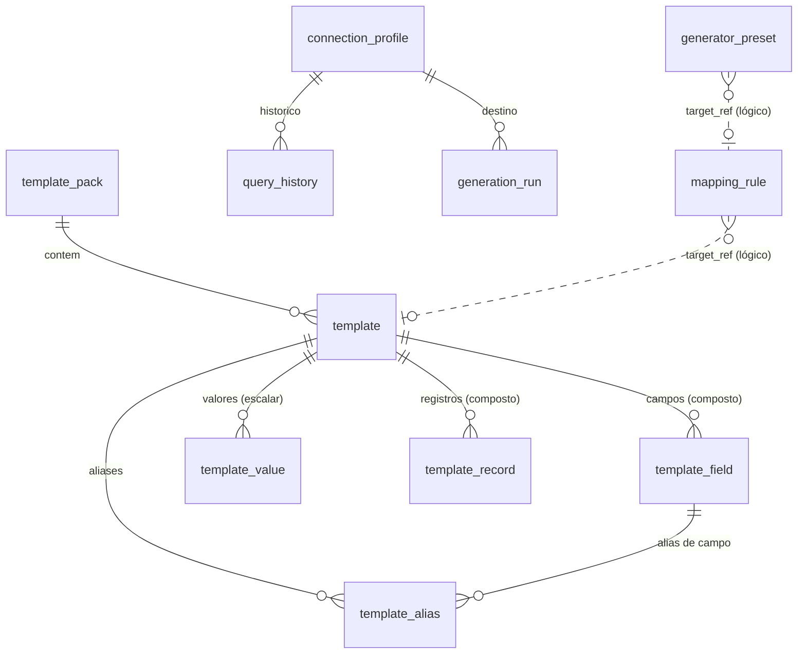

# 09 — Banco de Dados Interno (Catálogo)

| Campo | Valor |
|---|---|
| Objetivo | Especificar o banco interno `catalog.db`: entidades, DDL, índices, constraints, migrações, seeds, integridade, backup e recuperação. |
| Escopo | Schema físico versão 1 (migração `V0001`). Schema de **staging** (importação) também é contrato público. |
| Relacionados | ADR-004, ADR-016, [08 §4](08-domain-model.md), [13](13-template-catalog.md), [C03](contracts/C03-catalog.md) |
| Requisitos | FR-050..FR-059, FR-064, FR-001/003, FR-029, FR-114 |

## 1. Localização e configuração

| Item | Valor |
|---|---|
| Arquivo | `%LOCALAPPDATA%\MockDataStudio\catalog.db` (sobrescrevível por `--catalog <caminho>` e setting `CatalogPath`) |
| Pragmas na abertura | `journal_mode=WAL`, `foreign_keys=ON`, `synchronous=NORMAL`, `busy_timeout=5000`, `temp_store=MEMORY` |
| Backups automáticos | `%LOCALAPPDATA%\MockDataStudio\backups\catalog_<yyyyMMdd_HHmmss>_<motivo>.db` — motivos: `premigrate`, `premerge`, `daily`, `manual`. Retenção: 10 mais recentes por motivo, exceto `manual` (ilimitado) |
| Codificação | UTF-8 |
| Datas | Texto ISO-8601 UTC (`YYYY-MM-DDTHH:MM:SS.fffZ`) |
| Booleanos | `INTEGER` 0/1 com `CHECK` |
| JSON | `TEXT` com `CHECK (json_valid(col))` (JSON1 incluso no SQLite empacotado pelo `SQLitePCLRaw.bundle_e_sqlite3` [K]) |

## 2. Diagrama de entidades



Referências de `mapping_rule.target_ref` são **lógicas** (código textual), não FKs físicas, pois o alvo pode ser template, campo, preset ou gerador embutido. A integridade é verificada pelo `CatalogIntegrityChecker` (§8).

## 3. DDL — migração `V0001__init.sql`

```sql
CREATE TABLE schema_version (
    version      INTEGER PRIMARY KEY,
    script_name  TEXT    NOT NULL,
    checksum     TEXT    NOT NULL,              -- sha256 do script aplicado
    applied_at   TEXT    NOT NULL
);

CREATE TABLE template_pack (
    id           INTEGER PRIMARY KEY,
    code         TEXT    NOT NULL UNIQUE CHECK (length(code) BETWEEN 2 AND 64 AND code = upper(code)),
    name         TEXT    NOT NULL,
    version      TEXT    NOT NULL DEFAULT '1.0.0',
    author       TEXT,
    license      TEXT,
    is_builtin   INTEGER NOT NULL DEFAULT 0 CHECK (is_builtin IN (0,1)),
    created_at   TEXT    NOT NULL,
    updated_at   TEXT    NOT NULL
);

CREATE TABLE template (
    id            INTEGER PRIMARY KEY,
    code          TEXT    NOT NULL UNIQUE CHECK (length(code) BETWEEN 2 AND 64 AND code = upper(code)
                                                 AND code NOT GLOB '*[^A-Z0-9_]*' AND substr(code,1,1) GLOB '[A-Z]'),
    name          TEXT    NOT NULL,
    kind          TEXT    NOT NULL CHECK (kind IN ('scalar','composite')),
    logical_type  TEXT    CHECK (logical_type IN ('boolean','integer','decimal','float','string','text','binary','date',
                                   'time','datetime','datetimetz','uuid','json','enum','interval','other')),
    locale        TEXT    NOT NULL DEFAULT 'pt-BR',
    description   TEXT,
    tags          TEXT    NOT NULL DEFAULT '[]' CHECK (json_valid(tags) AND json_type(tags) = 'array'),
    pack_id       INTEGER NOT NULL REFERENCES template_pack(id) ON DELETE RESTRICT,
    is_builtin    INTEGER NOT NULL DEFAULT 0 CHECK (is_builtin IN (0,1)),
    content_hash  TEXT,                              -- recalculado após alterações de valores
    created_at    TEXT    NOT NULL,
    updated_at    TEXT    NOT NULL,
    CHECK ((kind = 'scalar' AND logical_type IS NOT NULL) OR (kind = 'composite' AND logical_type IS NULL))
);

CREATE TABLE template_field (
    id           INTEGER PRIMARY KEY,
    template_id  INTEGER NOT NULL REFERENCES template(id) ON DELETE CASCADE,
    field_code   TEXT    NOT NULL CHECK (length(field_code) BETWEEN 1 AND 64 AND field_code = lower(field_code)
                                         AND field_code NOT GLOB '*[^a-z0-9_]*' AND substr(field_code,1,1) GLOB '[a-z]'),
    logical_type TEXT    NOT NULL,
    ordinal      INTEGER NOT NULL,
    max_length   INTEGER CHECK (max_length IS NULL OR max_length > 0),
    required     INTEGER NOT NULL DEFAULT 1 CHECK (required IN (0,1)),
    UNIQUE (template_id, field_code),
    UNIQUE (template_id, ordinal)
);

CREATE TABLE template_alias (
    id                     INTEGER PRIMARY KEY,
    template_id            INTEGER NOT NULL REFERENCES template(id) ON DELETE CASCADE,
    field_id               INTEGER REFERENCES template_field(id) ON DELETE CASCADE,
    alias                  TEXT    NOT NULL CHECK (length(trim(alias)) > 0),
    normalized_alias       TEXT    NOT NULL,       -- NormalizedName.Compact (14 §2)
    weight                 REAL    NOT NULL DEFAULT 1.0 CHECK (weight > 0 AND weight <= 2),
    context_table_pattern  TEXT,                   -- glob sobre nome normalizado da tabela, ex. '*ENDERECO*'
    source                 TEXT    NOT NULL DEFAULT 'user' CHECK (source IN ('builtin','user','import','learned')),
    created_at             TEXT    NOT NULL
);
CREATE UNIQUE INDEX ux_template_alias ON template_alias(template_id, ifnull(field_id, 0), normalized_alias);
CREATE INDEX ix_template_alias_norm ON template_alias(normalized_alias);

CREATE TABLE template_value (
    id           INTEGER PRIMARY KEY,
    template_id  INTEGER NOT NULL REFERENCES template(id) ON DELETE CASCADE,
    value        TEXT    NOT NULL,
    weight       REAL    NOT NULL DEFAULT 1.0 CHECK (weight > 0),
    UNIQUE (template_id, value)
);

CREATE TABLE template_record (
    id           INTEGER PRIMARY KEY,
    template_id  INTEGER NOT NULL REFERENCES template(id) ON DELETE CASCADE,
    record_key   TEXT    NOT NULL,
    data         TEXT    NOT NULL CHECK (json_valid(data) AND json_type(data) = 'object'),
    weight       REAL    NOT NULL DEFAULT 1.0 CHECK (weight > 0),
    UNIQUE (template_id, record_key)
);

CREATE TABLE generator_preset (
    id                 INTEGER PRIMARY KEY,
    code               TEXT    NOT NULL UNIQUE CHECK (code = upper(code) AND length(code) BETWEEN 2 AND 64),
    name               TEXT    NOT NULL,
    generator_id       TEXT    NOT NULL,           -- ex. 'core.date.range'
    generator_version  INTEGER NOT NULL,
    parameters         TEXT    NOT NULL DEFAULT '{}' CHECK (json_valid(parameters) AND json_type(parameters) = 'object'),
    description        TEXT,
    is_builtin         INTEGER NOT NULL DEFAULT 0 CHECK (is_builtin IN (0,1)),
    created_at         TEXT    NOT NULL,
    updated_at         TEXT    NOT NULL
);

CREATE TABLE mapping_rule (
    id              INTEGER PRIMARY KEY,
    column_pattern  TEXT    NOT NULL,              -- glob sobre NormalizedName.Compact, ex. 'DTNASC*'
    table_pattern   TEXT,                          -- glob sobre nome normalizado da tabela
    engine          TEXT    CHECK (engine IS NULL OR engine IN ('sqlite','mysql','postgresql','firebird')),
    target_kind     TEXT    NOT NULL CHECK (target_kind IN ('template','template_field','preset','generator')),
    target_ref      TEXT    NOT NULL,              -- 'ENDERECO.cep', 'TELEFONE', 'DATA_NASC_ADULTO', 'core.uuid'
    parameters      TEXT    CHECK (parameters IS NULL OR json_valid(parameters)),
    scope           TEXT    NOT NULL DEFAULT 'global' CHECK (scope IN ('global','engine')),
    priority        INTEGER NOT NULL DEFAULT 100,
    source          TEXT    NOT NULL CHECK (source IN ('builtin','user','learned')),
    enabled         INTEGER NOT NULL DEFAULT 1 CHECK (enabled IN (0,1)),
    hit_count       INTEGER NOT NULL DEFAULT 0,
    created_at      TEXT    NOT NULL,
    updated_at      TEXT    NOT NULL
);
-- UNIQUE de tabela no SQLite não aceita expressões → índice único de expressão
CREATE UNIQUE INDEX ux_mapping_rule ON mapping_rule(column_pattern, ifnull(table_pattern,''), ifnull(engine,''), target_kind, target_ref);
-- Regras de escopo 'project' (RuleScope.Project) vivem no arquivo .mdsproj, não no catálogo.

CREATE TABLE mapping_feedback (                  -- "histórico de mapeamentos" usado como evidência (14 §5)
    column_compact  TEXT    NOT NULL,
    target_kind     TEXT    NOT NULL,
    target_ref      TEXT    NOT NULL,
    accepted_count  INTEGER NOT NULL DEFAULT 0,
    rejected_count  INTEGER NOT NULL DEFAULT 0,
    last_at         TEXT    NOT NULL,
    PRIMARY KEY (column_compact, target_kind, target_ref)
) WITHOUT ROWID;

CREATE TABLE connection_profile (
    id               TEXT    PRIMARY KEY,          -- GUID
    name             TEXT    NOT NULL UNIQUE,
    engine           TEXT    NOT NULL CHECK (engine IN ('sqlite','mysql','postgresql','firebird')),
    settings         TEXT    NOT NULL CHECK (json_valid(settings)),   -- ConnectionSettings SEM senha
    environment      TEXT    NOT NULL CHECK (environment IN ('development','test','staging','production','unknown')),
    color_hex        TEXT    CHECK (color_hex IS NULL OR color_hex GLOB '#[0-9A-Fa-f][0-9A-Fa-f][0-9A-Fa-f][0-9A-Fa-f][0-9A-Fa-f][0-9A-Fa-f]'),
    is_readonly      INTEGER NOT NULL DEFAULT 0 CHECK (is_readonly IN (0,1)),
    prompt_password  INTEGER NOT NULL DEFAULT 0 CHECK (prompt_password IN (0,1)),
    secret           BLOB,                         -- DPAPI CurrentUser (23 §3); NULL se prompt_password
    notes            TEXT,
    created_at       TEXT    NOT NULL,
    updated_at       TEXT    NOT NULL,
    last_used_at     TEXT
);

CREATE TABLE query_history (
    id              INTEGER PRIMARY KEY,
    profile_id      TEXT    REFERENCES connection_profile(id) ON DELETE SET NULL,
    executed_at     TEXT    NOT NULL,
    sql_text        TEXT    NOT NULL,              -- truncado em 64 KB
    statement_kind  TEXT    NOT NULL,
    duration_ms     INTEGER NOT NULL,
    rows_affected   INTEGER,
    success         INTEGER NOT NULL CHECK (success IN (0,1)),
    error_code      TEXT
);
CREATE INDEX ix_query_history_profile ON query_history(profile_id, executed_at DESC);

CREATE TABLE generation_run (
    id                  TEXT    PRIMARY KEY,       -- RunId GUID
    project_id          TEXT    NOT NULL,
    project_path        TEXT,
    profile_name        TEXT    NOT NULL,
    started_at          TEXT    NOT NULL,
    finished_at         TEXT,
    status              TEXT    NOT NULL CHECK (status IN ('running','completed','failed','cancelled','interrupted')),
    seed                TEXT    NOT NULL,          -- ulong em texto decimal
    plan_hash           TEXT    NOT NULL,
    structure_hash      TEXT    NOT NULL,
    output_kind         TEXT    NOT NULL CHECK (output_kind IN ('sqlScript','directInsert','csv','jsonLines')),
    target_profile_id   TEXT    REFERENCES connection_profile(id) ON DELETE SET NULL,
    target_fingerprint  TEXT,
    rows_total          INTEGER NOT NULL DEFAULT 0,
    report              TEXT    CHECK (report IS NULL OR json_valid(report)),  -- RunOutcome serializado
    cleanup_path        TEXT
);
CREATE INDEX ix_generation_run_project ON generation_run(project_id, started_at DESC);

CREATE TABLE app_setting (
    key    TEXT PRIMARY KEY,
    value  TEXT NOT NULL
) WITHOUT ROWID;

CREATE TABLE recent_project (
    path            TEXT PRIMARY KEY,
    name            TEXT NOT NULL,
    last_opened_at  TEXT NOT NULL
) WITHOUT ROWID;

-- Gatilhos de proteção de itens embutidos
CREATE TRIGGER trg_template_builtin_protect_upd BEFORE UPDATE OF code, kind, logical_type ON template
WHEN OLD.is_builtin = 1
BEGIN SELECT RAISE(ABORT, 'CAT-BUILTIN-READONLY'); END;

CREATE TRIGGER trg_template_builtin_protect_del BEFORE DELETE ON template
WHEN OLD.is_builtin = 1
BEGIN SELECT RAISE(ABORT, 'CAT-BUILTIN-READONLY'); END;
```

**Notas de integridade**
- Valores/aliases de templates embutidos **podem** receber acréscimos do usuário (ex.: novos aliases de `TELEFONE`), mas não remoção de itens com `source='builtin'` — verificado na camada de repositório (`CAT-BUILTIN-READONLY`).
- `template_alias.field_id`, quando não nulo, deve pertencer ao mesmo `template_id` — verificado no repositório e pelo `CatalogIntegrityChecker` (SQLite não permite CHECK com subconsulta).
- `template_record.data` deve conter todas as chaves de `template_field` com `required=1` e nenhuma chave desconhecida — verificado no merge e no repositório.

## 4. Schema de staging (contrato público para scripts)

Executado num banco SQLite temporário isolado (ADR-016). **Sem IDs, sem FKs** — scripts referenciam templates por `code`. É este schema que o usuário (ou uma IA externa) usa para escrever INSERTs.

```sql
CREATE TABLE template (
    code          TEXT NOT NULL,
    name          TEXT,
    kind          TEXT DEFAULT 'scalar',        -- 'scalar' | 'composite'
    logical_type  TEXT DEFAULT 'string',        -- obrigatório p/ scalar; ignorado p/ composite
    locale        TEXT DEFAULT 'pt-BR',
    description   TEXT,
    tags          TEXT                          -- JSON array opcional, ex. '["pessoa","br"]'
);
CREATE TABLE template_field (
    template_code TEXT NOT NULL,
    field_code    TEXT NOT NULL,
    logical_type  TEXT DEFAULT 'string',
    ordinal       INTEGER,                      -- nulo = ordem de inserção
    max_length    INTEGER,
    required      INTEGER DEFAULT 1
);
CREATE TABLE template_alias (
    template_code          TEXT NOT NULL,
    field_code             TEXT,                -- nulo = alias do template inteiro
    alias                  TEXT NOT NULL,
    weight                 REAL DEFAULT 1.0,
    context_table_pattern  TEXT
);
CREATE TABLE template_value (
    template_code TEXT NOT NULL,
    value         TEXT NOT NULL,
    weight        REAL DEFAULT 1.0
);
CREATE TABLE template_record (
    template_code TEXT NOT NULL,
    record_key    TEXT,                         -- nulo = gerado (sha256 de data, 16 hex)
    data          TEXT NOT NULL,                -- objeto JSON {campo: valor}
    weight        REAL DEFAULT 1.0
);
CREATE TABLE mapping_rule (
    column_pattern TEXT NOT NULL,
    table_pattern  TEXT,
    engine         TEXT,
    target_kind    TEXT NOT NULL,
    target_ref     TEXT NOT NULL,
    parameters     TEXT,
    priority       INTEGER DEFAULT 100
);
CREATE TABLE generator_preset (
    code              TEXT NOT NULL,
    name              TEXT,
    generator_id      TEXT NOT NULL,
    generator_version INTEGER,
    parameters        TEXT DEFAULT '{}',
    description       TEXT
);
```

Regras do staging: somente `INSERT` é permitido (o importador verifica a classificação de cada comando via `SqlTooling` antes de executar; `UPDATE/DELETE` sobre tabelas de staging são permitidos por conveniência, `CREATE/DROP/ATTACH/PRAGMA` são rejeitados com `CAT-STG-FORBIDDEN`). O staging é aberto **sem acesso a arquivos** (`ATTACH` rejeitado; conexão `Data Source=:memory:` ou arquivo temporário exclusivo, deletado ao final).

## 5. Exemplos de INSERT (staging)

```sql
-- Template escalar com aliases e valores
INSERT INTO template (code, name, logical_type, tags) VALUES ('TELEFONE', 'Telefone', 'string', '["contato","br"]');
INSERT INTO template_alias (template_code, alias) VALUES
  ('TELEFONE','TELEFONE'), ('TELEFONE','FONE'), ('TELEFONE','TEL'), ('TELEFONE','NRO_TEL'),
  ('TELEFONE','CELULAR'), ('TELEFONE','ZAP'), ('TELEFONE','WHATSAPP'), ('TELEFONE','FAX');
INSERT INTO template_value (template_code, value) VALUES
  ('TELEFONE','(11) 98765-4321'), ('TELEFONE','(21) 99876-1234'), ('TELEFONE','(31) 3222-1100');

-- Template composto com campos, aliases de campo e registros coerentes
INSERT INTO template (code, name, kind) VALUES ('ENDERECO', 'Endereço completo', 'composite');
INSERT INTO template_field (template_code, field_code, logical_type, max_length) VALUES
  ('ENDERECO','cep','string',8), ('ENDERECO','logradouro','string',120), ('ENDERECO','bairro','string',60),
  ('ENDERECO','cidade','string',60), ('ENDERECO','uf','string',2);
INSERT INTO template_alias (template_code, field_code, alias) VALUES
  ('ENDERECO','cep','CEP'), ('ENDERECO','cep','NRO_CEP'), ('ENDERECO','cep','COD_POSTAL'),
  ('ENDERECO','logradouro','LOGRADOURO'), ('ENDERECO','logradouro','RUA'), ('ENDERECO','logradouro','ENDERECO'),
  ('ENDERECO','cidade','CIDADE'), ('ENDERECO','cidade','MUNICIPIO'), ('ENDERECO','uf','UF'), ('ENDERECO','uf','ESTADO');
INSERT INTO template_record (template_code, data) VALUES
  ('ENDERECO','{"cep":"01310100","logradouro":"Avenida Exemplo Paulista","bairro":"Bela Vista","cidade":"São Paulo","uf":"SP"}'),
  ('ENDERECO','{"cep":"30130010","logradouro":"Rua dos Exemplos","bairro":"Centro","cidade":"Belo Horizonte","uf":"MG"}');
```

Arquivo completo: [examples/catalog-import-example.sql](examples/catalog-import-example.sql).

## 6. Seeds iniciais

Migração `V0002__seed_core.sql` não é usada para dados; seeds são carregados por `BuiltInPackInstaller` a partir de `Seeds/pack-core-ptbr.json` (formato `template-pack-1.0`) **pela mesma rotina de staging+merge** (dogfooding do importador). Conteúdo do pacote `CORE_PTBR` v1:

| Template | Tipo | Itens mínimos | Observação |
|---|---|---|---|
| `NOME` | escalar string | 400 nomes (masc./fem.) | autorais, nomes comuns |
| `SOBRENOME` | escalar string | 300 | |
| `NOME_COMPLETO` | — (preset de expressão `{NOME} {SOBRENOME}`) | — | Preset `NOME_COMPLETO` (gerador `core.format`) |
| `EMAIL_DOMINIO` | escalar | 20 domínios **fictícios** (`exemplo.com.br`, `teste.dev`...) | Nunca domínios reais de provedores |
| `ENDERECO` | composto (cep, logradouro, bairro, cidade, uf) | 1.000 registros fictícios coerentes por UF/cidade | Logradouros sintéticos; cidades/UF reais (dados públicos IBGE de nome de município são fatos não protegidos — PA-009) |
| `CIDADE_UF` | composto (cidade, uf, ibge, ddd) | 5.570 municípios (V1.1; MVP: 200) | |
| `UF` | escalar | 27 | |
| `EMPRESA` | escalar | 300 razões sociais sintéticas | |
| `PRODUTO` | composto (descricao, categoria, unidade, preco_ref) | 500 | |
| `PROFISSAO` | escalar | 150 | |
| `BANCO` | composto (codigo, nome) | 30 fictícios | |
| `STATUS_PEDIDO` | escalar | 5 | Exemplo de lista ponderada |

Aliases embutidos (amostra): `CPF: CPF, NRCPF, NUM_CPF, CPF_CNPJ*`(*ambíguo, ver 14), `CNPJ: CNPJ, CGC`, `TELEFONE: FONE, TEL, CELULAR, ZAP, WHATSAPP, FAX`, `EMAIL: EMAIL, E_MAIL, MAIL`. CPF/CNPJ são **presets** de geradores algorítmicos (`br.cpf`, `br.cnpj`), não templates com valores.

## 7. Migrações e versionamento

| Regra | Descrição |
|---|---|
| M-01 | Arquivos `Migrations/VNNNN__descricao.sql`, numeração contínua, imutáveis após release (checksum em `schema_version`; divergência → `CAT-MIG-CHECKSUM` e app não abre o catálogo em modo escrita). |
| M-02 | `CatalogMigrator` na inicialização: lê `MAX(version)`; se < alvo → backup `premigrate` → aplica cada migração em transação própria → registra. |
| M-03 | Catálogo com versão **maior** que a do app (downgrade) → abre somente leitura com aviso `CAT-NEWER-SCHEMA`. |
| M-04 | Migrações que exigem lógica (ex.: recalcular `content_hash`) usam `IDataMigration` em C#, numerada junto (`V0005__hash.cs.sql` marca + classe `DataMigration0005`). |
| M-05 | Teste obrigatório por migração: catálogo da versão N-1 com dados de fixture → migra → `CatalogIntegrityChecker` ok (T-CAT-MIG-NNN). |

## 8. Integridade, backup e recuperação

- `CatalogIntegrityChecker` (na abertura, no máximo 1x/dia, e sob demanda): `PRAGMA integrity_check`, `PRAGMA foreign_key_check`, verificações lógicas (alias de campo do mesmo template; records com campos obrigatórios; presets com parâmetros válidos para o gerador registrado; `mapping_rule.target_ref` resolvível — inválidas são **desabilitadas** com aviso, não excluídas).
- Backup: `VACUUM INTO '<arquivo>'` (consistente sob WAL). Agendamento diário na primeira abertura do dia.
- Restauração: fecha todas as conexões do catálogo, renomeia o atual para `catalog_<ts>_replaced.db`, copia o backup, reabre, roda migrações e integridade.
- Corrupção detectada → modo de recuperação ([05 §9](05-system-architecture.md)).
- Segredos (`connection_profile.secret`) só são restauráveis pelo mesmo usuário Windows (DPAPI).

## 9. Política de retenção

| Tabela | Retenção padrão | Configurável |
|---|---|---|
| `query_history` | 5.000 registros ou 90 dias (o que ocorrer primeiro); opção "não gravar histórico" por perfil Production (padrão: não gravar SQL de Production, apenas metadados) | Sim |
| `generation_run` | Ilimitado (índice leve); `report` > 1 MB é truncado com resumo | Sim |
| Backups | 10 por motivo | Sim |
