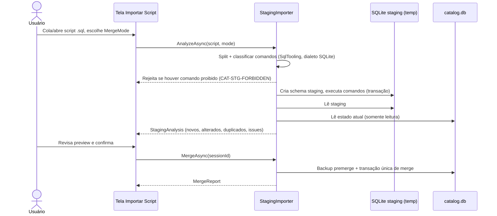

# 13 — Catálogo de Templates

| Campo | Valor |
|---|---|
| Objetivo | Especificar o funcionamento do catálogo: templates escalares e compostos, aliases, valores, presets, packs, importação por script e proteção contra alterações acidentais. |
| Escopo | Funcional e técnico. Persistência em [09](09-internal-database.md). |
| Relacionados | ADR-016, [14](14-semantic-mapping.md), [15 §7](15-generation-engine.md), [C03](contracts/C03-catalog.md) |
| Requisitos | FR-050..FR-059 |

## 1. Conceitos

| Conceito | Definição | Exemplo |
|---|---|---|
| **Template escalar** | Tipo semântico com lista de valores ponderados de um único tipo lógico | `TELEFONE` com 300 números |
| **Template composto** | Tipo semântico com campos correlacionados; cada **registro** fornece todos os campos coerentes | `ENDERECO {cep, logradouro, bairro, cidade, uf}` |
| **Alias** | Nome alternativo de coluna que aponta para um template (ou um campo de template composto) | `ZAP → TELEFONE`; `NRO_CEP → ENDERECO.cep` |
| **Preset de gerador** | Configuração nomeada de um gerador funcional, mapeável como um template | `DATA_NASC_ADULTO = core.date.relative(-80y..-18y)`; `CPF = br.cpf(formatado=false)` |
| **Pack** | Pacote distribuível de templates/aliases/valores/presets/regras | `CORE_PTBR` (embutido), `VAREJO_DEMO` (do usuário) |

**Por que presets são mapeáveis:** a proposta original separava "templates" de "geradores por função". Para o usuário, `CPF` e `TELEFONE` são ambos "tipos de campo". O catálogo unifica a experiência: aliases podem apontar para presets via `mapping_rule` (`target_kind='preset'`) — o motor de mapeamento os trata como candidatos iguais.

## 2. Templates escalares

- Tipo lógico obrigatório; valores armazenados como texto e convertidos para o tipo da coluna na geração (`ValueCoercer`, [15 §5](15-generation-engine.md)).
- Valores únicos por template (duplicados no import são contados e ignorados, `CAT-IMP-DUPVALUE` Info).
- Peso: real > 0 (padrão 1). Amostragem ponderada O(1) via tabela de alias de Vose.
- Ordem canônica: ordinal por `value` → base do determinismo (inserção em ordem diferente não altera geração).
- `ContentHash` = SHA-256 de `value\u001Fweight\u001E` concatenados em ordem canônica → registrado no projeto (`CatalogDependency`) e na execução; se mudar, o relatório indica "dados de template alterados desde a última execução" (reprodutibilidade, [15 §4.5](15-generation-engine.md)).

## 3. Aliases

- `alias` é armazenado como digitado; `normalized_alias` = `INameNormalizer.Normalize(alias).Compact` ([14 §2](14-semantic-mapping.md)).
- Um alias pode existir em mais de um template (ex.: `DOC` → `CPF` e `CNPJ`) → gera ambiguidade tratada no mapeamento.
- `weight` ∈ (0, 2]: >1 reforça, <1 enfraquece (ex.: `ENDERECO` como alias de `logradouro` com 0,8 porque também é nome de tabela).
- `context_table_pattern`: o alias só pontua bônus total se a tabela casar o padrão (ex.: alias `NUMERO` → `ENDERECO.numero` com contexto `*ENDERECO*|*CLIENTE*`). Padrões separados por `|`, glob `*`/`?` sobre nome normalizado da tabela.

## 4. Valores ponderados e listas

Exemplo de distribuição realista: `STATUS_PEDIDO` = `ABERTO:3, PAGO:5, ENVIADO:4, CANCELADO:1`. O peso é relativo (normalizado na carga).

## 5. Templates compostos — coerência

### 5.1 Modelo
- Campos com tipo lógico e `max_length` opcional.
- Registro = objeto JSON com todos os campos `required`.
- Exemplo de pacotes compostos sugeridos: `ENDERECO`, `CIDADE_UF {cidade, uf, ibge, ddd}`, `PESSOA {nome, sobrenome, sexo, data_nasc}`, `PRODUTO {descricao, categoria, unidade, preco_ref}`, `EMPRESA {razao_social, fantasia, ramo}`, `VEICULO {marca, modelo, ano}`.

### 5.2 Slots
Na geração, colunas da **mesma linha** vinculadas a campos do **mesmo template composto e mesmo slot** usam o **mesmo registro**. Slot padrão = código do template. Exemplo:

| Coluna | Binding | Slot |
|---|---|---|
| `cep_res` | `catalog.template.field(ENDERECO.cep)` | `residencial` |
| `cidade_res` | `catalog.template.field(ENDERECO.cidade)` | `residencial` |
| `cep_com` | `catalog.template.field(ENDERECO.cep)` | `comercial` |
| `cidade_com` | `catalog.template.field(ENDERECO.cidade)` | `comercial` |

O mapeamento automático atribui slots por **sufixo/prefixo comum** das colunas (`_res`, `_com`, `ent_`, `cob_`): colunas que casam campos do mesmo template e compartilham um token adicional idêntico recebem slot = esse token; demais → slot padrão ([14 §7](14-semantic-mapping.md)).

### 5.3 Coerência entre tabelas (V2)
Ex.: `pedido.cep_entrega` coerente com `cliente.cep` do cliente referenciado. V1: suportado via MDS-Expr `parent('fk_pedido_cliente', 'nro_cep')` (valor de coluna do pai — recomputável pelo KeyOracle quando o pai foi gerado nesta execução; [15 §9](15-generation-engine.md)). V2: "herança de slot" declarativa.

## 6. Interface de manutenção (resumo; telas em [21](21-user-interface-ux.md))

- Listagem com busca por código/nome/tag/alias, contagem de valores, origem (pack).
- Editor de template: dados gerais, campos (composto), aliases (com preview de normalização), valores em grade virtualizada (edição inline, colar várias linhas da área de transferência — uma por linha; TSV para compostos), pesos.
- Itens embutidos: somente leitura em código/tipo; o usuário pode **clonar** (`CloneAsync`) para personalizar, ou **acrescentar** aliases/valores.

## 7. Importação por script SQL (ADR-016)

### 7.1 Fluxo

### 7.2 Validações (antes do merge)

| Código | Severidade | Regra |
|---|---|---|
| CAT-STG-FORBIDDEN | Error | Comando diferente de INSERT/UPDATE/DELETE em tabela de staging, ou referência a tabela inexistente |
| CAT-STG-SQLERROR | Error | Erro de execução no staging (mensagem SQLite + índice do comando + linha) |
| CAT-IMP-CODE | Error | Código de template inválido (padrão `^[A-Z][A-Z0-9_]{1,63}$`) — sugestão: forma normalizada |
| CAT-IMP-KIND | Error | `kind` inválido, ou escalar sem `logical_type` válido |
| CAT-IMP-UNKNOWN-TEMPLATE | Error | `template_code` de alias/valor/registro não existe no staging nem no catálogo |
| CAT-IMP-FIELD | Error | `field_code` inexistente no template composto; ou alias com `field_code` em template escalar |
| CAT-IMP-RECORD-JSON | Error | `data` não é objeto JSON; campo obrigatório ausente; chave desconhecida |
| CAT-IMP-VALUE-TYPE | Warning | Valor não conversível para o `logical_type` (ex.: `'abc'` em template integer) |
| CAT-IMP-LENGTH | Warning | Valor maior que `max_length` do campo |
| CAT-IMP-DUPVALUE | Info | Valor duplicado (no script ou já existente) — ignorado |
| CAT-IMP-BUILTIN | Error | Tentativa de alterar `kind/logical_type` de template embutido (Upsert) |
| CAT-IMP-WEIGHT | Error | Peso ≤ 0 |
| CAT-IMP-RULE | Error | `mapping_rule` com `target_kind` inválido ou `target_ref` não resolvível |
| CAT-IMP-SIZE | Error | Script > 200 MB ou > 2 milhões de linhas de staging (limite configurável) |

### 7.3 Modos de merge

| Modo | Templates existentes | Valores/registros existentes |
|---|---|---|
| `InsertOnly` (padrão) | Mantidos; dados gerais do script ignorados (Info) | Novos acrescentados; existentes mantidos |
| `Upsert` | Nome/descrição/tags atualizados (não `kind`/`logical_type`) | Novos acrescentados; peso de existentes atualizado |
| `ReplaceTemplateData` | Como Upsert | **Todos os valores/registros** dos templates presentes no script são substituídos (exige confirmação adicional; não permitido para embutidos) |

O merge recalcula `content_hash` dos templates afetados e registra `source='import'` em aliases.

### 7.4 Prompt sugerido para IA externa (incluído na UI, botão "Copiar instruções para IA")

O app fornece um texto com o schema de staging (§4 de [09](09-internal-database.md)) e regras (códigos em maiúsculas, `data` JSON, sem DDL), para o usuário colar numa IA de sua escolha. Nenhuma chamada a IA é feita pelo app.

## 8. Packs (exportação/importação JSON)

- Formato [template-pack-1.0](contracts/schemas/template-pack-1.0.schema.json); exportação de seleção de templates com seus campos, aliases, valores/registros, presets e regras associadas.
- Importação de pack reutiliza o mesmo staging (o JSON é convertido em INSERTs de staging), garantindo as mesmas validações.
- Convenção de nomes: **formatos JSON** (pack, projeto, digest) usam *camelCase* em chaves e valores enumerados (`templateField`, `logicalType`); **SQL** (catálogo e staging) usa *snake_case* (`template_field`, `logical_type`). A conversão pack → staging é mecânica e coberta por T-CAT-008. Exemplo: [examples/pack-exemplo.mdspack.json](examples/pack-exemplo.mdspack.json).
- Metadados obrigatórios do pack: `code`, `name`, `version`, `license` (texto livre; o app exibe a licença ao importar).

## 9. Prevenção de alterações acidentais

| Mecanismo | Descrição |
|---|---|
| Staging isolado | Script nunca toca o catálogo diretamente |
| Preview obrigatório | Merge só após visualizar análise |
| Backup `premerge` | Restaurável pela tela de manutenção |
| Embutidos protegidos | Triggers + repositório |
| Exclusão de template | Confirmação mostrando nº de valores, aliases e **projetos recentes** que o referenciam (varredura de `recent_project` → `CatalogDependency`) |
| Desfazer | Última operação de merge pode ser desfeita restaurando o backup `premerge` correspondente (com aviso de que alterações posteriores serão perdidas) |
