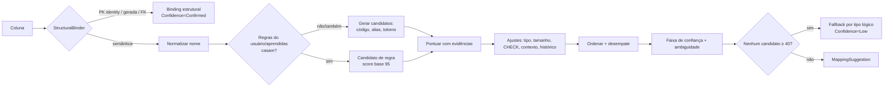

# 14 — Mapeamento Automático e Semântico

| Campo | Valor |
|---|---|
| Objetivo | Especificar o algoritmo determinístico que sugere geradores/templates para cada coluna, com pontuação explicável, desempate e faixas de confiança. |
| Escopo | `MockDataStudio.Mapping` — `INameNormalizer`, `IStructuralBinder`, `IMappingEngine`. Sem IA. |
| Relacionados | [13](13-template-catalog.md), [C04](contracts/C04-mapping.md), [08 §5](08-domain-model.md) |
| Requisitos | FR-060..FR-066 |

## 1. Pipeline

## 2. Normalização de nomes (`INameNormalizer`) — algoritmo exato

Entrada: identificador da coluna (ex. `dsEmailCliente`, `NRO_CEP_ENTREGA`, `"Telefone Celular"`).

1. **Unicode**: NFD → remover marcas diacríticas (categoria `Mn`) → NFC. `ç→c`, `ã→a`.
2. **Separação camelCase/PascalCase**: inserir `_` entre minúscula→maiúscula (`dsEmail`→`ds_Email`) e entre sequência de maiúsculas seguida de maiúscula+minúscula (`CPFCliente`→`CPF_Cliente`); entre letra↔dígito (`end2`→`end_2`).
3. **Maiúsculas invariantes**.
4. **Tokenização**: separadores = qualquer caractere fora de `[A-Z0-9]`. Tokens vazios descartados.
5. **Expansão de abreviações** (dicionário `AbbreviationMap`, editável no V1.1, embutido no V1): `NR, NRO, NUM, NUMERO → NUM`; `TEL, FONE, TELEF → TEL`; `END, ENDER → ENDERECO`; `DT, DAT → DATA`; `DS, DESC, DESCR → DESCRICAO`; `VL, VLR → VALOR`; `QT, QTD, QTDE → QUANTIDADE`; `COD, CD → CODIGO`; `NASC → NASCIMENTO`; `CEL → CELULAR`; `LOGR → LOGRADOURO`; `COMPL → COMPLEMENTO`; `MUN → MUNICIPIO`; `RAZ → RAZAO`; `FANT → FANTASIA`; `EMAIL, E_MAIL(→ tokens E,MAIL fundidos) → EMAIL`. A expansão produz `Tokens` canônicos.
6. **Tokens de ruído** (removidos para `CoreTokens`, mas mantidos em `Tokens`): prefixos húngaros/de tipo `DS, NM, VL, DT, FL, ID_ (só quando há outros tokens), TX, ST, IN, CD, NR, NUM, CODIGO (quando não é o único)`; sufixos `ID` (quando não é o único token), `FK`, `PK`; nome da própria tabela e seu singular (`CLIENTE` em `cliente.cliente_nome`); tokens numéricos isolados (`2` em `telefone_2`, registrado como `Ordinal` para slots).
7. **Formas compactas**: `Compact` = concatenação dos tokens do passo 4 (forma literal, usada para casar aliases exatamente como o usuário os escreveu); `ExpandedCompact` = concatenação dos tokens após o passo 5 (usada para casar aliases normalizados).

| Entrada | Tokens (passo 4) | Compact | Tokens expandidos | CoreTokens |
|---|---|---|---|---|
| `ZAP` | ZAP | `ZAP` | ZAP | ZAP |
| `nro_cep` | NRO, CEP | `NROCEP` | NUM, CEP | CEP |
| `dsEmailCliente` (tabela `cliente`) | DS, EMAIL, CLIENTE | `DSEMAILCLIENTE` | DESCRICAO, EMAIL, CLIENTE | EMAIL |
| `DT_NASC` | DT, NASC | `DTNASC` | DATA, NASCIMENTO | NASCIMENTO (`DATA` é ruído quando há outro token; tipo lógico Date reforça) |
| `Telefone Celular 2` | TELEFONE, CELULAR, 2 | `TELEFONECELULAR2` | TELEFONE, CELULAR, 2 | TELEFONE, CELULAR |

Aliases do catálogo são normalizados pelo mesmo algoritmo (sem contexto de tabela): `normalized_alias = Compact`; o índice em memória também guarda `ExpandedCompact` e `CoreTokens` de cada alias.

> Correspondência com o contrato C04: `NormalizedName.Tokens` = tokens expandidos (passo 5); `CoreTokens` = passo 6; `Compact` e `ExpandedCompact` conforme passo 7.

## 3. Binding estrutural (precede o semântico)

| Condição | Binding | Confiança |
|---|---|---|
| Coluna gerada (`gs`/`gv`) | `core.skip` | Confirmed |
| Identity/auto (`ai`,`idd`,`ida`,`ser`,`tsq`) e é PK de coluna única | `rel.key` (estratégia do perfil: Explicit) | Confirmed |
| Participa de FK | `rel.fk` (por FK; colunas de FK composta compartilham o binding da FK) | Confirmed |
| PK não-identity inteira de coluna única, sem FK | `rel.key` (Explicit sequencial) | Confirmed |
| PK `uuid` | `core.uuid` (v4 determinístico) | Confirmed |
| PK composta sem FK nas colunas | Semântico por coluna + unicidade de combinação (15 §8) | — |
| Default de função de tempo (`now()`, `CURRENT_TIMESTAMP`) e coluna NOT NULL | Sugestão `core.date.relative(-30d..0)`; alternativa `core.default` | High |
| Tipo Boolean | `core.bool(p=0.5)` se nenhum candidato semântico ≥ 60 | Medium |

Binding estrutural de PK/FK/gerada **não** é sobrescrito pela pontuação; o usuário pode alterá-lo manualmente (ex.: FK com `Fixed`).

## 4. Geração de candidatos

Para a coluna normalizada `n`, candidatos são coletados de:
1. **Regras** (`mapping_rule` habilitadas + regras de projeto) cujo `column_pattern` (glob) casa `n.Compact` ou `n.ExpandedCompact`, e `table_pattern` (se houver) casa a tabela, e `engine` (se houver) casa.
2. **Código de template/preset** igual a `n.Compact` ou `n.ExpandedCompact` ou a um `CoreToken` único.
3. **Aliases** com `normalized_alias ∈ {Compact, ExpandedCompact}`.
4. **Aliases por CoreTokens**: aliases cujo `ExpandedCompact` é igual a algum CoreToken, ou cujos CoreTokens ⊆ CoreTokens da coluna.
5. **Sobreposição de tokens** (Jaccard ≥ 0,5 entre CoreTokens da coluna e do alias).

## 5. Pontuação (0–100)

Score = `min(100, base + Σ ajustes)`, onde `base` é o **maior** dos componentes de casamento aplicáveis (não somados entre si):

| Evidência (base) | Pontos |
|---|---|
| `RuleMatch` (regra do usuário) | 95 + (priority−100)/20 (limitado a [90,99]) |
| `RuleMatch` (aprendida) | 92 |
| `ExactTemplateCode` | 90 |
| `ExactAlias` (Compact == alias) | 88 × weight do alias (máx. 95) |
| `NormalizedAlias` (ExpandedCompact == alias expandido) | 82 × weight |
| `CoreTokenAlias` (alias == um CoreToken) | 70 × weight |
| `TokenOverlap` | 40 + 30 × Jaccard |

Ajustes (somados):

| Evidência | Pontos | Regra |
|---|---|---|
| `TypeCompatible` | +5 | Tipo lógico do template/campo/preset compatível com a coluna (matriz §6) |
| `TypeIncompatible` | −40 | Incompatível e sem coerção possível |
| `TypeCoercible` (via `TypeCompatible` com nota) | −5 | Compatível só por coerção (ex.: CEP string → coluna integer) |
| `LengthFits` | +3 | `MaxValueLength` do template ≤ comprimento da coluna |
| `LengthTooSmall` | −25 | Coluna menor que o **percentil 95** do comprimento dos valores (truncaria) |
| `TableContext` | +8 | Alias com `context_table_pattern` que casa a tabela; ou tabela é nome/alias de template composto e o candidato é campo dele (ex.: tabela `ENDERECO`, coluna `NUMERO`) |
| `TableContextMismatch` | −15 | Alias com contexto definido que **não** casa |
| `CheckConstraintHint` | +5 / −30 | CHECK interpretável compatível (ex.: `IN` com valores presentes no template) / incompatível |
| `HistoryMatch` | +min(10, 2 × (accepted − 2×rejected)) | `mapping_feedback` para o mesmo `Compact` e alvo |
| `UniqueCapacity` | −20 | Coluna UNIQUE e template com `ValueCount` < linhas pedidas no perfil ativo (só se perfil conhecido) |

## 6. Compatibilidade de tipos

| Template → Coluna | Boolean | Integer | Decimal | Float | String | Text | Date | DateTime | Uuid | Json |
|---|---|---|---|---|---|---|---|---|---|---|
| boolean | ✔ | ~ (0/1) | ✘ | ✘ | ~ | ~ | ✘ | ✘ | ✘ | ✘ |
| integer | ~ | ✔ | ✔ | ✔ | ~ | ~ | ✘ | ✘ | ✘ | ✘ |
| decimal | ✘ | ~ (arredonda) | ✔ | ✔ | ~ | ~ | ✘ | ✘ | ✘ | ✘ |
| string | ~ (se valores ∈ {S,N,0,1,true,false}) | ~ (se todos os valores numéricos após remover não-dígitos) | ~ | ~ | ✔ | ✔ | ~ (se ISO) | ~ | ~ (se GUID) | ~ |
| date | ✘ | ✘ | ✘ | ✘ | ~ | ~ | ✔ | ✔ | ✘ | ✘ |

✔ compatível (+5) · ~ coercível (−5; verificação real dos valores feita na validação) · ✘ incompatível (−40).
DateTimeTz/Time/Interval seguem as linhas date/datetime por analogia; Enum aceita string se valores ⊆ enum (senão ✘).

## 7. Ordenação, desempate e confiança

**Ordenação**: score desc → origem (`Rule` > `Template code` > `Alias` > `Token`) → menor `ValueCount` ausente? não: **maior** `ValueCount` (mais diversidade) → código do alvo (ordinal). Totalmente determinístico.

**Faixas de confiança** (heurísticas, **não probabilidades** — não usar linguagem como "95% de certeza" na UI):

| Faixa | Condição |
|---|---|
| Confirmed | Estrutural, ou `Origin=User`, ou regra de usuário |
| High | score ≥ 80 **e** margem para o 2º ≥ 10 |
| Medium | score ≥ 60 e (score < 80 ou margem < 10) |
| Low | 40 ≤ score < 60, ou fallback por tipo |
| None | Sem candidatos ≥ 40 e sem fallback (tipo Other/Binary) |

**Ambíguo** = 2 ou mais candidatos com score ≥ 60 e diferença < 10 → UI destaca e exige escolha para aplicar.

**AutoBind** aplica somente `High` não ambíguo (e `Confirmed`). `Medium` é pré-selecionado na UI mas não aplicado até confirmação (opção "Aceitar todas as Médias" em lote).

**Fallback por tipo lógico** (Low): Integer→`core.random.int` (faixa pelo tipo/precision, limitada a 1..100000), Decimal→`core.random.decimal` (pela precisão/escala, 0..10^(p−s)−1 limitado a 0..100000), String→`core.format("{lorem(1..3)}")` limitado ao length, Text→`core.lorem.paragraph`, Date→`core.date.range(-5y..0)`, DateTime→idem, Boolean→`core.bool`, Uuid→`core.uuid`, Json→`core.fixed("{}")`, Enum→`core.list.random(valores do enum)`, Binary→`core.random.bytes(16)` (Low), Other→ None.

**Slots** (compostos): após escolher candidatos `TemplateField` do mesmo template na mesma tabela, agrupa por tokens residuais (tokens da coluna menos tokens do alias). Grupos com token residual idêntico não-vazio → slot = token (ex.: `RES`, `COM`, `ENTREGA`); colunas sem resíduo → slot padrão. Exemplo: `cep_entrega` e `cidade_entrega` → slot `ENTREGA`.

## 8. Persistência e aprendizado

- Confirmação manual na UI → `ColumnBinding(Origin=User)` no projeto + `mapping_feedback.accepted_count++` para (Compact, alvo).
- Rejeição explícita de sugestão (usuário troca o alvo sugerido) → `rejected_count++` para o alvo rejeitado.
- Opção "Lembrar para outros projetos" ao confirmar → cria `mapping_rule(source='learned', column_pattern=Compact)`; com Shift → abre editor de regra para generalizar padrão (ex.: `*CEP*`).
- Regras aprendidas nunca são criadas automaticamente sem ação do usuário.

## 9. Diagnóstico de mapeamentos (FR-065)

Painel "Diagnóstico" por projeto lista:
| Código | Condição |
|---|---|
| MAP-UNMAPPED | Coluna NOT NULL sem binding e sem default |
| MAP-AMBIGUOUS | Sugestão ambígua não resolvida |
| MAP-LOWCONF | Binding aplicado com confiança Low (fallback) |
| MAP-TYPE | Binding incompatível com o tipo (após mudança de schema) |
| MAP-ORPHAN | Binding órfão |
| MAP-REVIEW | Binding `NeedsReview` |

## 10. Desempenho

`MappingKnowledge` construído uma vez por sessão (invalidado após merge no catálogo). Índices: dicionário por `Compact`, por `ExpandedCompact`, por CoreToken. Meta: 10.000 colunas sugeridas em < 2 s (NFR-PERF-006).

## 11. Testes

Corpus `tests/fixtures/mapping-corpus/*.csv` (≥ 1.500 nomes de colunas reais anonimizados de schemas típicos pt-BR/en, com alvo esperado e confiança mínima). Métricas verificadas em T-MAP-CORPUS: cobertura High ≥ 70%, precisão High ≥ 95%, nenhum alvo `TypeIncompatible` com confiança ≥ Medium.

> **Revisão de meta (DA-044, 2026-10-12):** a cobertura High de 70% vale para nomes **sem prefixo de tipo** (`DS_`, `TX_`, `NM_`, `VL_`, §2 passo 6). Nomes com prefixo de tipo são medidos e reportados, mas não entram na meta: a pontuação da §5 leva um alias de vários tokens com sobreposição total a 78 (Medium). Corpus sintético atual: cobertura sem prefixo 86,2%; precisão High 100%. A meta sobre o corpus real (§11, primeiro parágrafo) segue pendente.
