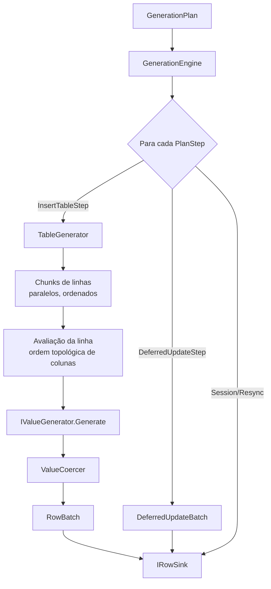

# 15 — Motor de Geração

| Campo | Valor |
|---|---|
| Objetivo | Especificar o motor de geração: avaliação por linha, determinismo, biblioteca de geradores, templates compostos, unicidade, MDS-Expr, nulos, extensão e memória. |
| Escopo | `MockDataStudio.Generation` (exceto planejamento relacional, em [16](16-relational-generation.md)). |
| Relacionados | ADR-005, ADR-013, ADR-014, [C05](contracts/C05-generation.md), [C06](contracts/C06-planning.md), [24](24-performance-scalability.md) |
| Requisitos | FR-070..FR-079, FR-091, FR-097 |

## 1. Visão geral



O motor **não conhece** SQL nem bancos: emite valores canônicos (C05 §4.1) para um `IRowSink`.

## 2. Avaliação de uma linha

1. Para a tabela, o planner calculou `EvaluationOrder`: ordenação topológica estável (desempate por ordinal da coluna) das colunas segundo `DependsOnColumns` dos geradores (expressões, slots compostos, `rel.child_seq` depende da FK). Ciclo → diagnóstico bloqueante `PLN-EXPR-CYCLE`.
2. Para cada coluna na ordem:
   1. Se `NullRate > 0`: `r = DeterministicRandom.For(StreamKey(col,"null"), row)`; se `r.NextDouble() < NullRate` → `null`, próxima coluna.
   2. `cell.Rng = DeterministicRandom.For(StreamKey(col,"value"), row)`; `v = generator.Generate(ref cell)`.
   3. `v = ValueCoercer.Coerce(v, column.Type)` (§5). Falha → `GenerationException(GEN-COERCE)` com tabela/coluna/linha.
   4. `RowContext.Set(column, v)`.
3. Colunas de `InsertColumns` são copiadas para `object?[]` na ordem de `InsertColumns`.

## 3. Algoritmo por tabela

```text
// PSEUDOCÓDIGO
for chunkStart in 0, B, 2B, ... < RowCount:         // B = OutputSettings.BatchSize (padrão 1000)
    rows = new object?[min(B, RowCount-chunkStart)][]
    if table.RequiresSequential:                    // unicidade por tentativas (15 §8.4) ou captured keys dependentes
        for i in range: rows[i] = EvaluateRow(chunkStart+i)
    else:
        Parallel.For over sub-ranges of 256 rows (MaxDOP = cores-1): rows[i] = EvaluateRow(chunkStart+i)
    captured = await sink.WriteBatchAsync(new RowBatch(table, chunkStart, InsertColumns, rows), ct)
    if captured != null: KeyRegistry.Append(table, captured)
    progress.Report(...)
    ct.ThrowIfCancellationRequested()
```

- Os batches são emitidos **em ordem crescente de índice** — o arquivo de saída é idêntico entre execuções independentemente do paralelismo (T-GEN-DET-002).
- Linhas de tabela *ParentDriven* são geradas percorrendo pais em ordem (§[16 §6](16-relational-generation.md)) com checkpoints de soma prefixada.

## 4. Determinismo

### 4.1 Especificação do RNG (congelada — `RngAlgorithm.Version = 1`)

```text
StreamKey.Derive(seed, scope, purpose) =
    XxHash64( UTF8("mds/v1|" + seed (decimal invariante) + "|" + scope + "|" + purpose), hashSeed = 0 )
StreamKey.Child(purpose) = XxHash64( UTF8(hex16(parent) + "|" + purpose), 0 )

DeterministicRandom.For(key, row):
    s = key XOR (uint64(row) * 0x9E3779B97F4A7C15 mod 2^64)
    state[0..3] = 4 saídas consecutivas de SplitMix64 iniciado em s
SplitMix64.Next(): s += 0x9E3779B97F4A7C15; z = s;
    z = (z ^ (z >> 30)) * 0xBF58476D1CE4E5B9; z = (z ^ (z >> 27)) * 0x94D049BB133111EB; return z ^ (z >> 31)
NextUInt64 (xoshiro256**): result = rotl(s1 * 5, 7) * 9; t = s1 << 17;
    s2 ^= s0; s3 ^= s1; s1 ^= s2; s0 ^= s3; s2 ^= t; s3 = rotl(s3, 45)
NextInt64(min, maxExcl): método de Lemire (multiplicação 128 bits via Math.BigMul, rejeição sem viés)
NextDouble(): (NextUInt64() >> 11) * 2^-53
NextDecimal(min, max, scale): unidades = NextInt64(0, (max-min)*10^scale + 1); min + unidades / 10^scale
```

**Vetores de teste congelados** (T-GEN-RNG-001) — `key = 0x0123456789ABCDEF`, três primeiras saídas de `NextUInt64`:

| row | 1ª | 2ª | 3ª |
|---|---|---|---|
| 0 | `0xA2C2A42038D4EC3D` | `0x05FC25D0738E7B0F` | `0x625E7BFF938E701E` |
| 1 | `0xC8BAB3CA1E5B1E1F` | `0x188BE30AA610EB7D` | `0xCF06E1E57C974F9E` |
| 1000000 | `0x07A5F5E3AC10A13A` | `0x067D67E0A09AAB25` | `0x09ABD2AAE1C56789` |

(Calculados com implementação de referência em BigInt durante a elaboração desta especificação; a implementação C# deve reproduzi-los exatamente.)

### 4.2 Escopos e propósitos

| Uso | scope | purpose |
|---|---|---|
| Valor de coluna | `ColumnRef.CanonicalId` | `value` |
| Decisão de nulo | `ColumnRef.CanonicalId` | `null` |
| Seleção de registro composto | `<TableId>` | `slot:<slot>` |
| Escolha de pai (FK) | `<TableId>` | `fk:<fkName>` |
| Cardinalidade por pai | `<ParentTableId>` | `card:<childTableId>:<fkName>` |
| Permutação de unicidade | `ColumnRef.CanonicalId` ou `<TableId>:uq:<cols>` | `perm` |
| Tentativa k de unicidade | `ColumnRef.CanonicalId` | `retry:<k>` |
| Função aleatória em expressão | `ColumnRef.CanonicalId` | `expr:<posição do nó na expressão>` |

Consequências: adicionar/remover/reordenar colunas não altera valores das demais; mudar a seed muda tudo; alterar o gerador de uma coluna altera apenas ela (e dependentes).

### 4.3 Tempo

`GenerationProfile.ReferenceInstant` ancora todo cálculo relativo ("últimos 30 dias"). Padrão: **fixado no momento da criação do perfil** e persistido (não "agora" a cada execução). Opção "usar data/hora atual a cada execução" existe, marcando a execução como `Reproducibility=TimeBound` no relatório. Fuso: valores `DateTime` são gerados no fuso configurado no perfil (`TimeZoneId`, padrão o do Windows na criação), `DateTimeTz` com offset desse fuso.

### 4.4 Versões de geradores

Cada gerador tem `CurrentVersion` e `SupportedVersions`. O `GeneratorSpec.Version` gravado no binding seleciona o comportamento. Regra: **qualquer mudança de saída para mesma entrada exige nova versão**; versões antigas permanecem implementadas enquanto suportadas. Bindings novos usam `CurrentVersion`; bindings existentes mantêm sua versão até o usuário "Atualizar geradores" (ação explícita que avisa sobre mudança de dados).

### 4.5 Garantia de reprodutibilidade (níveis)

| Nível | Condição | Garantia |
|---|---|---|
| **Exact** | Mesma seed, mesmo plano (`PlanHash`), mesmas versões de geradores e RNG, mesmos `ContentHash` de templates, sem fontes externas, `ReferenceInstant` fixo | Bytes idênticos do script (exceto cabeçalho com data de geração) |
| **SourceBound** | Usa `Existing`/`Query`/`rel.lookup` em banco | Exato **se** `KeyPool.Fingerprint` igual; relatório compara e avisa |
| **TimeBound** | `ReferenceInstant` = agora | Não reproduzível; registrado |
| **VersionBound** | Gerador marcado `VersionBound` (plugins/V2) | Exato só com a mesma versão do pacote |

`PlanHash` = SHA-256 do JSON canônico de (StructureHash, bindings ativos ordenados, perfil sem campos de saída, versões de geradores, `RngAlgorithm.Version`, ContentHash de templates usados, chaves iniciais calculadas). O relatório de execução mostra o nível e os motivos.

## 5. Coerção de valores (`ValueCoercer`)

| De → Para | Regra |
|---|---|
| string → Integer/Decimal/Float | Remove espaços; se houver caracteres não numéricos além de sinal/separador decimal `.` → remove não-dígitos (ex.: CEP `01310-100`→`1310100`); falha se vazio ou overflow |
| string → Boolean | `true/false/1/0/s/n/sim/nao/y/n` (case-insensitive) |
| string → Date/DateTime | ISO-8601 (`yyyy-MM-dd`, `yyyy-MM-dd HH:mm:ss[.fff]`); outros formatos → falha |
| string → Uuid | `Guid.TryParse` |
| long → String | Invariante; se coluna `char(n)` e o template indicar `padLeft` (parâmetro do binding) aplica zeros à esquerda |
| decimal → Integer | Arredondamento `MidpointRounding.ToEven` |
| qualquer → String com Length | **Não trunca silenciosamente**: se exceder → erro na validação/preview; opção explícita por binding `truncate: true` |
| DateTime → Date | Parte de data |
| bool → Integer | 1/0 |

## 6. Biblioteca de geradores (V1)

Todos versão 1. `Idx` = implementa `IIndexableGenerator` (unicidade bijetiva).

| ID | Categoria | Parâmetros (nome: tipo = padrão) | Saída | Idx |
|---|---|---|---|---|
| `core.fixed` | Basic | `value: string` | qualquer (coagido) | ✘ (cardinalidade 1) |
| `core.null` | Basic | — | null | ✘ |
| `core.default` | Basic | — | coluna omitida do INSERT | — |
| `core.skip` | Basic | — | coluna omitida (gerada/identity não referenciada) | — |
| `core.list.random` | Basic | `values: stringList`, `weights?: double[]` | string→coagido | ✔ (n) |
| `core.list.sequential` | Basic | `values: stringList`, `offset: int = 0` | valor `values[(row+offset) mod n]` | ✔ |
| `core.weighted` | Composite | `children: specList`, `weights: double[]` | do filho escolhido | ✘ |
| `core.switch` | Composite | `cases: [{when: expr, spec}]`, `else: spec` | do caso | ✘ |
| `core.sequence.int` | Numeric | `start: long = 1`, `step: long = 1` | `start + row*step` | ✔ |
| `core.random.int` | Numeric | `min: long`, `max: long`, `distribution: enum(uniform,normal,zipf) = uniform`, `mean?`, `stddev?`, `zipfS?` | long | ✔ (uniform) |
| `core.random.decimal` | Numeric | `min: decimal`, `max: decimal`, `scale: int = 2`, `distribution = uniform`, `mean?`, `stddev?` | decimal | ✔ (uniform) |
| `core.random.float` | Numeric | `min: double`, `max: double` | double | ✘ |
| `core.date.range` | DateTime | `start: datetime`, `end: datetime`, `granularity: enum(day,hour,minute,second,millisecond) = day`, `weekdays?: int[]` (1–7), `hours?: "08-18"` | Date/DateTime | ✔ |
| `core.date.relative` | DateTime | `from: duration` (ISO-8601, ex. `-P30D`), `to: duration = P0D`, `granularity` | idem, relativo a `ReferenceInstant` | ✔ |
| `core.date.sequence` | DateTime | `start: datetime`, `step: duration` | `start + row*step` | ✔ |
| `core.time.range` | DateTime | `start: "HH:mm:ss"`, `end` | TimeOnly | ✔ |
| `core.bool` | Basic | `probabilityTrue: double = 0.5` | bool | ✘ |
| `core.mask` | Text | `pattern: string` (`#` dígito, `A` A–Z, `a` a–z, `X` alfanumérico maiúsculo, `?` letra, `\` escape) | string | ✔ (produto) |
| `core.format` | Expression | `template: string` (MDS-Expr modo Template) | string | ✘ (✔ se usa `row_index()` sem aleatoriedade → marcado unique) |
| `core.expr` | Expression | `expression: string` | qualquer | ✘ |
| `core.random.string` | Text | `minLength: int`, `maxLength: int`, `charset: enum(alpha,alnum,numeric,hex,custom)`, `custom?` | string | ✘ |
| `core.lorem.words` | Text | `min: int = 1`, `max: int = 5` | string (vocabulário pseudo-latim embutido, 500 palavras) | ✘ |
| `core.lorem.paragraph` | Text | `sentences: int range = 2..5` | string | ✘ |
| `core.uuid` | Basic | `version: enum(v4,v7) = v4`, `format: enum(standard,compact,binary) = standard` | Guid | ✔ (v4: bits do RNG; colisão desprezível; tratado como único) |
| `core.random.bytes` | Basic | `length: int = 16` | byte[] | ✘ |
| `catalog.template` | Catalog | `template: string`, `selection: enum(weighted,uniform,sequential) = weighted`, `padLeft?: int` | valor escalar | ✔ (n valores) |
| `catalog.template.field` | Catalog | `template: string`, `field: string`, `slot: string = <template>`, `selection = weighted` | valor do campo do registro do slot | ✔ somente se valores do campo forem distintos (verificado na carga) |
| `rel.key` | Relational | (definido pelo `KeyColumnPlan`) | chave da linha | ✔ |
| `rel.fk` | Relational | (definido por `RelationSettings`) | componente da chave do pai | — (16) |
| `rel.child_seq` | Relational | `foreignKey: string`, `start: int = 1` | 1..k dentro do pai | ✔ por pai |
| `rel.lookup` | Relational | `table: string`, `column: string`, `source: enum(generated,existing)`, `selection = uniform` | valor de coluna de outra tabela (não-FK) | ✘ |
| `br.cpf` | Brazil | `formatted: bool = false`, `validOnly: bool = true` | string 11 (ou `000.000.000-00`) com DVs corretos | ✔ (10^9 bases) |
| `br.cnpj` | Brazil | `formatted: bool = false`, `branch: int = 1` | string 14 com DVs | ✔ (10^8 bases) |
| `br.phone` | Brazil | `kind: enum(mobile,landline,any) = mobile`, `ddds?: int[]`, `formatted: bool = true` | string | ✔ (produto) |
| `br.placa` | Brazil | `format: enum(mercosul,antiga) = mercosul` | string | ✔ |

Notas:
- **Durações** (`duration`): ISO-8601 com sinal opcional (`-P80Y`, `P1M15D`, `PT2H30M`). Como `TimeSpan` não representa anos/meses, o tipo `IsoDuration` (Generation) aplica componentes em ordem calendário: anos → meses → dias → tempo, via `DateTime.AddYears/AddMonths/AddDays/Add(TimeSpan)` sobre o `ReferenceInstant` no fuso do perfil. Ex.: `from=-P80Y`, `to=-P18Y` com referência 2026-10-11 ⇒ intervalo [1946-10-11, 2008-10-11].
- **CNPJ alfanumérico** (formato anunciado pela Receita Federal com vigência a partir de julho/2026 [K — verificar norma vigente]): parâmetro `alphanumeric: bool` previsto como **versão 2** de `br.cnpj` (V1.1), sem alterar a saída da versão 1.
- `core.date.*` com `granularity=day` gera `DateOnly` para colunas Date e meia-noite para DateTime.
- Distribuição `normal` usa Box-Muller com dois `NextDouble` e truncamento por rejeição dentro de [min,max] (máx. 16 rejeições; depois clamp).
- `zipf` usa tabela cumulativa pré-computada para n ≤ 10^6; acima, aproximação por rejeição (Devroye).

## 7. Templates compostos

- O engine carrega `TemplateDataSet` para todos os templates referenciados **antes** da execução (memória: valores do template, normalmente < 10 MB).
- Seleção do registro de um slot por linha: `RowContext.GetOrSelectSlotRecord(slot, data, ref rngSlot)` com `rngSlot = For(StreamKey(table,"slot:"+slot), row)`; seleção ponderada (Vose) ou uniforme; o índice é memorizado no `RowContext` para a linha → todas as colunas do slot leem o mesmo registro.
- Unicidade de um campo de composto (ex.: CEP único): se valores do campo são distintos, o slot inteiro passa a ser selecionado por permutação (§8) — os demais campos continuam coerentes.

## 8. Unicidade

### 8.1 Detecção
Uma coluna/tupla requer unicidade se: é PK, tem UNIQUE (constraint ou índice único não parcial), ou o binding tem `Unique=true`. Índices únicos **parciais** ou de **expressão**: aviso `VAL-UQ-PARTIAL` (não garantido construtivamente; o usuário pode marcar `Unique=true` na coluna base).

### 8.2 Estratégia hierárquica (escolhida pelo planner, sem tentativa aleatória ilimitada)

| Ordem | Estratégia | Condição | Memória |
|---|---|---|---|
| 1 | **Por construção** | Gerador sequencial (`core.sequence.int`, `rel.key`, `core.date.sequence`, `rel.child_seq`, `core.format` com `row_index()`), UUID | O(1) |
| 2 | **Permutação bijetiva** | `IIndexableGenerator` com `Cardinality ≥ RowCount` | O(1) |
| 3 | **Bloqueio por capacidade** | `IIndexableGenerator` com `Cardinality < RowCount` | — → `PLN-UNIQUE-CAPACITY` (Error) com sugestões: reduzir linhas, aumentar valores do template, usar outro gerador |
| 4 | **Decoração por sufixo** (opt-in, `uniqueStrategy: suffix`) | String não indexável com folga de comprimento | O(1) — valor + `-` + base36(row), validado contra Length |
| 5 | **Tentativas limitadas** | Não indexável (expr, random.string, lorem) | O(n) hashes de 64 bits; máx. 16 tentativas por linha; tabela forçada a sequencial; limite 5 M linhas por coluna (configurável) |

Falha na estratégia 5 (16 tentativas esgotadas) → `GEN-UNIQUE-EXHAUSTED` com tabela/coluna/linha e a recomendação de alterar o gerador. **Nunca** há laço sem limite.

### 8.3 Permutação bijetiva (Feistel com *cycle-walking*)

```text
// PSEUDOCÓDIGO — permutação determinística de [0, N)
bits = max(2, ceil(log2(N))); if bits odd: bits += 1; half = bits/2; mask = (1<<half)-1
F(round, x) = SplitMix64Hash(permKey XOR (round << 56) XOR x) AND mask       // 4 rodadas
Encrypt(x): L = x >> half; R = x AND mask
            for r in 0..3: (L, R) = (R, L XOR F(r, R))
            return (L << half) OR R
Perm(i): y = Encrypt(i); while y >= N: y = Encrypt(y); return y              // cycle-walking; domínio ≤ 4N
```
Propriedades: bijeção em [0,N); O(1) memória; ~4 iterações esperadas no pior caso. Testada exaustivamente para N ≤ 2^16 (T-GEN-UQ-001) e por amostragem para N grandes.

### 8.4 Unicidade composta (UNIQUE de várias colunas)
- Todos os componentes indexáveis → domínio produto `P = Π nᵢ` (overflow > 2^62 tratado como "suficiente"); `p = Perm(i)` sobre `[0,P)`, decomposição em base mista → `ValueAt` de cada componente. Distribuições individuais (pesos) são substituídas por uniformes nesse caso (Info `GEN-UQ-UNIFORM`).
- Componente FK + componente sequencial por pai (padrão `item_pedido(pedido_id, item_seq)`) → `rel.child_seq` (por construção).
- Componente FK + componente indexável → para cada pai, os filhos recebem `ValueAt(Perm_pai(j))` com `j` = ordem do filho dentro do pai (requer *ParentDriven* ou ordenação por pai; o planner força ParentDriven e informa).
- Demais casos → estratégia 5 sobre o hash da tupla.

### 8.5 Valores já existentes no destino
Para colunas únicas não-chave com `TargetState` informando linhas existentes > 0: diagnóstico `PLN-UNIQUE-EXISTING` (Warning) com opções: (a) carregar valores existentes como exclusão (força estratégia 5; limite 5 M), (b) aceitar risco, (c) usar sufixo. Chaves inteiras Explicit nunca colidem (faixa acima de MAX).

## 9. MDS-Expr

### 9.1 Gramática (EBNF)

```ebnf
template     = { text | "{" expression "}" } ;          (* modo Template; "{{" e "}}" escapam chaves *)
expression   = or_expr ;
or_expr      = and_expr { "or" and_expr } ;
and_expr     = not_expr { "and" not_expr } ;
not_expr     = [ "not" ] comparison ;
comparison   = additive [ ( "=" | "!=" | "<" | "<=" | ">" | ">=" ) additive ] ;
additive     = multiplicative { ( "+" | "-" | "||" ) multiplicative } ;
multiplicative = unary { ( "*" | "/" | "%" ) unary } ;
unary        = [ "-" ] primary ;
primary      = number | string | "true" | "false" | "null" | column_ref | function_call | "(" expression ")" ;
column_ref   = "@" identifier | "@" quoted_identifier ;      (* coluna da linha atual *)
function_call= identifier "(" [ expression { "," expression } ] ")" ;
identifier   = letter { letter | digit | "_" } ;
quoted_identifier = '"' { char | '""' } '"' ;
string       = "'" { char | "''" } "'" ;
number       = digit { digit } [ "." digit { digit } ] ;
```

Semântica: tipagem dinâmica com regras explícitas (`+` numérico se ambos numéricos, senão erro; `||` concatena strings convertendo com invariante; comparação de tipos diferentes = erro de avaliação `GEN-EXPR-TYPE`). `null` propaga em operações aritméticas e concatenação (`'a' || null` = `null`; usar `coalesce`).

### 9.2 Funções embutidas (v1)

| Função | Descrição |
|---|---|
| `lower(s)`, `upper(s)`, `trim(s)`, `slug(s)` | Texto; `slug` remove acentos, troca não-alfanuméricos por `.` e minúsculas |
| `substr(s, start, len)`, `left(s,n)`, `right(s,n)`, `pad_left(s,n,c)`, `replace(s,a,b)`, `length(s)` | Texto (índices base 1) |
| `concat(a, b, ...)` | Concatena ignorando null |
| `coalesce(a, b, ...)`, `if(cond, a, b)` | Controle |
| `row_index()` | Índice da linha (0-based) |
| `pick(a, b, ...)` | Escolha uniforme determinística |
| `rand_int(min, max)`, `rand_decimal(min, max, scale)` | Aleatórios determinísticos |
| `date_add(d, 'P1D')`, `date_diff_days(a,b)`, `format_date(d, 'yyyy-MM-dd')`, `year(d)`, `month(d)`, `day(d)` | Datas |
| `ref_now()` | `ReferenceInstant` |
| `template(code)` | Valor ponderado de template escalar |
| `field(code, field[, slot])` | Campo do registro do slot |
| `parent(fkName, column)` | Valor de coluna do pai escolhido para a FK (pai gerado nesta execução → recomputado; pai existente → requer coluna no `KeyPool`, senão erro de plano `PLN-EXPR-PARENT`) |
| `cpf(formatted)`, `cnpj(formatted)` | Atalhos |

Exemplo — e-mail derivado: `core.format` com template `{slug(@nome)}.{row_index()}@{template('EMAIL_DOMINIO')}`.

### 9.3 Limites de segurança
Expressão ≤ 4 KB; profundidade de AST ≤ 64; nenhuma função de IO/reflexão/tempo real (somente `ref_now`). Avaliação compilada uma vez para AST e reutilizada.

## 10. Nulos controlados

- `NullRate` ∈ [0,1] por binding; coluna NOT NULL com `NullRate > 0` → erro de validação `VAL-NULL-NOTNULL`.
- FK opcional: `RelationSettings.NullRate`.
- Unicidade com nulos: múltiplos nulos permitidos exceto `nnd` (PG `NULLS NOT DISTINCT`) e SQL Server-like (não aplicável aos 4 SGBDs); Firebird permite múltiplos NULL em UNIQUE [K].

## 11. Extensão

Novos geradores: implementar `IGeneratorFactory` + `IValueGenerator` (+ `IIndexableGenerator` quando aplicável), registrar via `IMdsModule`. Requisitos obrigatórios para aceitação de um novo gerador:
1. Pureza: saída função de (`cell.Rng`, `RowIndex`, `Row`) — teste de determinismo com 2 execuções paralelas (T-GEN-DET-001 parametrizado).
2. Descriptor completo (parâmetros com tipos, defaults, faixas).
3. Validação de parâmetros com códigos `GEN-PARAM-*`.
4. Vetores de saída congelados para a versão (snapshot Verify).

## 12. Memória

| Estrutura | Custo |
|---|---|
| Linhas em voo | `Channel` com no máx. 8 batches × BatchSize linhas |
| Templates carregados | Proporcional aos valores (`TemplateDataSet`) |
| KeyOracle Explicit/UUID | O(1) por tabela |
| KeyRegistry (Captured) | 8 bytes/linha para chaves inteiras; acima de 10 M chaves → arquivo temporário mapeado em memória |
| Pools Existing | ≤ `ExistingLimit` tuplas por FK (padrão 100 k) |
| Unicidade por tentativas | ~32 bytes/linha (HashSet<ulong>) — limite 5 M linhas/coluna |
| Checkpoints ParentDriven | 8 bytes por 4.096 pais |

Meta NFR-PERF-002: memória de trabalho ≤ 500 MB para geração de 10 M linhas em 20 tabelas sem estratégia 5.
