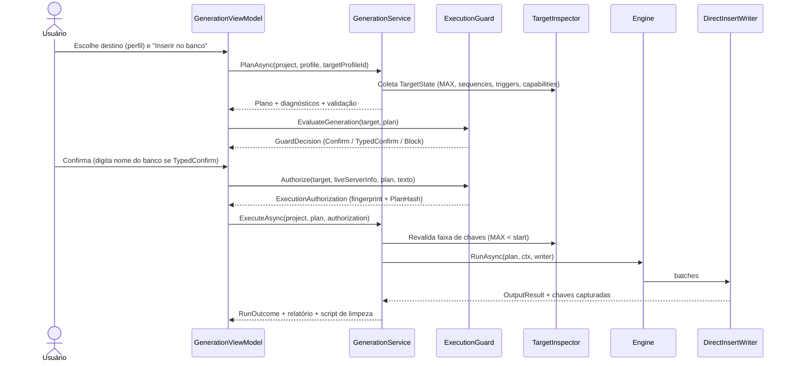

# 19 — Inserção Direta no Banco

| Campo | Valor |
|---|---|
| Objetivo | Especificar a inserção direta dos dados gerados no banco de destino: autorização, conexão, métodos de bulk, transações, captura de chaves, falhas, cancelamento e relatório. |
| Escopo | `DirectInsertWriter` (Output), `IBulkInserter` (providers), `IExecutionGuard` (Application). |
| Relacionados | ADR-008, [10](10-database-providers.md), [16](16-relational-generation.md), [23 §5](23-security.md), [C08](contracts/C08-output.md) |
| Requisitos | FR-095, FR-096, FR-098, FR-099, FR-007 |

## 1. Fluxo

## 2. Autorização (regras obrigatórias)

1. `ExecuteAsync` com `OutputKind.DirectInsert` **sem** `ExecutionAuthorization` válida → `SEC-NO-AUTHORIZATION` (falha imediata, teste T-SEC-001).
2. Autorização válida somente se: `TargetFingerprintHash` == fingerprint obtido na conexão aberta para escrita **e** `PlanHash` == plano a executar **e** emitida há ≤ 10 minutos.
3. Níveis de confirmação ([23 §5](23-security.md)): Development → Confirm; Test/Staging → Confirm com resumo; Production/Unknown → bloqueado se `IsReadOnly`; senão TypedConfirm (digitar o nome exato do banco).
4. O diálogo de confirmação mostra: perfil, engine/versão, host/database, ambiente (cor), tabelas e linhas, estratégia de transação, se haverá DisableChecks, faixas de chave.

## 3. Conexão de escrita

- Conexão **dedicada** (`ConnectionPurpose.WriteTarget`), nunca compartilhada com o editor SQL.
- `ServerInfo` relido e comparado ao fingerprint autorizado.
- Preâmbulo de sessão por dialeto (charset; MySQL `sql_mode` não é alterado — apenas lido).

## 4. Métodos de inserção por provider

| Provider | Método padrão | Fallback | Parâmetros |
|---|---|---|---|
| SQLite | `PreparedStatement`: um `SqliteCommand` preparado reutilizado, parâmetros rebinds por linha, dentro de transação `BEGIN IMMEDIATE` | — | — |
| MySQL | `MultiRowInsert` parametrizado: `INSERT ... VALUES (@p0,..),(..)` com até `min(1000 linhas, 65535/nCols)` | Linha a linha (Captured) | `AllowUserVariables=false` |
| PostgreSQL | `Copy` (`COPY ... FROM STDIN (FORMAT BINARY)`) | `MultiRowInsert` parametrizado se COPY negado (permissão) ou tabela com `OVERRIDING SYSTEM VALUE` necessário (COPY ignora identity ALWAYS? [K — COPY insere valores explícitos em identity ALWAYS sem override? verificar T-PRV-PG-COPY-001; se não, usar INSERT]) | `NpgsqlDbType` derivado do tipo |
| Firebird | `PreparedStatement` por linha | Batch API (FB4+, PV-002) quando disponível e verificado | Parâmetros tipados (`FbDbType`) |

Captured (`KeyStrategy.Captured`): força linha a linha com `RETURNING` (SQLite, PG, FB) ou `LAST_INSERT_ID()` (MySQL, INSERT de uma linha) e devolve as chaves ao engine (`WriteBatchAsync` → `KeyRegistry`).

## 5. Transações

| Modo | Comportamento | Uso |
|---|---|---|
| `PerBatch` (padrão) | Commit a cada `BatchSize` linhas (padrão 1.000; FB 5.000; PG COPY 50.000). Componentes de ciclo com `DeferredConstraint` → uma transação para o componente inteiro | Volumes grandes |
| `Single` | Uma transação para toda a execução | ≤ 1 M linhas (aviso acima); "tudo ou nada" |

`DisableChecks` (MySQL/SQLite): reativação garantida em `finally` (inclusive em cancelamento/erro); SQLite: `PRAGMA foreign_keys` só altera fora de transação → aplicado antes do `BEGIN`.

## 6. Falhas

| Falha | Ação |
|---|---|
| Erro de constraint em batch | Rollback do batch; execução para; relatório traz tabela, índice da 1ª linha do batch, categoria (`IErrorTranslator`) e mensagem do SGBD; oferece "Diagnosticar batch" — reexecuta o batch linha a linha em transação revertida para localizar a linha exata (somente fora de Production) |
| Conexão perdida | Status `Failed`; batches confirmados permanecem; relatório indica último batch confirmado por tabela |
| Deadlock/lock timeout | Uma nova tentativa do **mesmo batch** (idempotente porque o batch foi revertido); falhando de novo → `Failed` |
| Disco cheio no log/manifesto | Execução continua; aviso (o banco é a saída principal) |

Nenhuma retentativa de batch confirmado. Nenhuma retentativa em erros de constraint.

## 7. Cancelamento e limpeza

- Cancelar → conclui/reverte o batch corrente → `Cancelled`.
- Para `Failed`/`Cancelled` em `PerBatch`: o relatório oferece **"Remover dados inseridos por esta execução"** → executa o script de limpeza ([18 §7](18-sql-generation.md)) restrito às faixas efetivamente confirmadas (registradas por batch), com nova autorização (mesmas regras do §2).
- O script de limpeza também é gravado em disco junto ao relatório.

## 8. Relatório de execução (`RunOutcome` + UI)

Inclui: status, duração, linhas/s, por tabela (linhas, faixas/chaves, método de inserção), reprodutibilidade (nível + motivos), versões de geradores, hashes de templates, fingerprints, avisos, erro (se houver), caminho do script de limpeza. Persistido em `generation_run.report` e resumido no projeto (`RunSummary`).

## 9. Desempenho esperado (metas, verificadas por benchmark B-DIR-*)

| Destino (local, SSD) | Meta |
|---|---|
| PostgreSQL COPY | ≥ 100 k linhas/s (10 colunas mistas) |
| MySQL multi-row | ≥ 30 k linhas/s |
| SQLite prepared | ≥ 80 k linhas/s |
| Firebird prepared | ≥ 8 k linhas/s |

Metas são de projeto, não medidas; ajustáveis após B-DIR-* com registro em [32](32-decisions-and-assumptions.md).
