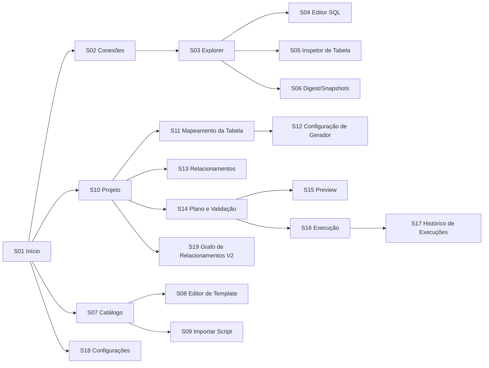

# 21 — Interface do Usuário e UX

| Campo | Valor |
|---|---|
| Objetivo | Definir design system WPF, navegação e especificação de todas as telas principais. |
| Escopo | `MockDataStudio.App`. Wireframes textuais. |
| Relacionados | ADR-001, [20](20-sql-editor.md), [13](13-template-catalog.md), [14](14-semantic-mapping.md), [16](16-relational-generation.md), [19](19-direct-database-execution.md) |
| Requisitos | FR-010..FR-015, FR-020..FR-031, FR-050..FR-066, FR-090..FR-099, FR-110..FR-122 |

## 1. Princípios de UX

1. **Densidade equilibrada**: linhas de grade 24 px, fonte 13 px (Segoe UI Variable/Segoe UI), editor 13 px Cascadia Mono (fallback Consolas).
2. **Ambiente sempre visível**: toda superfície que executa algo contra um banco mostra o *chip de ambiente* (cor + rótulo + nome do perfil).
3. **Nada bloqueia a UI**: operações > 100 ms são assíncronas com indicador; > 2 s mostram progresso e botão Cancelar.
4. **Explicabilidade**: sugestões mostram evidências em tooltip/painel.
5. **Teclado primeiro**: todos os comandos têm atalho ou acesso por `Ctrl+Shift+P` (paleta de comandos).
6. **Desfazer onde barato**: edição de bindings no projeto tem Undo/Redo (pilha de 100 operações por projeto aberto).

## 2. Design system

### 2.1 Tokens (ResourceDictionary `Themes/Tokens.xaml`)

| Token | Claro | Escuro | Uso |
|---|---|---|---|
| `Bg.Base` | `#FFFFFF` | `#1E1F22` | Fundo de documentos |
| `Bg.Panel` | `#F5F6F8` | `#2B2D30` | Painéis laterais |
| `Fg.Primary` | `#1F2328` | `#DFE1E5` | Texto |
| `Fg.Muted` | `#656D76` | `#9DA0A8` | Secundário |
| `Accent` | `#0B63CE` | `#4C8DF6` | Ação primária, foco |
| `Border` | `#D0D7DE` | `#3C3F44` | Divisores |
| `Env.Development` | `#2DA44E` | `#3FB950` | Chip/margem |
| `Env.Test` | `#0969DA` | `#58A6FF` | |
| `Env.Staging` | `#BF8700` | `#D29922` | |
| `Env.Production` | `#CF222E` | `#F85149` | + ícone de cadeado |
| `Env.Unknown` | `#8250DF` | `#A371F7` | |
| `Sev.Error/Warning/Info/Success` | `#CF222E/#9A6700/#0969DA/#1A7F37` | variantes claras | Diagnósticos |
| `Conf.High/Medium/Low/None` | `#1A7F37/#9A6700/#BC4C00/#656D76` | idem | Confiança de mapeamento (sempre acompanhada de texto/ícone — não só cor) |

Espaçamento base 4 px (4/8/12/16/24). Raio 4 px. Contraste mínimo 4,5:1 para texto (verificado por T-UI-A11Y-001 nos dois temas). Tema segue o Windows (claro/escuro) com opção manual. O tema Fluent nativo do WPF (`ThemeMode`, .NET 9+, experimental [K]) **não** é usado no V1.

### 2.2 Componentes padronizados

| Componente | Descrição |
|---|---|
| `EnvironmentChip` | Cor + rótulo + nome do perfil; Production com cadeado |
| `SeverityBadge` | Ícone + texto |
| `ConfidenceBadge` | Ícone (●●● / ●●○ / ●○○) + texto |
| `ObjectTree` | TreeView virtualizada com ícones por tipo de objeto e filtro incremental |
| `DataGridEx` | DataGrid virtualizado, cópia TSV, colunas redimensionáveis, coluna de linha |
| `ProgressPanel` | Barra, fase, linhas/s, ETA, Cancelar |
| `DiagnosticsList` | Lista agrupada por severidade com ação rápida |
| `ConfirmDialog` / `TypedConfirmDialog` | Confirmação simples / digitada |
| `GeneratorEditor` | Formulário gerado a partir de `GeneratorDescriptor.Parameters` (tipo → controle), validação inline, preview de 10 valores ao vivo |
| `CommandPalette` | `Ctrl+Shift+P` |

### 2.3 Mensagens
Padrão: **o que aconteceu + por quê + o que fazer**. Ex.: "Não foi possível gerar valores únicos para `cliente.cpf`: o template CPF_LISTA tem 800 valores e foram pedidas 1.000 linhas. Reduza as linhas, use o gerador CPF algorítmico ou acrescente valores ao template." Código de erro exibido discretamente (copiável).

## 3. Estrutura da janela (Shell)

```text
┌───────────────────────────────────────────────────────────────────────────────┐
│ Menu: Arquivo  Editar  Exibir  Projeto  Banco  Catálogo  Ferramentas  Ajuda    │
│ Toolbar: [Novo projeto][Abrir][Salvar] | [Nova consulta][Executar] | [Gerar ▶] │
├──────────────┬───────────────────────────────────────────────┬────────────────┤
│ EXPLORER     │  DOCUMENTOS (abas)                            │ INSPETOR       │
│ ▸ Conexões   │  [Projeto: Loja] [SQL: dev-pg ●] [Catálogo]   │ (propriedades  │
│ ▸ Projeto    │                                               │  do item       │
│ ▸ Catálogo   │                                               │  selecionado)  │
│ (filtro)     │                                               │                │
├──────────────┴───────────────────────────────────────────────┴────────────────┤
│ PAINEL INFERIOR: [Saída] [Diagnósticos (3)] [Histórico] [Execuções]           │
├───────────────────────────────────────────────────────────────────────────────┤
│ Status: perfil ativo ● dev-pg (Development) | Transação: nenhuma | 12:03      │
└───────────────────────────────────────────────────────────────────────────────┘
```

Painéis redimensionáveis (`GridSplitter`), recolhíveis (`Ctrl+B` explorer, `Ctrl+J` inferior, `Ctrl+Alt+I` inspetor); larguras persistidas em `app_setting`.

## 4. Mapa de navegação



## 5. Especificação das telas

Formato: Objetivo · Layout · Componentes · Estados · Comandos/atalhos · Validação/erros · Assíncrono · Acessibilidade.

### S01 — Início
- **Objetivo**: ponto de partida rápido.
- **Layout**: colunas "Projetos recentes" (lista com caminho, data), "Conexões recentes", "Ações" (Novo projeto, Abrir projeto, Nova conexão, Abrir catálogo, Importar digest).
- **Estados**: vazio (primeiro uso) → cartão "Comece aqui" com 3 passos (Conectar → Capturar digest → Gerar). Projeto recente inexistente → item esmaecido com "Remover da lista".
- **Atalhos**: `Ctrl+N` novo projeto, `Ctrl+O` abrir.

### S02 — Gerenciador de Conexões
- **Objetivo**: CRUD de perfis, teste, ambiente.
- **Layout**: lista de perfis (esquerda, agrupada por ambiente) + formulário (direita): Nome, SGBD (combo), campos específicos (Host/Porta/Database ou Arquivo para SQLite com botão "Procurar"; Firebird: Servidor/Caminho-ou-alias/Role/Charset/ServerType), Usuário, Senha (`PasswordBox`, "Salvar senha" / "Sempre perguntar"), Ambiente (obrigatório; padrão **Unknown**), Somente leitura (marcado e travado em Production até desmarcação explícita com confirmação), Cor, Avançado (expander com `ExtraSettings` do provider, timeouts, SSL).
- **Estados**: novo, editando (dirty → asterisco), testando (spinner), teste ok (versão do servidor, latência), teste falhou (mensagem do driver + dica).
- **Comandos**: Testar (`F6`), Salvar (`Ctrl+S`), Duplicar, Excluir (confirmação; bloqueado se referenciado em execução em andamento).
- **Validação**: nome único; porta 1–65535; arquivo SQLite existe (ou "Criar novo"); ambiente obrigatório.
- **Assíncrono**: teste com timeout de conexão do perfil; cancelável.
- **Acessibilidade**: rótulos `AutomationProperties.Name`; ordem de tab lógica; erros associados ao campo (`AutomationProperties.HelpText`).

### S03 — Explorer de Banco
- **Objetivo**: navegar estruturas.
- **Layout**: árvore: Perfil ● → Namespaces → {Tabelas, Views, Sequences, Rotinas, Triggers}; Tabela → {Colunas, Chaves, Índices, Referências (de/para), Triggers}. Barra de filtro no topo (filtra por nome, incremental, com contagem).
- **Comandos (menu de contexto / atalhos)**: Abrir no editor `SELECT TOP 100` (sintaxe do dialeto) (`Enter`), Nova consulta aqui (`Ctrl+Q`), Contar linhas, Gerar INSERT modelo, Copiar nome qualificado (`Ctrl+C`), Inspecionar (`F4` → S05), Atualizar nó (`F5`), Capturar digest (`Ctrl+Shift+D`), Adicionar ao projeto.
- **Estados**: carregando nó (placeholder "Carregando..."), erro no nó (ícone + tooltip + "Tentar novamente"), desconectado.
- **Assíncrono**: carga lazy por nó; refresh incremental (§11 §6).
- **Desempenho**: 10.000 tabelas listadas com virtualização sem travar (T-UI-PERF-001).

### S04 — Editor SQL
Especificado em [20](20-sql-editor.md). Layout: barra (perfil com chip, modo de transação, botões Executar/Script/Cancelar/Commit/Rollback, formatação), editor, splitter, resultados (abas de resultado + Mensagens), barra de status (linha:coluna, comando atual, tempo, linhas).
- **Estados**: ocioso, executando (cronômetro + Cancelar), transação pendente (barra laranja), desconectado (barra vermelha + Reconectar).
- **Acessibilidade**: zoom do editor `Ctrl+roda`/`Ctrl+=`; leitor de tela lê comando atual e resultados (DataGrid com `AutomationPeer` padrão).

### S05 — Inspetor de Tabela
- **Objetivo**: ver detalhes estruturais e relacionamentos.
- **Layout**: cabeçalho (nome qualificado, nº colunas, linhas estimadas sob demanda), abas: Colunas (grade: nome, tipo nativo, tipo lógico, nulo, default, identity/gerada, chaves), Chaves e Constraints, Índices, Referências (tabelas que referenciam / referenciadas, com navegação), Triggers (nome, timing, eventos, ativa — sem corpo), DDL (V1.1: somente PG/MySQL via funções do servidor).

### S06 — Digest e Snapshots
- **Objetivo**: capturar, exportar, importar, comparar.
- **Layout**: lista de snapshots do projeto (rótulo, data, hash curto, origem); botões Capturar novo, Importar arquivo, Exportar (JSON / JSON.gz, minificado/indentado), Comparar (seleciona 2). Visualizador do digest (árvore + JSON somente leitura com busca). Diff: tabela de mudanças com filtros por severidade e coluna "Impacto nos mapeamentos".
- **Fluxo de ativação** de novo snapshot: mostra resumo do `BindingMigrationResult` (mantidos/revisar/órfãos/propostas de renomeação) antes de confirmar.
- **Opções de captura** (diálogo): views, rotinas, triggers, comentários, filtros de namespace e glob de tabelas.
- **Assíncrono**: progresso por fase com Cancelar.

### S07 — Catálogo
- **Objetivo**: navegar e manter templates/presets/regras.
- **Layout**: abas Templates | Presets | Regras de Mapeamento | Packs. Templates: grade (código, nome, tipo, tipo lógico, nº valores, aliases, pack, embutido) + busca (código/nome/alias/tag) + painel de detalhes.
- **Comandos**: Novo template (`Ctrl+N`), Editar (`Enter` → S08), Clonar, Excluir (com impacto), Importar script (S09), Importar/Exportar pack, Backup/Restaurar catálogo.

### S08 — Editor de Template
- **Layout**: Geral (código, nome, tipo, tipo lógico, locale, tags, descrição) · Campos (composto; grade ordenável) · Aliases (grade: alias, campo, peso, contexto; coluna "normalizado" calculada ao vivo) · Valores/Registros (grade virtualizada com edição inline, colar em lote, contagem, filtro; composto: colunas = campos) · Pré-visualização (amostra ponderada de 20 valores).
- **Validação inline**: padrões de código, duplicidade, JSON/campos obrigatórios, pesos > 0.
- **Estados**: embutido (campos estruturais travados com explicação e botão "Clonar para editar").

### S09 — Importar Script para o Catálogo
- **Layout**: editor SQL (dialeto SQLite, highlight) com o **schema de staging** visível ao lado (painel de referência com botão "Copiar instruções para IA"); seletor de modo de merge; botão Analisar (`F5`).
- **Resultado da análise**: cartões (Templates novos/alterados, Aliases novos, Valores novos/duplicados, Registros novos) + lista de issues (com índice do comando e salto para a linha no editor). Botão **Mesclar no catálogo** habilitado só sem Errors.
- **Pós-merge**: relatório + caminho do backup + "Desfazer (restaurar backup)".

### S10 — Workspace do Projeto
- **Objetivo**: visão geral e configuração por tabela.
- **Layout**: cabeçalho (nome, snapshot ativo, perfil de geração ativo [combo], conexões Origem/Destino/Referência com chips). Grade de tabelas: Incluir (checkbox), Tabela, Linhas (editável; ParentDriven mostra "≈ derivado"), Colunas mapeadas (barra de progresso x/y), Status (✔ pronto / ⚠ revisar / ✖ bloqueado), Dependências. Barra: "Mapear tudo automaticamente", "Planejar e validar" (`F7` → S14), "Gerar" (`F9`).
- **Estados**: sem snapshot → CTA "Capturar ou importar digest"; snapshot desatualizado (hash do banco ≠) → banner "O banco mudou desde a captura (N mudanças). Comparar?".

### S11 — Mapeamento da Tabela
- **Objetivo**: revisar/ajustar binding de cada coluna.
- **Layout**: grade de colunas: Coluna, Tipo, Restrições (ícones PK/FK/UQ/NN/CHECK), Binding (gerador/template + parâmetros resumidos), Confiança (`ConfidenceBadge`), Nulos %, Amostra (3 valores do preview). Painel direito: **Sugestões** da coluna selecionada (candidatos com score e evidências expansíveis: "Alias exato 'ZAP' → TELEFONE (+88)", "Tipo compatível (+5)"), botão "Aplicar", "Lembrar para outros projetos".
- **Comandos**: Aceitar todas Altas (já aplicadas) / Aceitar todas Médias (`Ctrl+Shift+A`), Reaplicar sugestões (não toca `User`), Limpar binding, Desfazer/Refazer (`Ctrl+Z/Y`), Preview da tabela (`Ctrl+P` → S15).
- **Estados por linha**: Confirmed, High, Medium (pendente de aceite, fundo âmbar claro), Low, None (fundo vermelho claro se NOT NULL), Ambíguo (ícone ⚖), NeedsReview, Orphaned (seção separada).

### S12 — Configuração de Gerador (painel/diálogo)
- **Layout**: seletor de gerador (busca por nome/categoria; filtra por compatibilidade de tipo, mostrando incompatíveis desabilitados com motivo), `GeneratorEditor` (parâmetros), Nulos %, Único (checkbox), Slot (para campos de composto), **preview ao vivo** de 10 valores (recalculado com debounce 300 ms), mensagens de validação inline (`GEN-PARAM-*`).
- **Expressões**: editor de uma linha/multilinha com highlight MDS-Expr, autocomplete de `@colunas` e funções, erro com posição.

### S13 — Relacionamentos
- **Layout**: grade de FKs incluídas: FK, Filho → Pai, Colunas, Fonte (Generated/Existing/Fixed/Dataset/Query), Cardinalidade (modo + distribuição), Nulos % (se anulável), 1:1, Estratégia de ciclo (auto/manual). Painel de detalhes da FK com editor da fonte (ex.: Query com editor SQL e botão "Testar" que mostra contagem e 10 tuplas).
- **Indicadores**: ciclos detectados (ícone ⟲ com explicação da estratégia escolhida), origem≠destino (⚠).

### S14 — Plano e Validação
- **Layout**: lista ordenada de passos (tabela, linhas, estratégia de chave/faixa, ciclos), estimativas (linhas totais, tamanho de script, tempo estimado — baseado em benchmark local de 2 s), `DiagnosticsList` (L1–L3; L4 opcional com botão "Executar inserção de teste" — desabilitado em Production).
- **Comandos**: Revalidar (`F7`), Preview (`Ctrl+P`), Exportar relatório, Prosseguir para execução (habilitado sem Errors; Warnings exigem "Estou ciente").

### S15 — Preview
- **Layout**: seletor de tabela, N linhas (padrão 50, máx. 1.000), grade com valores formatados como SQL ou como dados, destaque de células com erro de coerção/comprimento (tooltip com o problema). Visualização "lado a lado" pai/filho para conferir FKs (V1.1).
- **Determinismo**: preview mostra as **mesmas** linhas que serão geradas (mesmos índices).

### S16 — Execução
- **Layout**: escolha da saída (Script SQL / Inserção direta / CSV / JSON Lines) com opções específicas (diretório, segmentação, transação, limpeza...); para inserção direta, seletor de **perfil de destino** com chip e resumo, e o diálogo de confirmação (§19 §2). Durante a execução: `ProgressPanel` geral + por tabela (linhas/s, ETA), log ao vivo, Cancelar (confirmação).
- **Fim**: resumo (status, duração, artefatos com "Abrir pasta", "Abrir no editor"), nível de reprodutibilidade, botão "Remover dados inseridos" (se direta e não Completed, ou sempre disponível com autorização).
- **Comportamento**: fechar a janela durante execução pede confirmação e cancela de forma limpa.

### S17 — Histórico de Execuções
- Grade (data, projeto, perfil, saída, destino, status, linhas, duração), filtro, detalhes (relatório completo), ações: Reexecutar com mesma seed (abre S14 com o perfil), Abrir artefatos, Executar limpeza.

### S18 — Configurações
- Seções: Aparência (tema, fonte do editor), Editor (autocomplete, recuperação), Execução (timeouts padrão, histórico), Catálogo (caminho, backups), Geração (BatchSize, paralelismo, limites de memória), Privacidade (histórico de SQL), Logs (nível, abrir pasta).

### S19 — Grafo de Relacionamentos (V2)
Visualização de tabelas e FKs com destaque de ciclos, contagem de linhas planejadas, filtro por componente; somente leitura no V2.0.

## 6. Atalhos globais

| Atalho | Ação |
|---|---|
| `Ctrl+Shift+P` | Paleta de comandos |
| `Ctrl+N` / `Ctrl+O` / `Ctrl+S` | Novo / Abrir / Salvar (contextual) |
| `Ctrl+Q` | Nova consulta no perfil selecionado |
| `F5` / `Ctrl+Enter` / `Esc` | Executar script / comando / cancelar (editor) |
| `F7` / `F9` | Planejar e validar / Gerar |
| `Ctrl+P` | Preview |
| `Ctrl+B` / `Ctrl+J` / `Ctrl+Alt+I` | Alternar explorer / painel inferior / inspetor |
| `Ctrl+Tab` | Alternar documentos |
| `F1` | Ajuda contextual (abre a seção do manual local) |

## 7. Acessibilidade (requisitos verificáveis)

- Todos os controles interativos com `AutomationProperties.Name` (T-UI-A11Y-002 percorre a árvore UIA e falha se houver controle interativo sem nome).
- Navegação completa por teclado (T-UI-A11Y-003 roteiro FlaUI sem mouse: criar conexão SQLite → capturar → mapear → gerar script).
- Foco visível (borda 2 px `Accent`).
- Cor nunca é o único indicador (badges com ícone/texto).
- Escala de DPI 100–200% sem cortes (T-UI-DPI-001); respeita "Tamanho do texto" do Windows.

## 8. Comportamento assíncrono (regras gerais)

| Duração esperada | Indicação |
|---|---|
| < 100 ms | Nenhuma |
| 100 ms – 2 s | Cursor de espera local / spinner no controle |
| > 2 s | `ProgressPanel` com fase e Cancelar |
| Indeterminada (conexão) | Spinner + texto + Cancelar após 3 s |

Comandos ficam desabilitados enquanto sua operação roda (`AsyncRelayCommand.IsRunning`), evitando execuções duplicadas.
