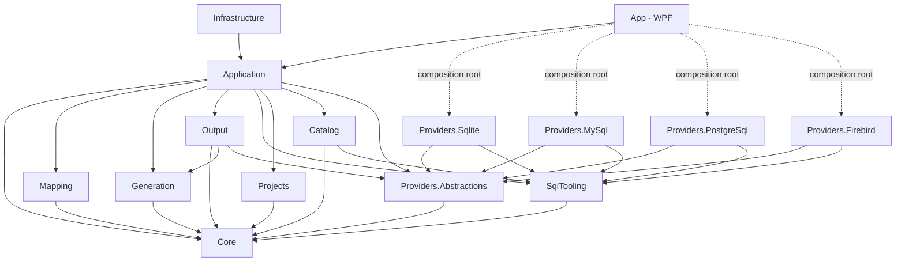
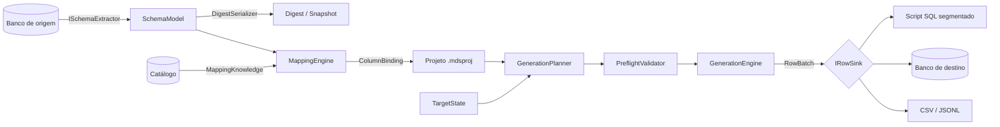
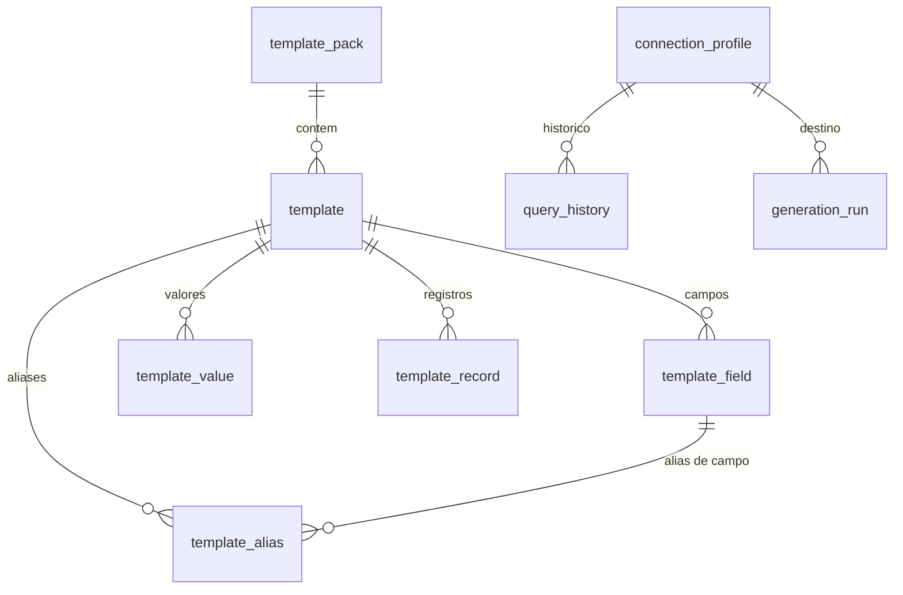
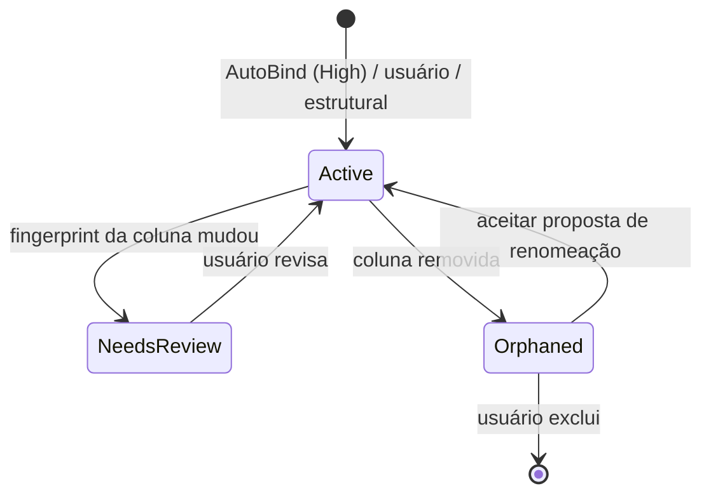
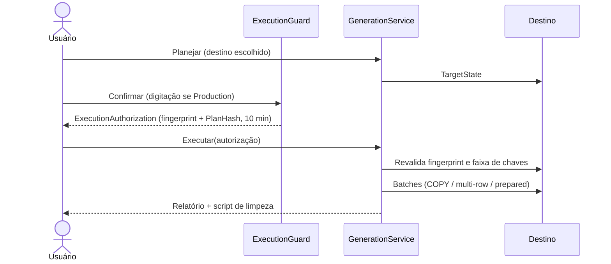

# Diagramas

| Campo | Valor |
|---|---|
| Objetivo | Reunir os diagramas principais (Mermaid) para consulta rápida. Os diagramas também aparecem, com contexto, nos documentos de origem. |
| Fonte de verdade | O documento de origem indicado em cada seção; em divergência, prevalece o documento de origem. |

## 1. Componentes e dependências (origem: [05 §2](../05-system-architecture.md))

## 2. Pipeline ponta a ponta

## 3. Modelo do catálogo (origem: [09 §2](../09-internal-database.md))

## 4. Estados de binding (origem: [12 §9](../12-schema-digest.md))

## 5. Execução direta com autorização (origem: [19 §1](../19-direct-database-execution.md))

